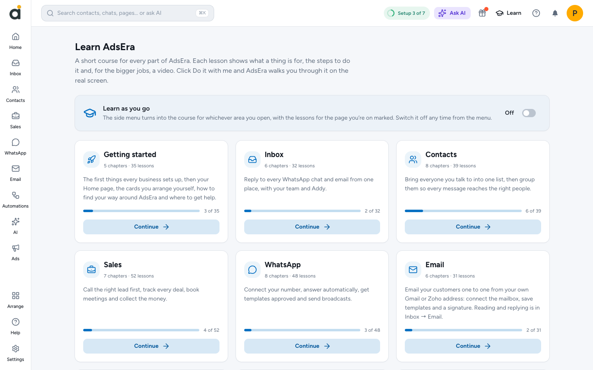
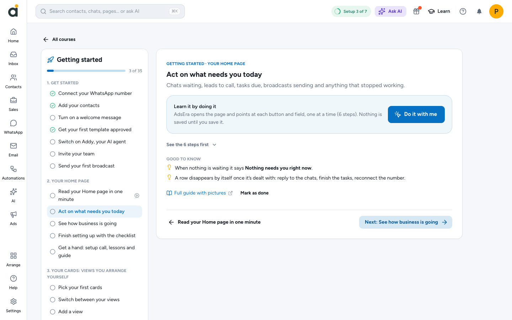
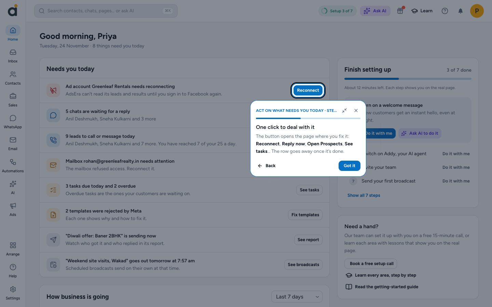
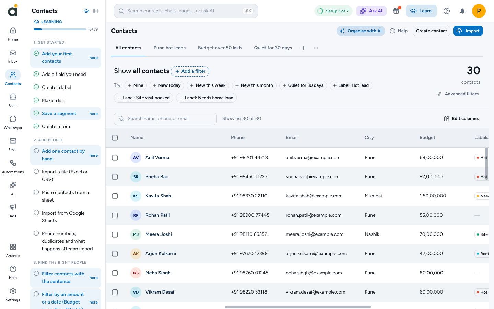
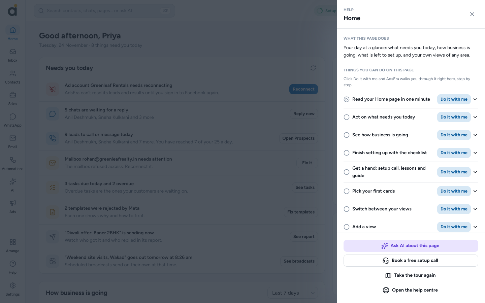

The **Education hub** teaches every part of AdsEra by doing it. Every lesson can open the real page and point at each button, field and choice in turn, explaining what it is and what to pick, while you click. We call this **Do it with me**.

**Where to find it:** click **Learn** in the top bar, or **Open the Education hub** in Help on any page.

---

## Courses

There is one course per area, in the same order as the icon rail: **Getting started**, **Inbox**, **Contacts**, **Sales**, **WhatsApp**, **Email**, **Automations**, **AI**, **Ads & selling** and **Settings**. Each card shows how many of its lessons you’ve done. Click **Start** (or **Continue**) to open it.

The **Getting started** course has the 7 setup steps first, then your Home page, your cards, finding your way around, and this page.

## A lesson

On the left: the course’s chapters and lessons. A tick means done. On the right, the lesson:

- What you’ll be able to do, and why.
- **Do it with me**: opens the page and walks you through it (below).
- A note when a video walkthrough is coming for the bigger jobs.
- **See the steps first**: the whole list of steps, if you’d rather read them.
- **Good to know**: tips and limits.
- **Full guide with pictures**: the page in this help centre.
- **Mark as done** ticks the lesson. Setup lessons tick themselves when the job is really done in your account.
- **Next** goes to the next lesson.

## Do it with me

<Steps>
  <Step title="Click Do it with me">
    On a lesson, in Help, or on a setup step on Home. AdsEra opens the right page.
  </Step>
  <Step title="Follow the ring">
    One thing is ringed and the rest of the page is dimmed. A card next to it says what it is, what to choose and why.

    
  </Step>
  <Step title="Click, or press Got it">
    When the card says **Click the highlighted…**, click it yourself: the guide waits and moves on when you do. Otherwise read it and press **Got it**.
  </Step>
  <Step title="Finish">
    After the last step, finish the job on the page, then **Mark lesson done**.
  </Step>
</Steps>

| On the card | What it does |
| --- | --- |
| **Got it** | Next step. |
| **Back** | The step before. |
| **Skip** / **Skip this step** | Jumps over a step (for example, when you’ve already done it). |
| Arrow (**Tuck the guide away**) | Folds the card into a small pill so you can see the page; click the pill to bring it back. |
| **×** (**Close the guide**) | Closes it for now. Start it again from the lesson any time. |

If a button is still greyed out, the card tells you what to fill in first. If something you clicked didn’t go through, the guide says so and goes back a step. Nothing is saved until you save it yourself.

## Learning mode

Turn the side menu into the course for whichever area you open. The lessons for the page you’re on are marked **here**; click a lesson to do it on the page.

- Switch it on with the graduation cap at the top of any side menu, or the **Learn as you go** switch on the Education hub.
- Switch it off with **Back to the normal menu** at the bottom of the course, or the cap again.
- The **Learn** button in the top bar is tinted while learning mode is on.

## Help on every page

Help (the **?** at the top right) lists **Things you can do on this page**: every lesson for that page, each with **Do it with me**. See [Help on every page](/help/introduction/getting-around#help-on-every-page).

---

## FAQs

<AccordionGroup>
  <Accordion title="Does Do it with me change anything in my account?">
    No. It only points and explains. Anything that gets saved is saved by your own click on **Save**, **Create** or **Send**.
  </Accordion>
  <Accordion title="Are my lessons ticked on every computer?">
    Lessons you **Mark as done**, and learning mode, are remembered in this browser. Setup lessons are ticked from your account, so they show everywhere.
  </Accordion>
  <Accordion title="Is there a video?">
    The bigger lessons say *A video walkthrough of this is coming soon*. Until then, Do it with me shows you on the real page.
  </Accordion>
  <Accordion title="I’d rather talk to someone.">
    **Book a free setup call** from Help or Home and the AdsEra team sets it up with you in 15 minutes.
  </Accordion>
</AccordionGroup>

## Related

<CardGroup cols={2}>
  <Card title="Your Home page" icon="house" href="/help/dashboard">
    Needs you today, the numbers, setup and your cards.
  </Card>
  <Card title="Find your way around" icon="compass" href="/help/introduction/getting-around">
    The icon rail, Arrange, side menus and the top bar.
  </Card>
</CardGroup>
