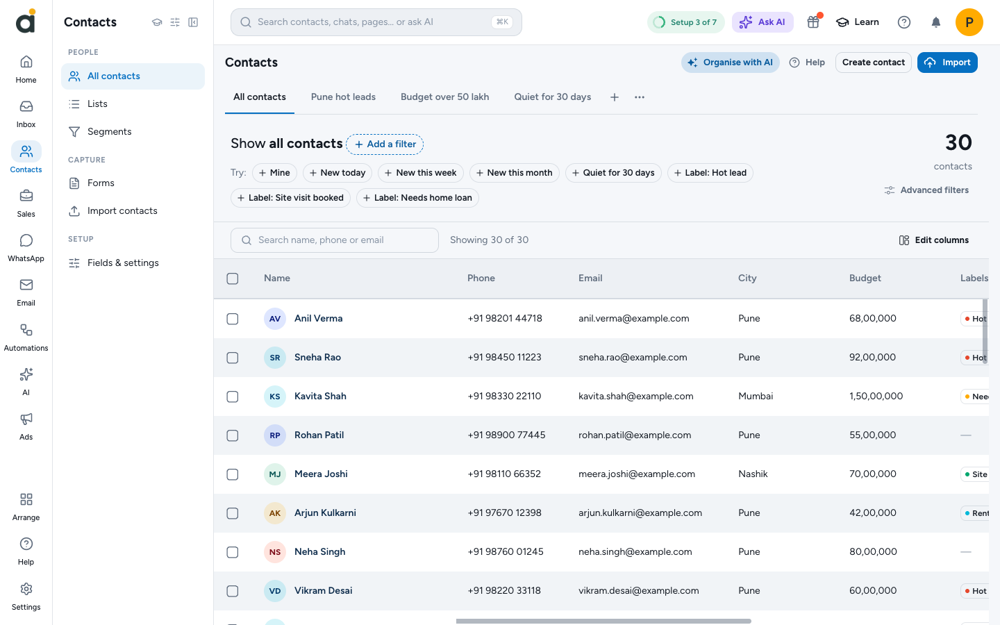
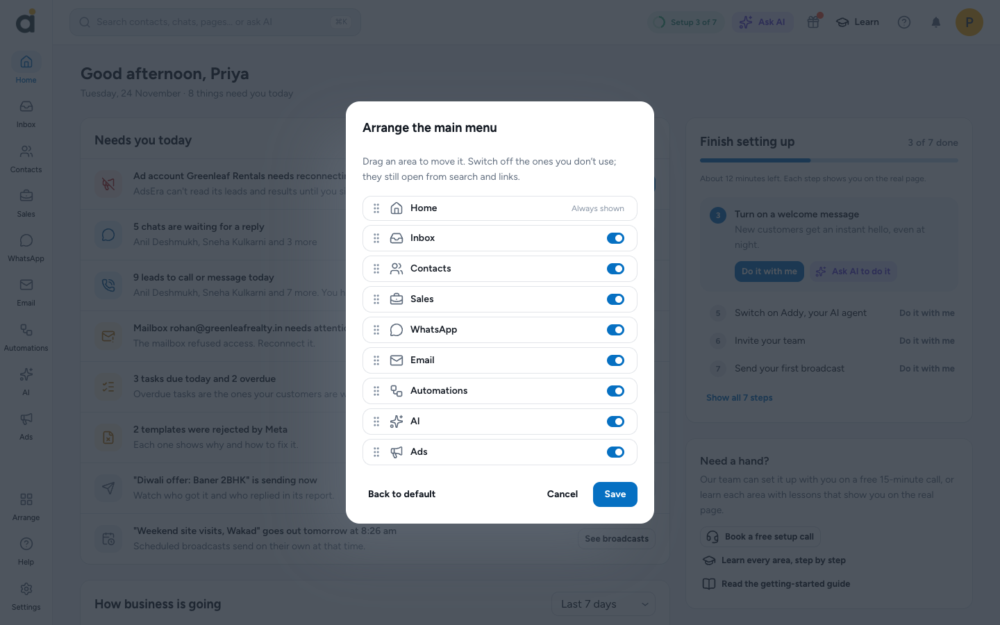
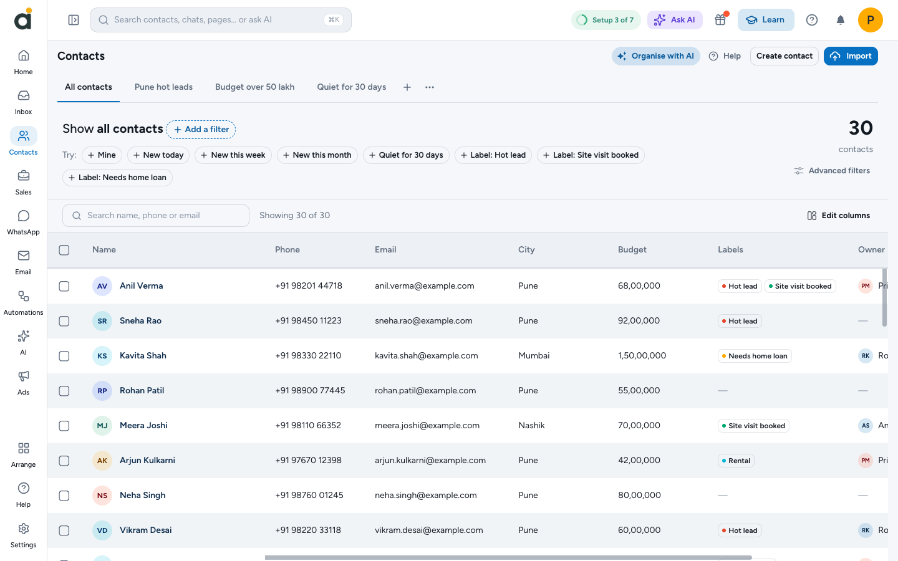
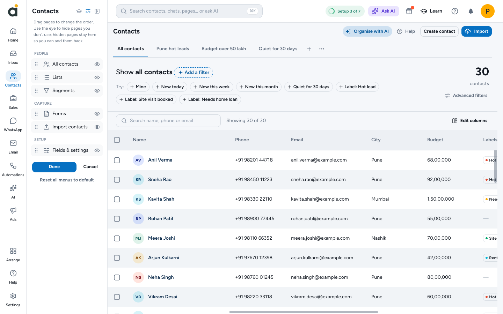
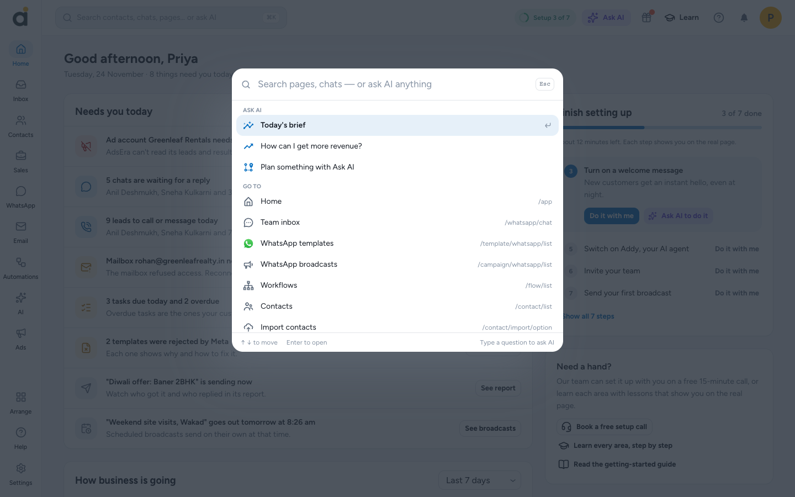
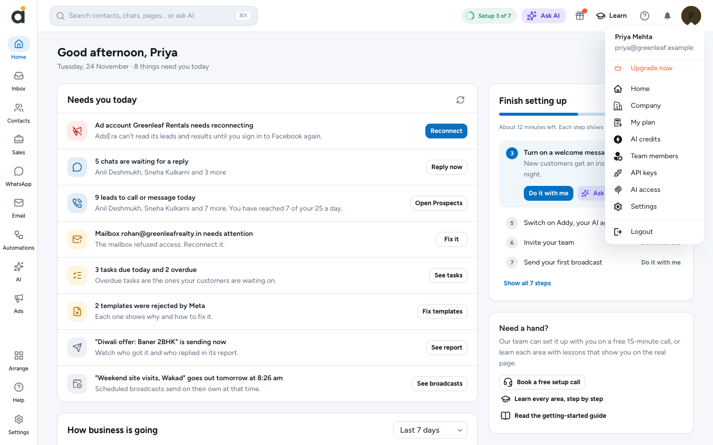
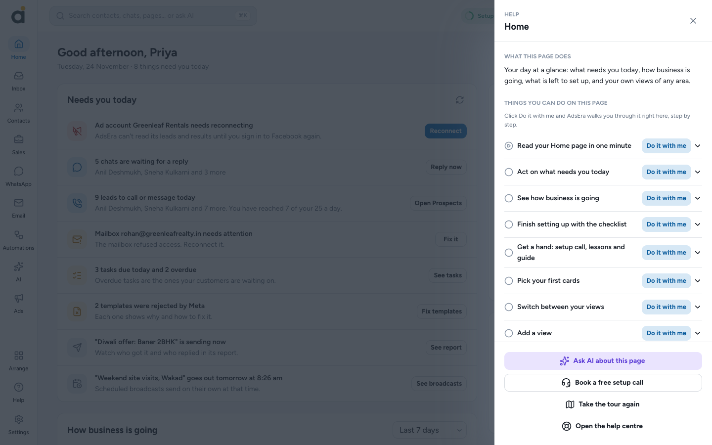

AdsEra is split into **areas**, like Inbox, Contacts and WhatsApp. Pick an area on the icon rail at the far left, then a page in its side menu. The top bar has the tools you need on every page, and Help for the page you’re on is always one click away.

<Tip>
Open **Learn → Getting started → Find your way around** and click **Do it with me**: AdsEra points at each part on the real page. See [Learn with the Education hub](/help/introduction/education-hub).
</Tip>

---

## The icon rail

The narrow strip on the far left. Each area has its name under its icon; the one you’re in is blue.

| Area | What you find there |
| --- | --- |
| **Home** | What needs you today, how business is going, your setup checklist and your own cards. See [Your Home page](/help/dashboard). |
| **Inbox** | WhatsApp chats and email, in one place. |
| **Contacts** | All contacts, lists, segments, forms and imports. |
| **Sales** | Prospects, deals, meetings, tasks, pipelines and products. |
| **WhatsApp** | Broadcasts, auto-replies, WhatsApp Flows, templates, quick replies, the file manager and your numbers. |
| **Email** | Mailboxes, email templates, signatures and unsubscribes. |
| **Automations** | Workflows and apps & integrations. |
| **AI** | Addy (chat agent), Closer (follow-ups), Ask AI and your AI credits. |
| **Ads** | Meta Ads, Pixel & events and WhatsApp Commerce. |
| **Arrange** | Reorder or hide the areas on this rail (below). |
| **Help** | Help for the page you are on. |
| **Settings** | Your account, company, team, plan and developer settings. |

You only see the areas and pages your role lets you open. If a page you expect is missing, ask your admin.

### Arrange the rail: reorder or hide areas

Put the areas you use most at the top and switch off the ones you never use.

<Steps>
  <Step title="Click Arrange">
    **Arrange** is near the bottom of the icon rail. A window opens: **Arrange the main menu**.

    
  </Step>
  <Step title="Drag to reorder">
    Hold the handle on the left of an area and drag it up or down.
  </Step>
  <Step title="Switch off what you don’t use">
    Switch an area off to hide it from the rail. **Home** is always shown. A hidden area still opens from search, links and Help, and its area shows while you’re on one of its pages.
  </Step>
  <Step title="Save">
    Click **Save**. **Back to default** puts the original order back and shows every area; **Cancel** closes without saving.
  </Step>
</Steps>

Your order is saved to your login, so it follows you to any computer. **Help** and **Settings** always stay at the bottom.

---

## The side menu

Click an area and its pages appear next to the rail, in groups such as **Send & reply**, **Content** and **Setup**. The page you’re on is highlighted. At the top of the side menu are three small buttons:

| Button | What it does |
| --- | --- |
| Graduation cap (**Learning mode**) | Shows this area’s course in the side menu instead of its pages. See [learning mode](/help/introduction/education-hub#learning-mode). |
| Sliders (**Edit this menu**) | Reorder or hide this area’s pages (below). |
| Arrow (**Hide this menu**) | Folds the side menu away for more room. **Show menu** at the top left of the page brings it back. |

### Edit a side menu: reorder or hide pages

<Steps>
  <Step title="Click the sliders icon">
    At the top of the side menu, click **Edit this menu** (the sliders icon).

    
  </Step>
  <Step title="Drag or hide">
    Drag a page by its handle to move it. Click the eye to hide a page: it stays in the list, crossed out, so you can show it again.
  </Step>
  <Step title="Done">
    Click **Done** to save, or **Cancel**. **Reset all menus to default** undoes your changes in every area.
  </Step>
</Steps>

Settings’ menu can’t be edited.

---

## The top bar

From left to right:

| Part | What it does |
| --- | --- |
| **Search contacts, chats, pages… or ask AI** | Jump to any page, contact or chat, or ask a question. Shortcut: <kbd>Ctrl</kbd> + <kbd>K</kbd> (<kbd>⌘</kbd> + <kbd>K</kbd> on a Mac). |
| **Setup 3 of 7** | How many setup steps are done. Click it to go to the checklist on Home. It goes away when all are done. |
| **Ask AI** (purple) | Opens Ask AI. Shortcut: <kbd>Ctrl</kbd> + <kbd>J</kbd>. |
| Gift (**What’s new**) | The latest changes to AdsEra, in a new tab. A red dot means something you haven’t seen. |
| **Learn** | The [Education hub](/help/introduction/education-hub). |
| **?** (**Help for this page**) | Help for the page you’re on (below). |
| Bell | Your notifications. |
| Your photo | Your account menu. |

### Search or ask

Click the search box (or press <kbd>Ctrl</kbd> + <kbd>K</kbd>). Type a page (“templates”), a contact’s name or number, or a question. Pick a result to open it, or send the question to Ask AI. <kbd>Esc</kbd> closes it.

### Ask AI

Click **Ask AI** on any page and type what you want, like *“Set up a welcome message for new customers”* or *“How many leads came from ads this week?”*. It knows which page you’re on, it can check and set things up for you, and it always asks before it changes anything. Each answer uses AI credits. See [Ask AI](/help/ai/ask-ai). If you don’t see **Ask AI**, it isn’t switched on for your account: write to contact@adsera.in.

### Notifications

The bell shows new leads, template approvals, finished broadcasts and other updates, in tabs: **All**, **Messages**, **Updates**, **Tasks** and **System**. Click one to open the page it is about.

### Your account menu

Click your photo at the top right.

| Item | Opens |
| --- | --- |
| **Upgrade now** | My plan (admins). |
| **Home** | Your Home page. |
| **Company** | Your business details. |
| **My plan** | Your plan, add-ons and invoices. |
| **AI credits** | How many AI credits you have and what used them. |
| **Team members** | Your team and what each person can do. |
| **API keys** | Keys for your developer. |
| **AI access** | Connect AI apps like Claude or ChatGPT. |
| **Settings** | Your account. |
| **Logout** | Signs you out on this computer. |

You see only the items your role allows.

### The plan bar

When your trial or plan is about to end, a bar above the top bar says so, with **See plans** or **Renew now**. When it has ended, a window asks you to renew. See [Plan and billing](/help/account/plan).

---

## Help on every page

Click the **?** at the top right, or **Help** on the icon rail, on any page. A panel opens on the right:

- **What this page does**, in a sentence or two.
- **Things you can do on this page**: every lesson for this page, each with **Do it with me**.
- **Quick tips** and **How it works**, step by step.
- **Guides** from this help centre.
- **Open the Education hub**, **Ask AI about this page**, **Book a setup call**, **Take the layout tour again** and **Open the help centre**.
- Your setup checklist, folded at the bottom.

Small <Icon icon="circle-info" /> icons next to a setting explain it when you point at them.

---

## FAQs

<AccordionGroup>
  <Accordion title="I hid an area by mistake. How do I get it back?">
    Click **Arrange**, switch it back on and click **Save**, or click **Back to default**.
  </Accordion>
  <Accordion title="A page I need is missing from the side menu.">
    You may have hidden it: click the sliders icon and look for it crossed out, then click the eye. If it isn’t there at all, your role can’t open it: ask your admin.
  </Accordion>
  <Accordion title="Do my menu changes affect my team?">
    No. Arrange and side-menu changes are yours only, saved to your login.
  </Accordion>
</AccordionGroup>

## Related

<CardGroup cols={2}>
  <Card title="Your Home page" icon="house" href="/help/dashboard">
    Needs you today, the numbers, setup and your cards.
  </Card>
  <Card title="Learn with the Education hub" icon="graduation-cap" href="/help/introduction/education-hub">
    Courses, Do it with me and learning mode.
  </Card>
</CardGroup>
