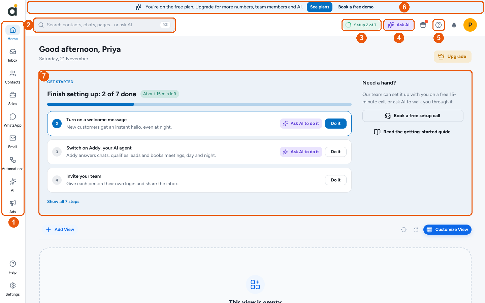
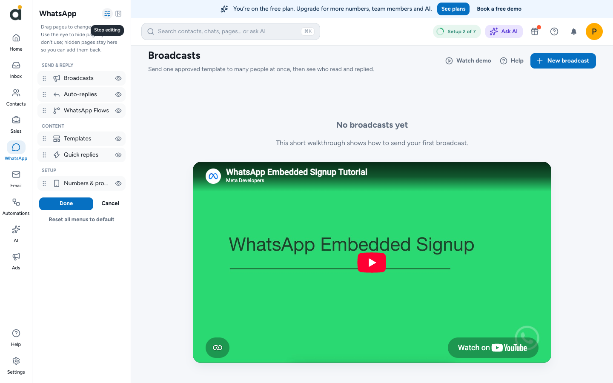
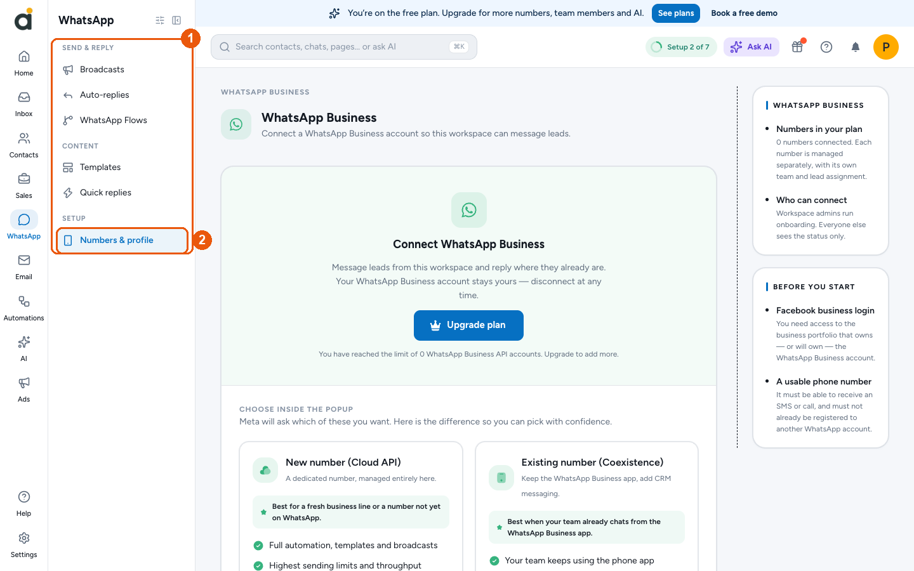
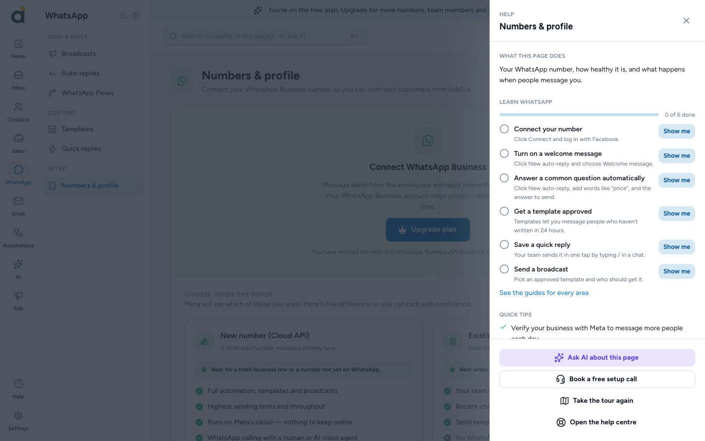
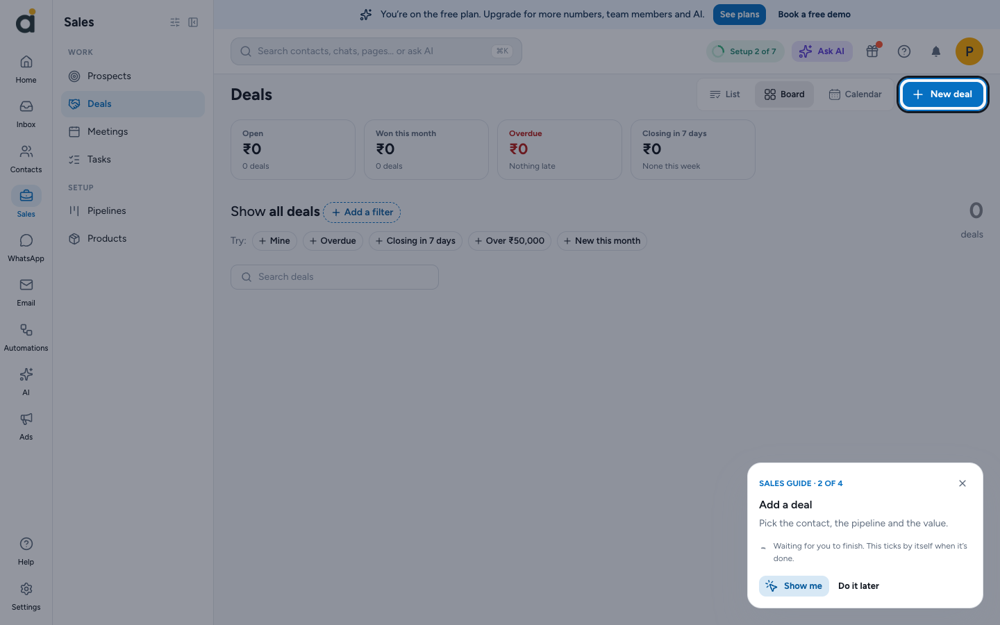
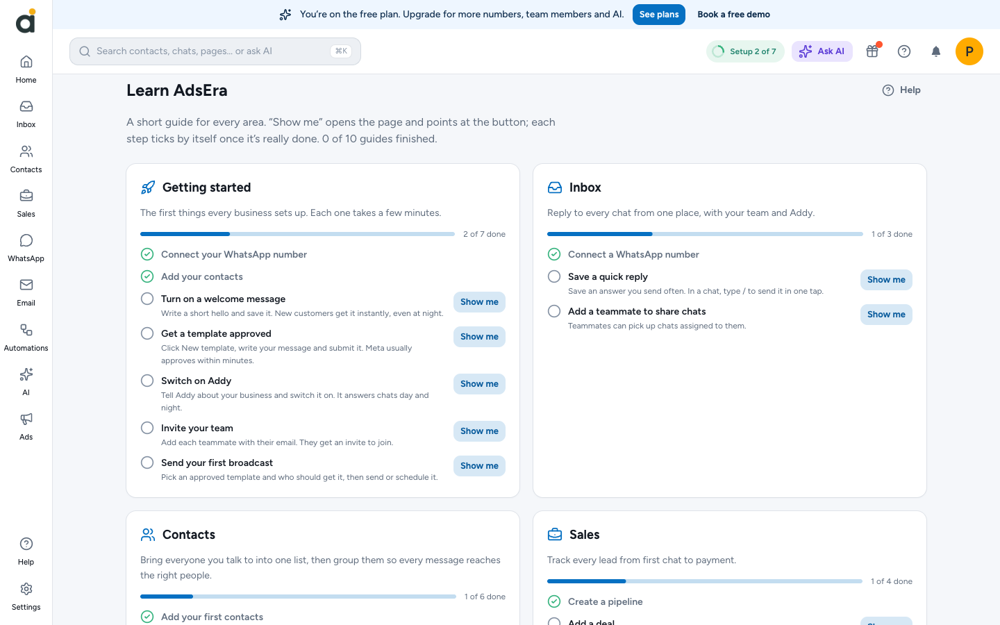
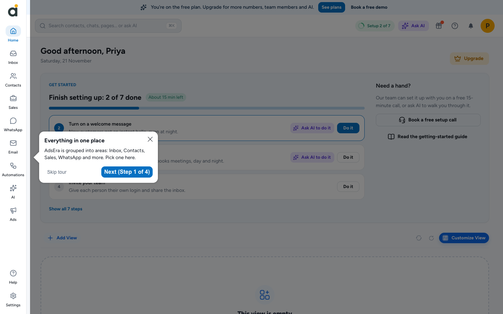

AdsEra is organised into a few **areas**, like Inbox, Contacts and WhatsApp. Pick an area on the left, then a page inside it. Help for the page you are on is always one click away.

1. **The menu:** the areas of AdsEra. Pick one to open it.
2. **Search:** find a contact, chat or page, or ask AI.
3. **Setup progress:** how many getting-started steps are done.
4. **Ask AI:** the AI assistant that can set things up for you.
5. **Help:** help for the page you are on.
6. **Plan bar:** your plan, and a reminder when it is time to renew.
7. **Get started:** your setup checklist on Home.

## The menu on the left

The narrow strip on the far left lists the areas. Each one has its name under its icon, so you never have to guess.

| Area | What you find there |
| --- | --- |
| **Home** | Your setup checklist and your dashboard. |
| **Inbox** | WhatsApp chats and email, in one place. |
| **Contacts** | All contacts, lists, segments, forms and imports. |
| **Sales** | Prospects, deals, meetings, tasks, pipelines and products. |
| **WhatsApp** | Broadcasts, auto-replies, WhatsApp Flows, templates, quick replies and your numbers. |
| **Email** | Mailboxes, email templates, signatures and unsubscribes. |
| **Automations** | Workflows, apps and integrations, and your files. |
| **AI** | Addy (chat agent), Closer (follow-ups), Ask AI and your AI credits. |
| **Ads** | Meta Ads, Pixel & events and WhatsApp Commerce. |
| **Help** | Help for the page you are on. |
| **Settings** | Your account, company, team, plan, connected apps and developer settings. |

You only see the areas and pages your role lets you open. If a page you expect is missing, ask your admin.

### The pages in an area

Click an area and its pages appear next to it, in groups such as **Send & reply**, **Content** and **Setup**.

- **Hide the list** with the panel button at its top right, for more room. Bring it back with the same button at the top left of the page.
- **Change the order** or hide pages you never use: click the sliders button at the top of the list. Drag a page by its handle to move it, click the eye to hide it, then click **Done**. Hidden pages stay in the list, crossed out, so you can show them again. **Reset all menus to default** puts every area back the way it came.

## The top bar

From left to right:

- **Search:** find a contact, chat or page, or type a question for Ask AI. Shortcut: <kbd>Ctrl</kbd> + <kbd>K</kbd> (<kbd>⌘</kbd> + <kbd>K</kbd> on a Mac).
- **Setup progress:** shows how many getting-started steps are done, for example *Setup 4 of 7*. Click it to see what is left. It disappears when everything is done.
- **Ask AI:** opens the AI assistant. Shortcut: <kbd>Ctrl</kbd> + <kbd>J</kbd>.
- **What's new:** the latest changes to AdsEra.
- **Help:** help for the page you are on.
- **Notifications** and **your account**.

## Help on every page

Click **Help** (in the top bar or at the bottom of the menu) on any page. A panel opens with:

- **What this page does**, in a sentence or two.
- **Learn this area**: a short checklist of what to set up here, with **Show me** on each step (see below).
- **Quick tips** and **How it works**, step by step.
- **Watch the demo**: a short video of the page.
- **Guides** from this help centre.
- **Ask AI about this page**, **Book a free setup call** with our team, and a link to the help centre.

On most pages you'll also find **Watch demo** and **Help** next to the page title.

## Learn each area, step by step

Every area has a short guide, for example *Sales: create a pipeline, add a deal, plan a follow-up task, add a product*.

1. Open **Help** on any page in the area, or go to **Learn every area, step by step** on Home.
2. Click **Show me** next to a step. AdsEra opens the right page and points at the button to click.
3. A card in the corner stays with you while you do it. It ticks the step by itself once it's really done (for example, once your pipeline is saved), then offers the next one.
4. Not now? Click **Do it later**. The step stays open in the checklist until you do it.
5. Done already but want to do it again (another template, another teammate)? Click **Do it again** on the finished step and the guide walks you through it once more. Click **I'm done** when you've finished.

Steps are only ticked by what exists in your account, never by clicking through, so the checklist always shows what is really set up.

The **Learn AdsEra** page shows every area's guide in one place, with how far you've got.

The first time you use the new layout, a short tour points out each part. Want it again? Open **Help** and click **Take the tour again**.

Small <Icon icon="circle-info" /> icons next to a setting explain what it does when you point at them.

## Ask AI

Tell Ask AI what you want in your own words, for example *"Set up a welcome message for new customers"*. It can check things and set them up for you, and it always asks before changing anything important. See [Ask AI](/help/ai/ask-ai).
