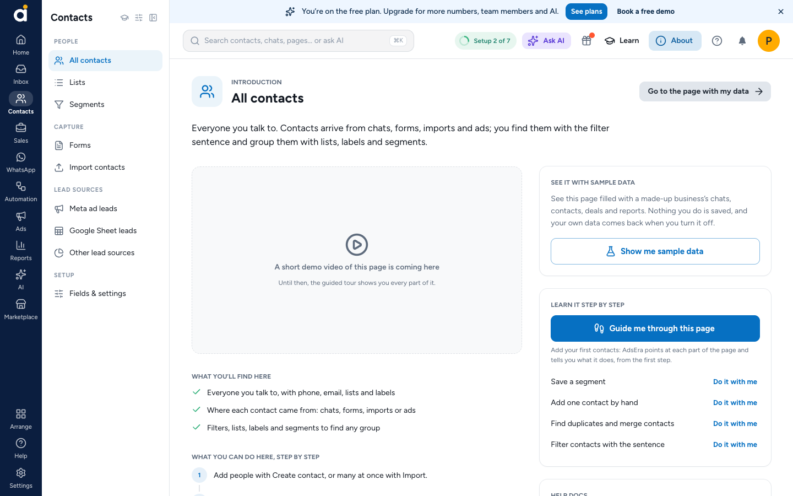
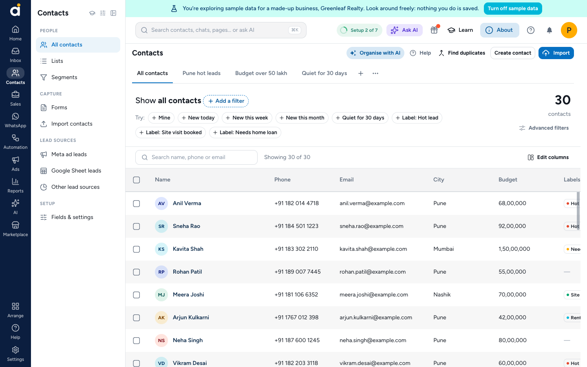
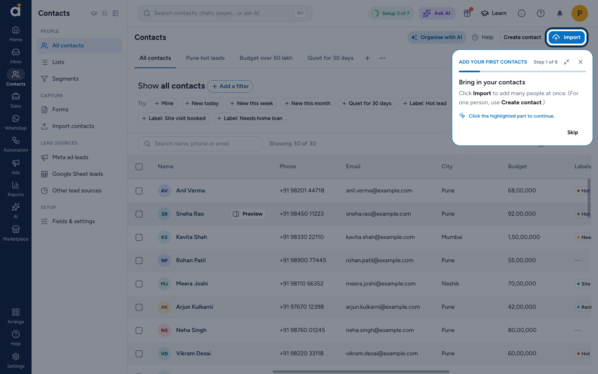

The first time you open a page, AdsEra shows its **introduction** in place of the page. It tells you what the page is for and what you can do there, and gives you three ways to get going: look at it filled with **sample data**, let AdsEra **guide you through it** step by step, or **go to the page with your own data**.

## What an introduction shows

| Part | What it tells you |
| --- | --- |
| **What the page is for** | One or two lines at the top. |
| **Demo video** | A short video of the page. Where one isn’t recorded yet, the space says so and the guided tour shows you instead. |
| **What you’ll find here** | The information the page holds, like *Everyone you talk to, with phone, email, lists and labels*. |
| **What you can do here, step by step** | The main things to do on the page, numbered in order. |
| **See it with sample data** | The **Show me sample data** button (below). |
| **Learn it step by step** | **Guide me through this page**, plus the page’s other lessons with **Do it with me**. |
| **Help docs** | The guides for this page, opening in a new tab. |

Click **Go to the page with my data** at the top right to see the page itself.

## Read an introduction again

- Click **About this page** at the top right, next to Help (on a laptop screen it says **About**).
- Or open **Help** (the **?**) and click **Read the introduction**.

Introductions open by themselves the first time you visit each page in the menu. A record, report or form you open from a page (like **View record** on a contact) opens straight away. To stop them opening on new pages, untick **Show the introduction the first time I open a page** at the bottom of any introduction. **About this page** still works.

## Show sample data

**Show me sample data** fills AdsEra with a made-up business, *Greenleaf Realty*, and takes you straight to the page with it: chats, contacts, deals, broadcasts, reports and more, on every page. Use it to see what each page looks like with data in it, before you have your own.

- A blue bar at the top says sample data is on, on every page. **Turn off sample data** there brings your own data back.
- **Nothing is saved** while it’s on. Creating, editing, sending or deleting says *You’re looking at sample data, so nothing is saved*.
- It stays on in this browser tab until you turn it off or close the tab. Your team doesn’t see it.
- Your name, company, plan and menus stay your own. A page that has no sample data shows your own data.
- Live chat updates pause while it’s on, so a real customer’s message doesn’t land in the sample inbox. The sample phone numbers aren’t real numbers.

## Guide me through this page

**Guide me through this page** starts the page’s guided lesson. AdsEra rings each part of the page and tells you what it does and what to click, one step at a time.

It always starts at **step 1**, even if you’ve done that task before, for example when your contacts are already imported. Then it walks you through every step, and you say when you’re done. Use it with sample data on to learn a page without changing anything.

## FAQs

<AccordionGroup>
  <Accordion title="Can my sample data mix with my real data?">
    No. While sample data is on, pages with sample data show only the made-up business, and nothing is saved. A page with no sample data shows your own data, as usual.
  </Accordion>
  <Accordion title="I closed the introduction. How do I see it again?">
    Click **About this page** at the top right, or **Help → Read the introduction**.
  </Accordion>
  <Accordion title="Do my teammates see the introductions?">
    Yes, each person sees each introduction once on their own computer, and can turn them off for themselves.
  </Accordion>
</AccordionGroup>

## Related

<CardGroup cols={2}>
  <Card title="Learn with the Education hub" icon="graduation-cap" href="/help/introduction/education-hub">
    Every course and lesson, with Do it with me.
  </Card>
  <Card title="Getting around AdsEra" icon="map" href="/help/introduction/getting-around">
    The icon rail, side menus and top bar.
  </Card>
</CardGroup>
