A **card** shows one thing on a report, for example *My daily tasks* or *Deal value by stage*. You change a report’s cards with **Edit layout**, and one card with the **gear** at its top.

**Where to find it:** open a report → **Edit layout** (blue, top right), or the gear on a card.

## Card types

| Type | What it shows | Good for |
| --- | --- | --- |
| **Table** | Rows of records with the columns you pick. Page through, sort, search, download. See [Tables](/help/reports/tables). | Today’s tasks, latest leads, chats waiting. |
| **Chart** | **Bar**, **Line**, **Area**, **Donut** or **Pie**, of what you pick to chart. | Deal value by stage, contacts added per day. |
| **Numbers** | A few big totals, each with an icon. With report dates picked they compare with the time before. | Pipeline value, deals won, open tasks. |
| **Summary** | Name-and-value lines (only for the plan card). | Your plan, renewal date, seats. |

Each kind of card offers only the types it supports.

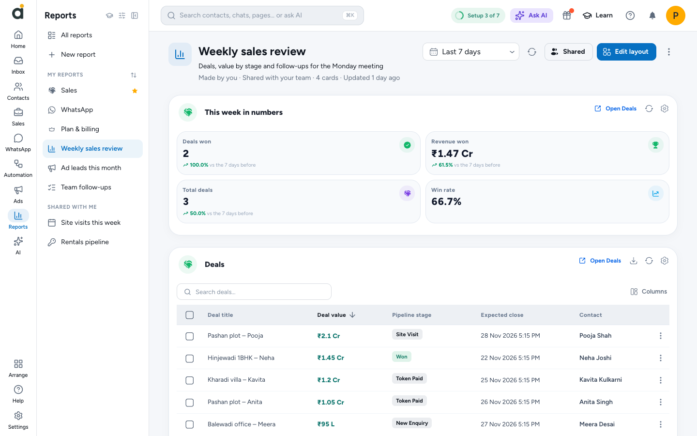

## Edit layout

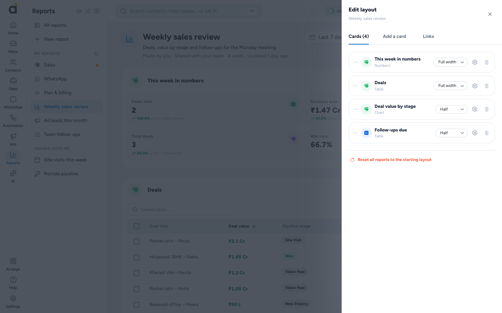

Click **Edit layout**. A panel opens on the right with three tabs.

| Tab | What you do there |
| --- | --- |
| **Cards** | Every card in order. Drag by the handle to move; the box sets the **width** (**One third**, **Half**, **Two thirds**, **Full width**); the gear opens the card’s settings; the bin (**Remove card**) takes it off after you confirm. **Reset all reports to the starting layout** is at the bottom. |
| **Add a card** | Every card you can add (below), and **New report from a template**. |
| **Links** | Make one card filter another (below). |

Changes save as you make them.

### Add a card

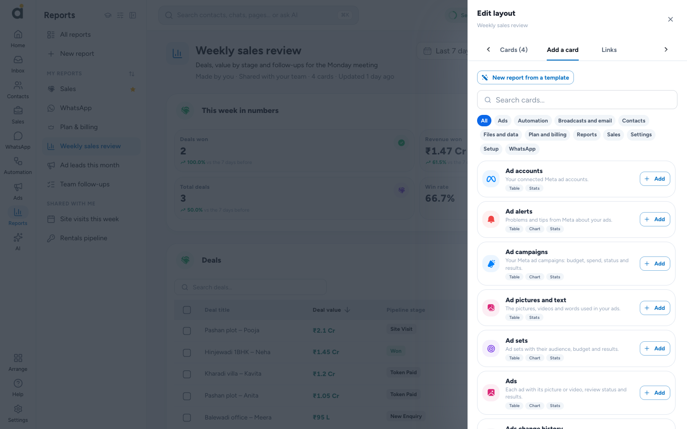

<Steps>
  <Step title="Find it">
    Type in **Search cards…**, or tap an area: **Contacts**, **Sales**, **WhatsApp**, **Broadcasts and email**, **Automation**, **Ads**, **Plan and billing**, **Settings**, **Files and data**, **Setup**, **Reports**.
  </Step>
  <Step title="Check what it shows">
    Each card says what it shows and how it can look (**Table**, **Chart**, **Stats**). The number next to **Add** says how many of it the report already has.
  </Step>
  <Step title="Add">
    Click **Add**. The card goes to the end of the report and its settings open so you can set it up.
  </Step>
</Steps>

You only see cards for areas your role can open; Ads cards appear once an ad account is connected.

**A whole report at once:** **New report from a template** adds one of the ready-made reports (Sales pipeline, WhatsApp operations, Meta ads performance, Audience growth) as a new report.

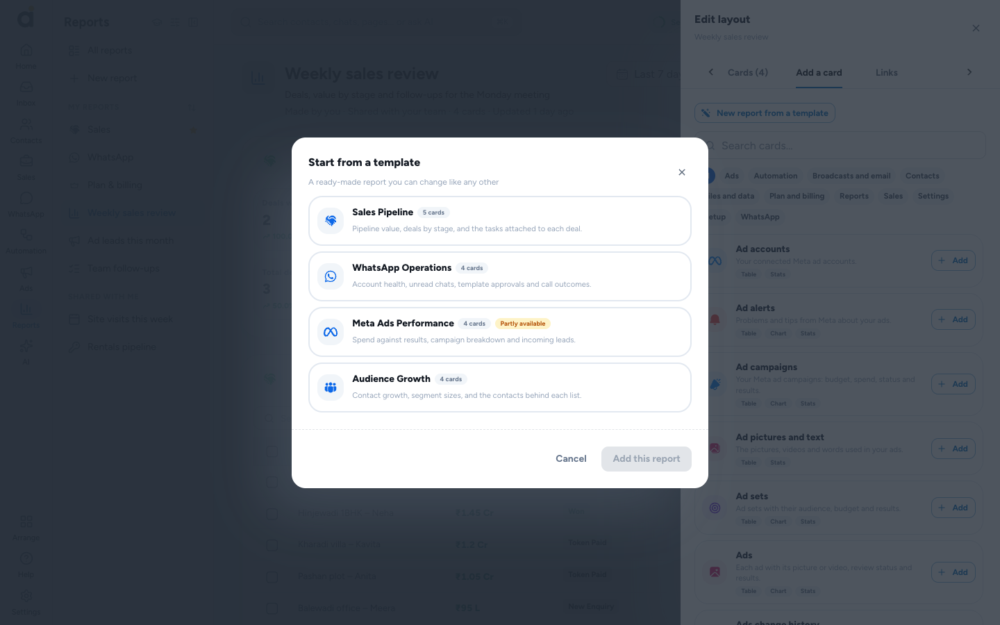

## Change a card

Click the **gear** at the top of a card. Its settings have three steps: **Look and size**, **What it shows** and **Filters**. **Save changes** saves at any step; **Next** goes on.

<Steps>
  <Step title="Look and size">
    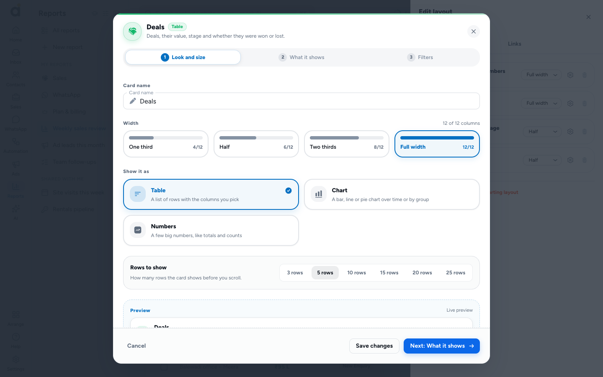

    | Setting | What it does | Example |
    | --- | --- | --- |
    | **Card name** | The name on the card. **Reset** goes back to the standard name. | Follow-ups due |
    | **Width** | **One third**, **Half**, **Two thirds** or **Full width**. | Half |
    | **Show it as** | **Table**, **Chart**, **Numbers** or **Summary** (only those the card supports). | Table |
    | **Rows to show** | For a table: how many rows a page has (3 to 50). | 10 |
  </Step>
  <Step title="What it shows">
    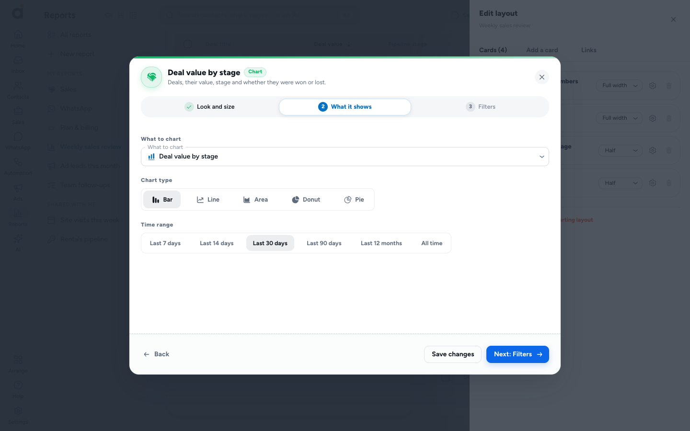

    - **Table:** tick the **Columns shown**, drag them into order, add **More fields** (your own contact fields too).
    - **Chart:** **What to chart** (for example *Deal value by stage*) and the **Chart type**.
    - **Numbers:** tick the **Numbers to show**.
    - **Time range:** **Last 7 days**, **14**, **30**, **90 days**, **Last 12 months** or **All time**. When the report has its own [report dates](/help/reports/filters#report-dates), every card follows those instead.
  </Step>
  <Step title="Filters">
    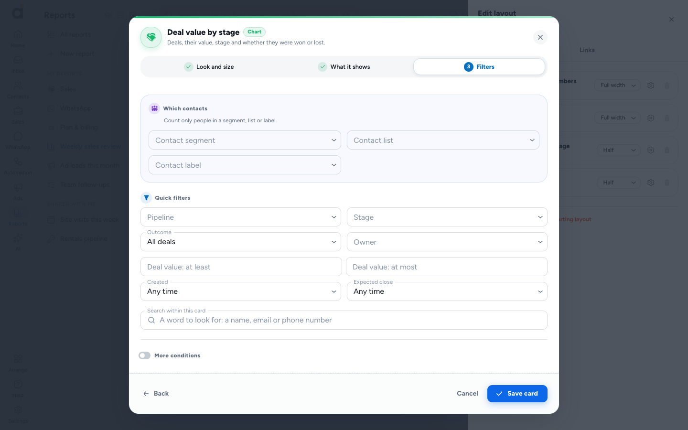

    Only some records: a segment, a pipeline, an owner, a date. See [Filters and dates](/help/reports/filters).
  </Step>
</Steps>

## Use a card

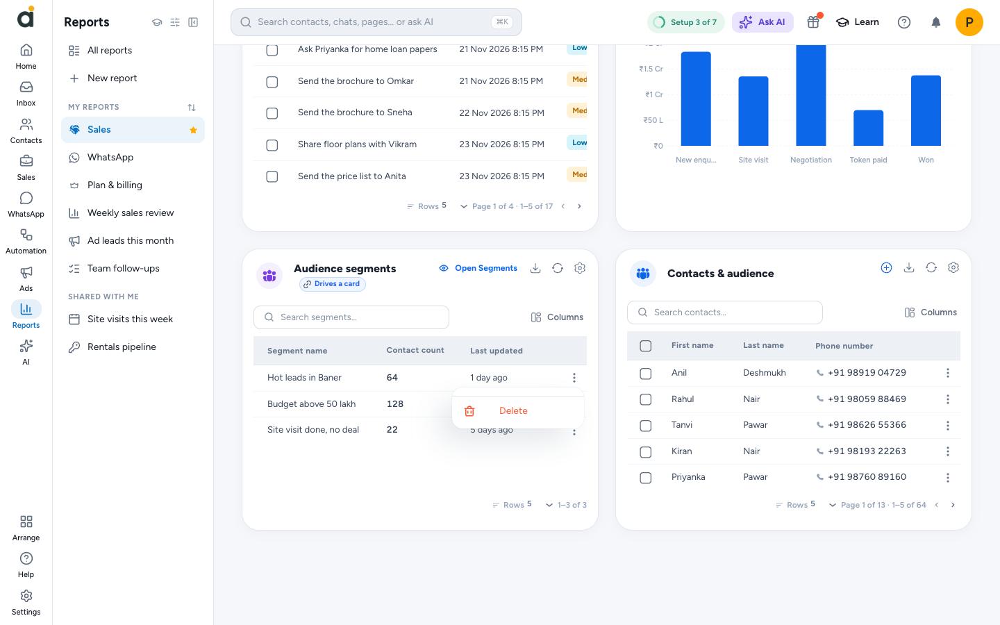

| Button | What it does |
| --- | --- |
| **Open …** (for example **Open Tasks**) | Opens the page behind the card. Some cards have their own action instead, like **New list**. |
| **Download arrow** (tables) | Saves the rows on screen as **CSV** or **Excel**. |
| **Round arrow** | Loads this card again. |
| **Gear** | The card’s settings. Not shown on a teammate’s report or if your role can only read reports. |
| **⋮** at the end of a row | Actions on that record, like **Mark Complete / To-do** on a task or **Open Contact**. Only actions your role allows; changes ask first. |

## Link two cards

Pick a row in one card and another card shows only its records: pick a segment, see its contacts.

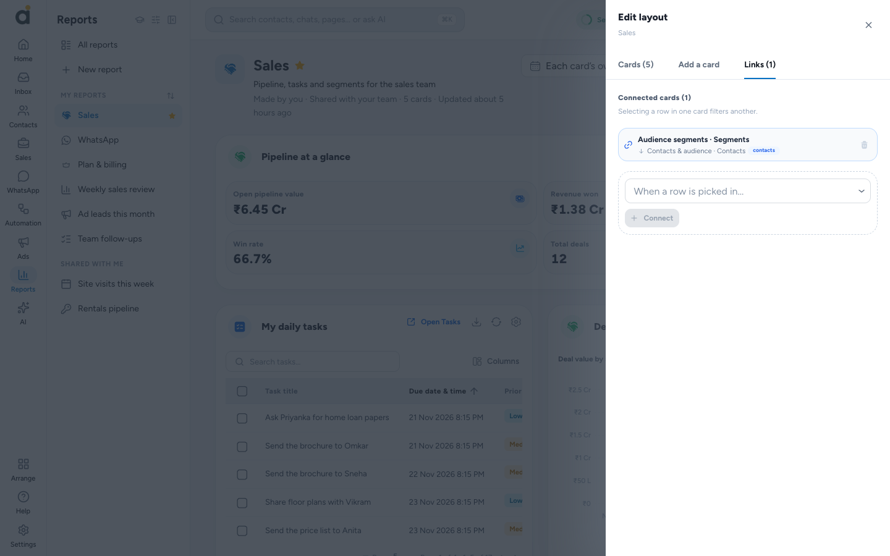

1. **Edit layout → Links**.
2. Under **When a row is picked in…**, choose the card you’ll pick from, then the card it should filter.
3. Click **Connect**.

The first card then says **Drives a card**. Click a row in it to filter the other card (it says **Filtered by selection**); click the row again, or the cross on that label, to clear.

## Card states

| State | What it looks like | What to do |
| --- | --- | --- |
| Loading | Grey placeholders. | Wait a moment. |
| Nothing to show | *No tasks found* with *Try widening the filters on this card.* | Change the card’s filters or dates. |
| No access | *No access to …* with **Remove card**. | Ask an admin for access, or remove it. |
| Couldn’t load | The reason and **Try again**. | Click **Try again**; other cards keep working. |

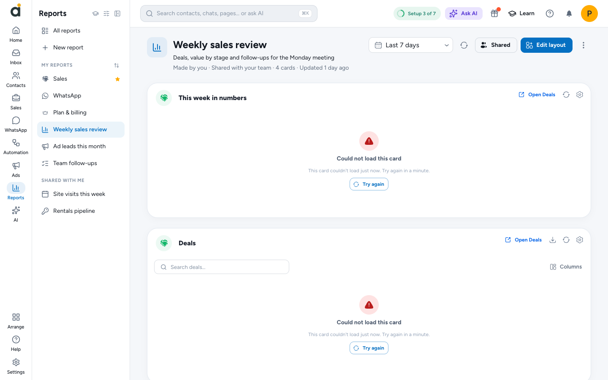

## Start again

**Edit layout → Cards → Reset all reports to the starting layout** replaces every report with Sales, WhatsApp and Plan & billing. It asks first and can’t be undone.

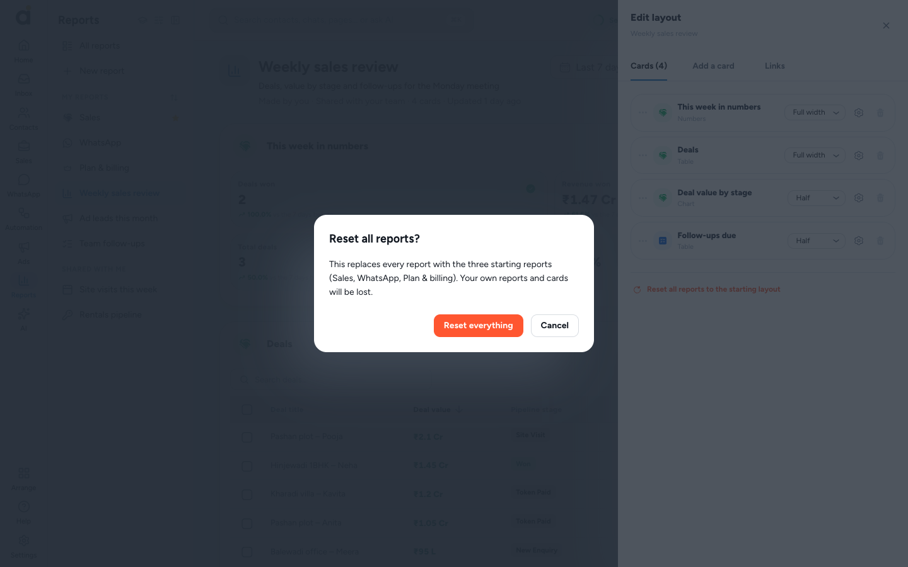

## FAQs

<AccordionGroup>
  <Accordion title="Can a card show two areas at once?">
    No: one card is one area. Use [Link two cards](#link-two-cards) to connect them.
  </Accordion>
  <Accordion title="Why did a card disappear after an update?">
    AdsEra removed a card for a feature that no longer exists, and showed a message. Add a different card.
  </Accordion>
  <Accordion title="Does changing a card change my team’s copy?">
    No. A teammate’s copy is theirs. If you shared the report, they see your change when they open your report.
  </Accordion>
</AccordionGroup>

## Related

<CardGroup cols={2}>
  <Card title="Tables" icon="table" href="/help/reports/tables">
    Pages, sort, search, columns and downloads.
  </Card>
  <Card title="Filters and dates" icon="filter" href="/help/reports/filters">
    Card filters and report dates.
  </Card>
</CardGroup>
