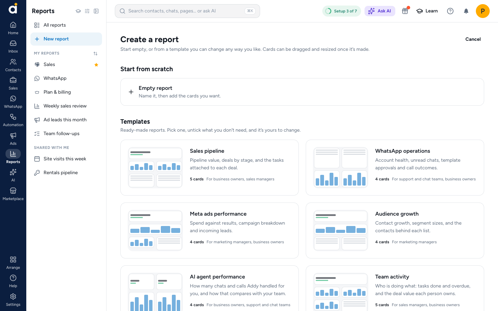
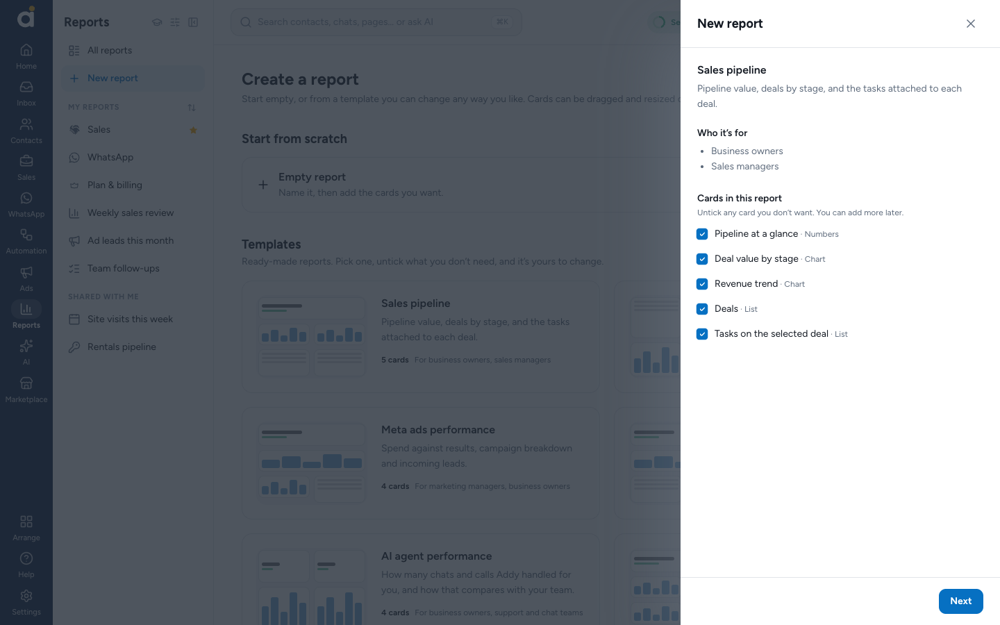

**New report** opens a page of templates. Start with an empty report and pick every card yourself, or start from a template and keep only the cards you want. Nothing is saved until you click **Create report**, so **Cancel** at any point leaves nothing behind.

**Where to find it:** **Reports** on the icon rail → **New report** (in the side menu, or the blue button on **All reports**).

<Steps>
  <Step title="Pick how to start">
    - **Empty report**: you name it, then add every card yourself.
    - **A template**: each one shows a small picture of its cards, how many cards it has and who it’s for. Click one.

    | Template | Its cards | Who it’s for |
    | --- | --- | --- |
    | **Sales pipeline** | Pipeline at a glance (numbers), Deal value by stage, Revenue trend, Deals, Tasks on the selected deal (linked to Deals). | Business owners, sales managers |
    | **WhatsApp operations** | Connected numbers, Chats needing attention, Template approvals, Call outcomes. | Support and chat teams, business owners |
    | **Meta ads performance** | Ad spend & results, Spend vs conversations, Spend by campaign, Incoming leads. Needs a connected ad account. | Marketing managers, business owners |
    | **Audience growth** | Audience (numbers), Contact growth, Lists, Contacts on the selected list (linked to Lists). | Marketing managers |
    | **AI agent performance** | AI in chats (chats Addy answered, replies it sent), AI on calls, Calls: AI vs your team, Messages sent over time. | Business owners, support and chat teams |
    | **Team activity** | Tasks at a glance, Tasks by team member, Tasks completed over time, Deal value by owner, Open tasks. | Sales managers, business owners |
    | **Lead sources** | Leads at a glance, Leads by source, Leads over time, Contacts added over time, Latest leads. | Marketing managers, business owners |
    | **WhatsApp calling** | Calls at a glance, Calls by outcome, Calls over time, Recent calls. | Sales teams, support and chat teams |

    **Some cards left out** on a template means a few of its cards are about parts of AdsEra your role can’t open: they won’t be added.
  </Step>
  <Step title="Keep the cards you want (templates)">
    A panel opens on the right with what the template is for, **Who it’s for** and **Cards in this report**. Every card is ticked: untick the ones you don’t want, then click **Next**.

    
  </Step>
  <Step title="Name it and choose who sees it">
    | Field | What it does | Example | Required? |
    | --- | --- | --- | --- |
    | **Report name** | The name in the side menu and at the top of the report. Up to 60 letters. Must differ from your other reports. A template fills in its own name. | Monday meeting | Yes |
    | **Who can see it?** | **Only me**, or **My team can view it**: teammates can read it and add a copy to their own reports; only you can change it. | Only me | Yes (Only me is picked) |

    

    Click **Create report**. If the name is missing or taken it says so in red, like *Give your report a name.*

    
  </Step>
</Steps>

## What happens after you click Create report

The report is saved, opens straight away and shows in the side menu under **My reports**. If you chose **My team can view it**, your team sees it under **Shared with me**. An empty report opens with the card picker ready, so you can add its first cards.

Then arrange it: drag a card by the dots beside its name, resize it from its bottom-right corner. See [Move and resize cards](/help/reports/cards#move-and-resize-cards). Pick **Report dates** and set it as your default from the report itself.

If the report was made but one setting didn’t save (for example sharing, on a bad connection), a yellow message says so: open the report and set it again.

## Other ways to make a report

- **Duplicate** one of your reports: **⋮ → Duplicate**. See [Sharing and organising](/help/reports/sharing).
- **Add a copy** of a teammate’s report: open it under **Shared with me** and click **Add a copy to my reports**.
- **From a template inside a report**: **Add cards → Add a card → New report from a template** adds a whole ready-made report.
- **The first time**: **Use the 3 ready-made reports** adds Sales, WhatsApp and Plan & billing.

## Troubleshooting

| Message | Why | What to do |
| --- | --- | --- |
| *Give your report a name.* | The name is empty. | Type a name. |
| *You already have a report with this name.* | Names must differ. | Add a word, like the month. |
| **Next** is greyed out | Every card of the template is unticked. | Tick at least one card, or start with **Empty report**. |
| A template is missing | None of its cards are about parts of AdsEra your role can open. | Ask an admin for access to that area. |
| No **New report** button | Your role can only read reports. | Ask an admin to tick **Make and change reports**. |

## FAQs

<AccordionGroup>
  <Accordion title="Can I leave half way and come back?">
    No: nothing is saved until **Create report**. Closing the panel (or **Cancel**) drops what you picked.
  </Accordion>
  <Accordion title="Can I change a template’s cards later?">
    Yes. Untick the ones you don’t want before you create it, and later add, change, move, resize or remove any card on the report.
  </Accordion>
  <Accordion title="Why do I see fewer cards than the template says?">
    Cards about parts of AdsEra your role can’t open (or Ads cards before an ad account is connected) are left out.
  </Accordion>
</AccordionGroup>

## Related

<CardGroup cols={2}>
  <Card title="Reports" icon="chart-column" href="/help/reports">
    All reports and reading a report.
  </Card>
  <Card title="Cards and card types" icon="table-cells-large" href="/help/reports/cards">
    Every card setting, and moving and resizing cards.
  </Card>
</CardGroup>
