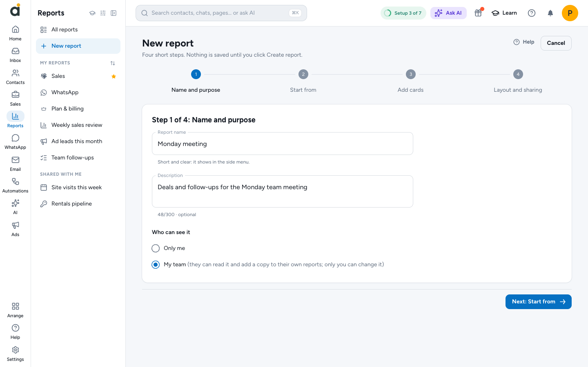
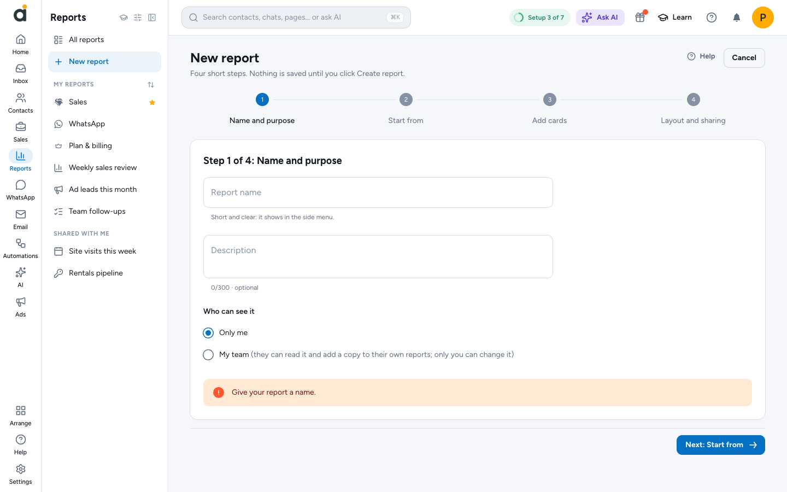
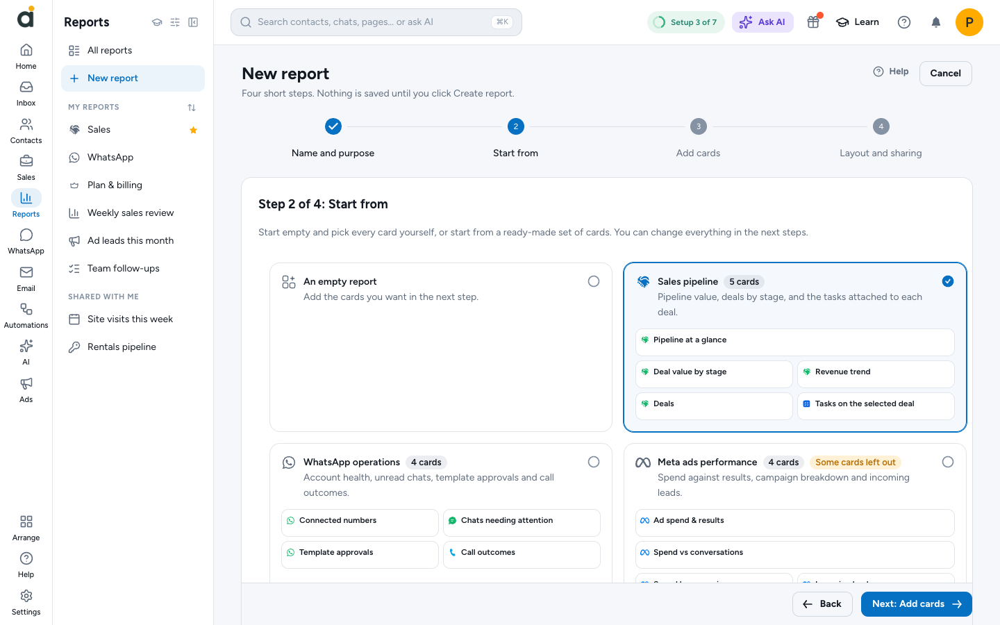
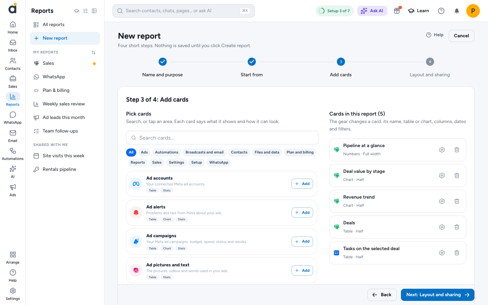
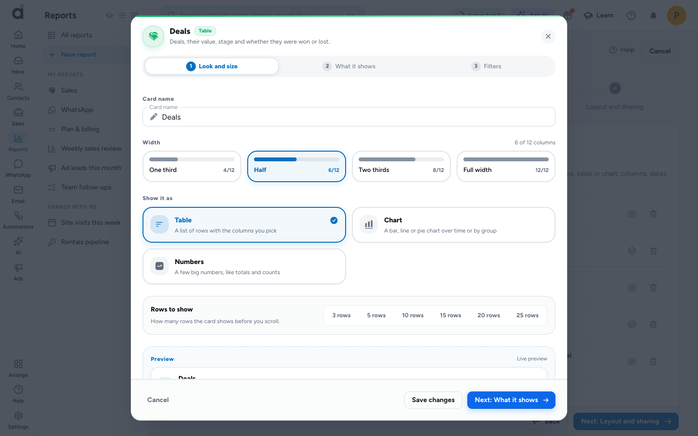
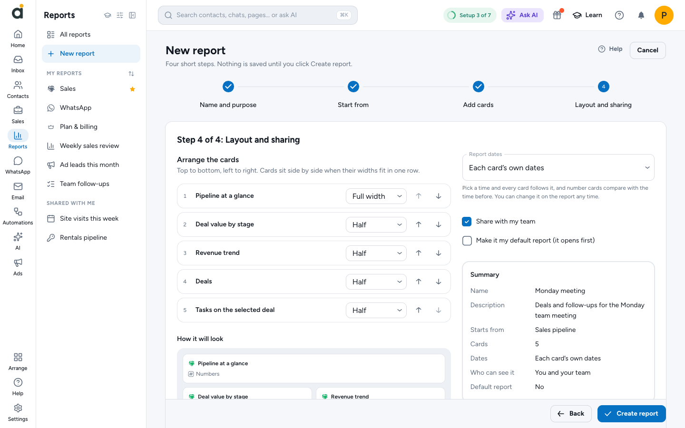

**New report** builds a report in four short steps. Start empty and pick each card, or start from a ready-made set of cards and change what you like. Nothing is saved until you click **Create report**, so **Cancel** at any point leaves nothing behind.

**Where to find it:** **Reports** on the icon rail → **New report** (in the side menu, or the blue button on **All reports**).

<Steps>
  <Step title="Name and purpose">
    | Field | What it does | Example | Required? |
    | --- | --- | --- | --- |
    | **Report name** | The name in the side menu and at the top of the report. Up to 60 letters. Must differ from your other reports. | Monday meeting | Yes |
    | **Description** | One line on what it’s for, shown under the name. Up to 300 letters. | Deals and follow-ups for the Monday team meeting | No |
    | **Who can see it** | **Only me**, or **My team**: teammates can read it and add a copy to their own reports; only you can change it. | Only me | Yes (Only me is picked) |

    Click **Next: Start from**. If something is missing it says so in red, like *Give your report a name.*

    
  </Step>
  <Step title="Start from">
    Pick **An empty report** (you add every card in the next step) or one of the ready-made sets. Each set shows its cards drawn as wide as they will be.

    

    | Ready-made set | Its cards |
    | --- | --- |
    | **Sales pipeline** | Pipeline at a glance (numbers), Deal value by stage, Revenue trend, Deals, Tasks on the selected deal (linked to Deals). |
    | **WhatsApp operations** | Connected numbers, Chats needing attention, Template approvals, Call outcomes. |
    | **Meta ads performance** | Ad spend & results, Spend vs conversations, Spend by campaign, Incoming leads. Needs a connected ad account. |
    | **Audience growth** | Audience (numbers), Contact growth, Lists, Contacts on the selected list (linked to Lists). |

    **Some cards left out** means a few of its cards are about parts of AdsEra your role can’t open: they won’t be added. Click **Next: Add cards**.
  </Step>
  <Step title="Add cards">
    On the left, search or tap an area (**Contacts**, **Sales**, **WhatsApp**, **Ads**…) and click **Add** on a card. On the right, **Cards in this report** lists what you picked (a ready-made set’s cards are already there).

    

    - The **gear** changes a card: its name, width, table or chart, columns, dates and filters (the same card editor as on a report, see [Cards](/help/reports/cards)).
    - The **bin** takes a card out.

    

    A report needs at least one card, and can have up to 16. Click **Next: Layout and sharing**.
  </Step>
  <Step title="Layout and sharing">
    

    | Setting | What it does |
    | --- | --- |
    | **Width** (each card) | **One third**, **Half**, **Two thirds** or **Full width** of the row. Cards sit side by side when they fit. |
    | **Up / down arrows** | Move a card earlier or later. **How it will look** shows the layout. |
    | **Report dates** | **Each card’s own dates**, or **Today**, **Last 7 days**, **Last 30 days**, **Last 90 days** for every card. You can change it on the report any time. |
    | **Share with my team** | Same as **My team** in step 1. |
    | **Make it my default report** | It opens first and is first in the side menu and on Home. |

    Check the **Summary**, then click **Create report**.
  </Step>
</Steps>

## What happens after you click Create report

The report is saved, opens straight away and shows in the side menu under **My reports** (first, if you made it your default). If you shared it, your team sees it under **Shared with me**. Change anything later with **Edit layout** or the **⋮** menu.

If the report was made but one setting didn’t save (for example sharing, on a bad connection), a yellow message says so: open the report and set it again.

## Other ways to make a report

- **Duplicate** one of your reports: **⋮ → Duplicate**. See [Sharing and organising](/help/reports/sharing).
- **Add a copy** of a teammate’s report: open it under **Shared with me** and click **Add a copy to my reports**.
- **From a template inside a report**: **Edit layout → Add a card → New report from a template** adds a whole ready-made report.
- **The first time**: **Use the 3 ready-made reports** adds Sales, WhatsApp and Plan & billing.

## Troubleshooting

| Message | Why | What to do |
| --- | --- | --- |
| *Give your report a name.* | Step 1 has no name. | Type a name. |
| *You already have a report with this name.* | Names must differ. | Add a word, like the month. |
| *Pick a template, or choose An empty report.* | Step 2 has nothing picked. | Click one of the choices. |
| *Add at least one card.* | Step 3 is empty. | Click **Add** on a card. |
| *A report can have up to 16 cards.* | Too many cards. | Take some out, or make a second report. |
| No **New report** button | Your role can only read reports. | Ask an admin to tick **Make and change reports**. |

## FAQs

<AccordionGroup>
  <Accordion title="Can I leave half way and come back?">
    No: nothing is saved until **Create report**. Leaving (or **Cancel**) drops what you picked.
  </Accordion>
  <Accordion title="Can I change a ready-made set’s cards?">
    Yes, in step 3 (gear or bin) or any time later with **Edit layout**.
  </Accordion>
  <Accordion title="Why do I see fewer cards than the set says?">
    Cards about parts of AdsEra your role can’t open (or Ads cards before an ad account is connected) are left out.
  </Accordion>
</AccordionGroup>

## Related

<CardGroup cols={2}>
  <Card title="Reports" icon="chart-column" href="/help/reports">
    All reports and reading a report.
  </Card>
  <Card title="Cards and card types" icon="table-cells-large" href="/help/reports/cards">
    Every card setting.
  </Card>
</CardGroup>
