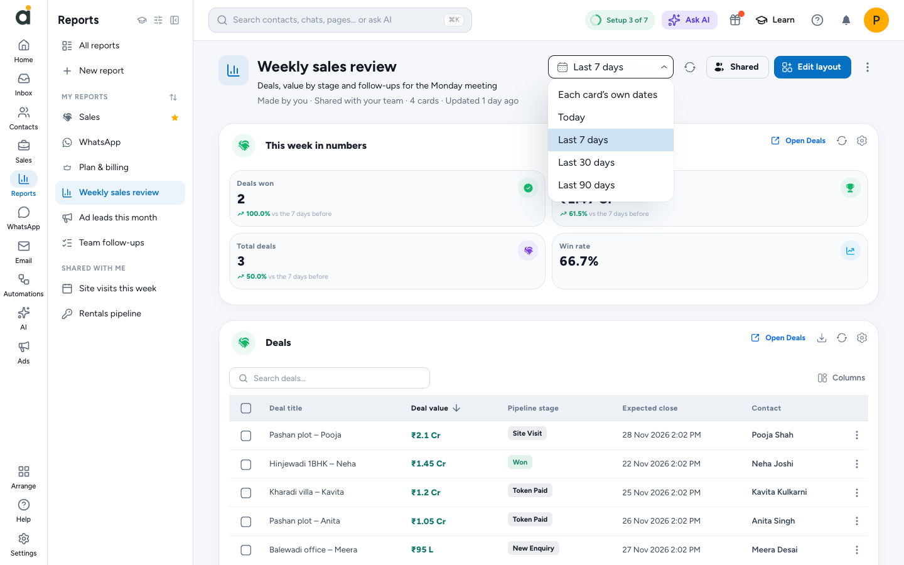
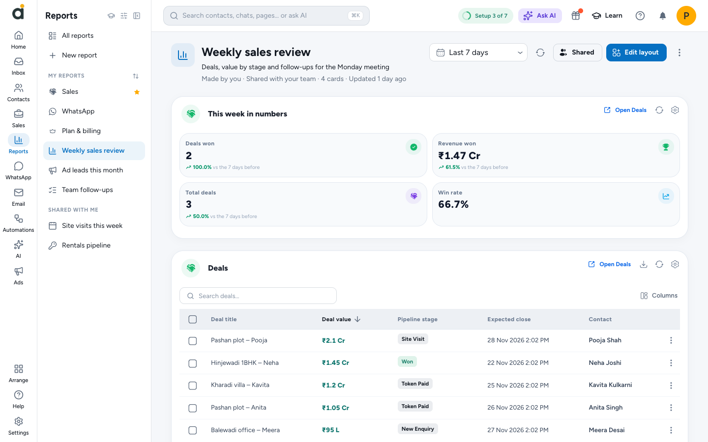
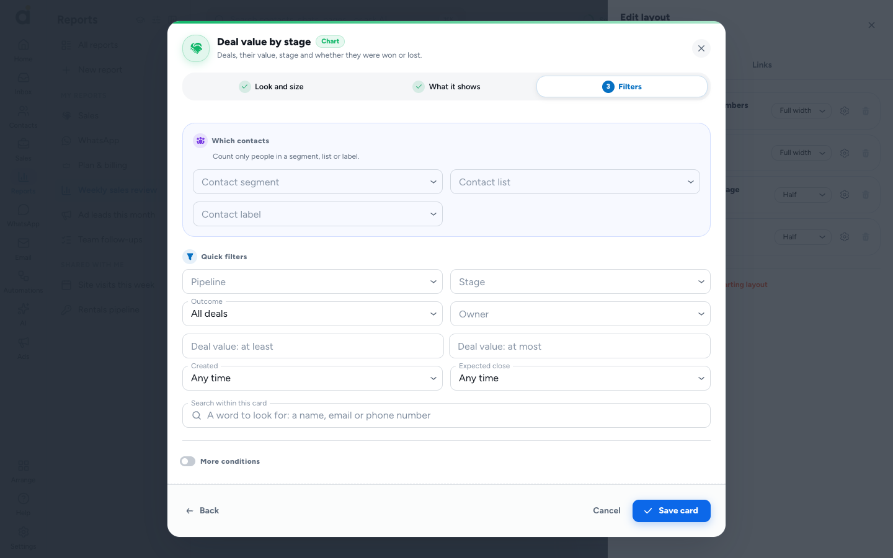

Two ways to narrow what a report shows:

- **Card filters**: one card counts only some records, for example *only deals in the Resale pipeline*.
- **Report dates**: every card on the report follows one time, for example *Last 7 days*, and number cards compare with the 7 days before.

## Report dates

**Where to find it:** at the top of a report, **Report dates** (next to the round arrow).

| Choice | What the cards show |
| --- | --- |
| **Each card’s own dates** | Every card keeps the **Time range** in its own settings. The default. |
| **Today** | Since midnight. Number cards compare with yesterday up to the same time. |
| **Last 7 days** | The last 7 days, compared with the 7 days before. |
| **Last 30 days** | The last 30 days, compared with the 30 days before. |
| **Last 90 days** | The last 90 days, compared with the 90 days before. |

With a time picked:

- **Number cards** show a small arrow and a percent under each total, like **↑ 50% vs the 7 days before**: green when it went the good way, red when not. No arrow means there was nothing in the time before (or the number is a rate, like *Win rate*).
- **Charts** draw that window.
- **Tables** show only records in that time.

Which date is used depends on the card: **Created** for most, the **due date** for tasks, the **received** date for ad leads, the **sent** date for messages. A card about something with no date (your WhatsApp numbers, your plan) shows everything whatever you pick.

Your choice is saved with the report, so it opens on the same dates next time. On a report a teammate shared with you it lasts for this visit only. You can also set it when you [make the report](/help/reports/create) (step 4).

## Card filters

**Where to find it:** the **gear** on a card → **Next: What it shows** → **Next: Filters**.

<Steps>
  <Step title="Which contacts">
    Count only people in one **segment**, **list** or **label**. Shown on cards about contacts and the things linked to them (deals, tasks, chats).
  </Step>
  <Step title="Quick filters">
    The choices this kind of card has. For deals: **Pipeline**, **Stage**, **Outcome** (All deals, Open only, Won only, Lost only), **Owner**, **Deal value** (from–to), **Created** and **Expected close** dates. Dates take **Any time**, **Last 7 days**, **14**, **30**, **90 days**, **Last 6 months**, **Last 12 months** or your own dates.
  </Step>
  <Step title="Search within this card">
    Only records that match a word, every time the card loads. (The search box on a table card does the same, just for now: see [Tables](/help/reports/tables).)
  </Step>
  <Step title="More conditions">
    For anything else: **Add conditions**, pick a field, how to compare (is, contains, greater than…) and a value. Every condition in a group must match; **Or match another group** adds a second group, and a record matching either group counts.
  </Step>
  <Step title="Save card">
    Click **Save card**. The card shows only what you picked.
  </Step>
</Steps>

## Link two cards

A card can also be filtered by a row you pick in another card (a segment → its contacts). See [Link two cards](/help/reports/cards#link-two-cards).

## Troubleshooting

| What you see | Why | What to do |
| --- | --- | --- |
| A card shows nothing after picking report dates | Nothing happened in that time on that card’s date. | Pick a longer time, or **Each card’s own dates**. |
| No arrow under a number | Nothing in the time before, or it is a rate. | Nothing to fix. |
| A filter you set seems ignored | **Report dates** replaces the card’s own date filter while a time is picked. | Pick **Each card’s own dates**. |
| *Filtered by selection* on a card | A row is picked in a card linked to it. | Click the cross on the label. |

## FAQs

<AccordionGroup>
  <Accordion title="Do report dates change the card settings?">
    No. Each card keeps its own time range; it is used again when you pick **Each card’s own dates**.
  </Accordion>
  <Accordion title="Which date does a deals card use with report dates?">
    The date the deal was **created**. To see deals by their expected close date, keep **Each card’s own dates** and set the card’s **Expected close** filter instead.
  </Accordion>
</AccordionGroup>

## Related

<CardGroup cols={2}>
  <Card title="Cards and card types" icon="table-cells-large" href="/help/reports/cards">
    Every card setting.
  </Card>
  <Card title="Reports" icon="chart-column" href="/help/reports">
    Reading a report.
  </Card>
</CardGroup>
