A **report** is a page of cards you pick yourself. Each **card** shows one thing as a table, a chart or a few big numbers: *deals by stage*, *today’s tasks*, *chats waiting for a reply*, *leads from your ads*. Make one report for your Monday sales meeting, one for your WhatsApp team, one for your ads: as many as you like.

Use Reports when you want the same numbers and lists every day without opening five pages, or when you want your team to look at the same thing.

**Where to find it:** click **Reports** on the icon rail on the left (after **Sales**). The side menu lists **All reports**, **New report**, then each of your reports by name and the ones your team **shared with you**.

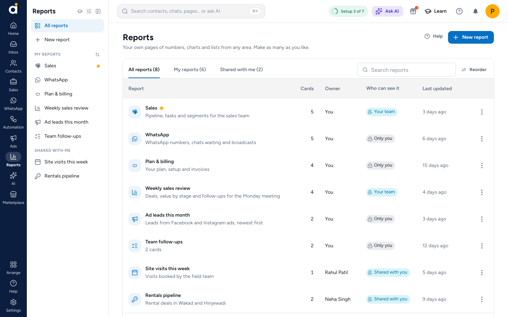

<Tip>
Want AdsEra to show you on the real page? Open **Learn → Reports** and click **Do it with me** on any lesson. See [Learn with the Education hub](/help/introduction/education-hub).
</Tip>

<Note>
Reports used to be **Your cards** at the bottom of Home. Nothing was lost: your views are now your reports, with the same cards. Home now shows a short **Your reports** list with your first three.
</Note>

---

## All reports

**All reports** is a table of your reports, like the Contacts list.

| Part | What it does |
| --- | --- |
| **New report** (blue, top right) | Opens the 4-step [New report](/help/reports/create). |
| **All reports / My reports / Shared with me** | Tabs. *My reports* are yours; *Shared with me* are reports teammates shared with the team. The number is how many there are. |
| **Search reports** | Finds a report by its name, description or owner. |
| **Reorder** | Puts **My reports** in the order you like (also in the side menu). |
| **Report** | Its icon, name, a star if it is your **default report**, and its description. |
| **Cards** | How many cards it has. |
| **Owner** | **You**, or the teammate who made it. |
| **Who can see it** | **Only you**, **Your team** (you shared it) or **Shared with you** (a teammate’s). |
| **Last updated** | When the report last changed (cards, name, sharing). |
| **⋮** | Open, Rename, Duplicate, Share / Make private, Set as default, Delete. On a teammate’s report: Open and **Add a copy to my reports**. |
| Arrows at the bottom | Move between pages. **Show** sets 5, 10 or 25 rows a page. |

Click a column name (**Report**, **Cards**, **Owner**, **Last updated**) to sort by it; click again to flip the order. Click a row to open the report.

<Tabs>
  <Tab title="Shared with me">
    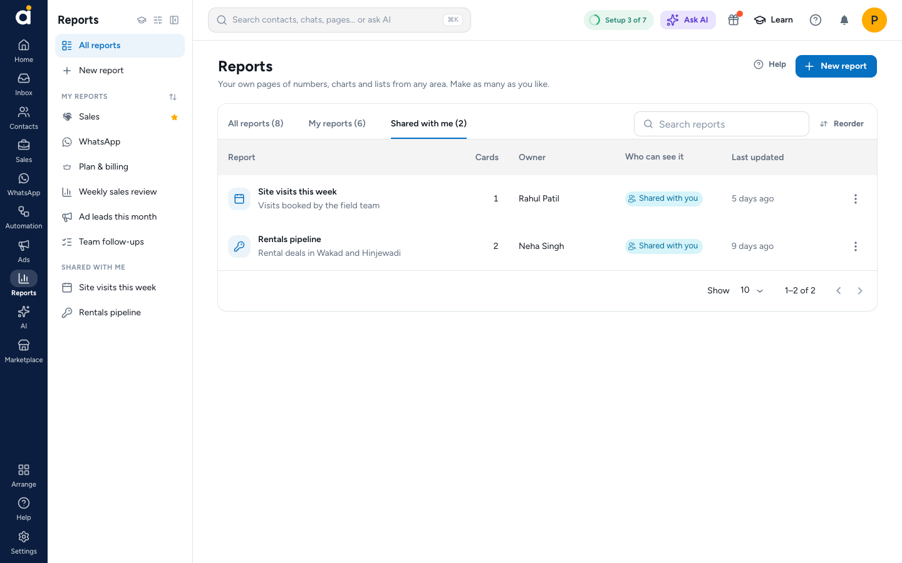
  </Tab>
  <Tab title="Search">
    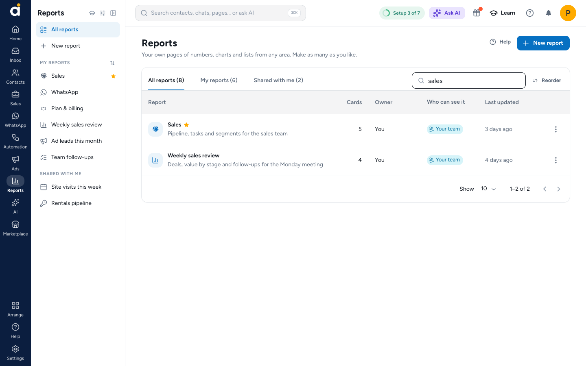
  </Tab>
  <Tab title="A report’s menu">
    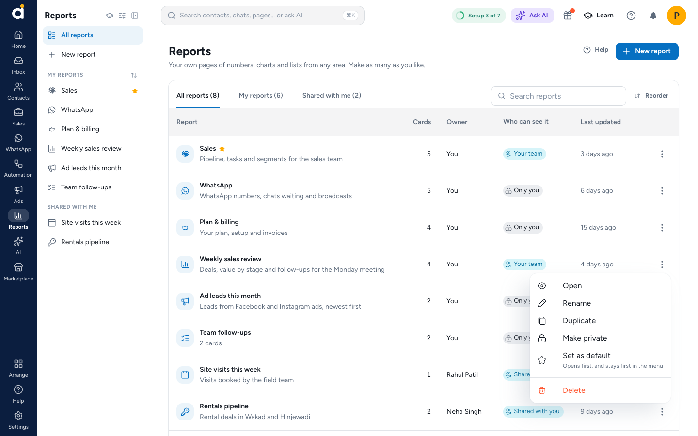
  </Tab>
  <Tab title="Your first visit">
    A new account has no reports yet. **New report** builds your own; **Use the 3 ready-made reports** adds **Sales**, **WhatsApp** and **Plan & billing** in one click.

    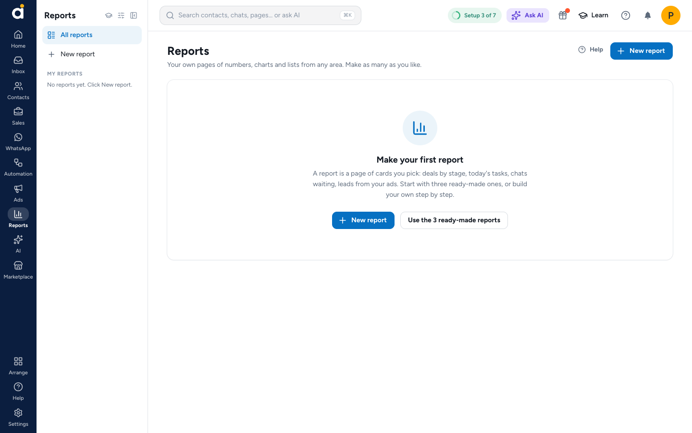
  </Tab>
</Tabs>

---

## Read a report

Click a report in the side menu or in **All reports**.

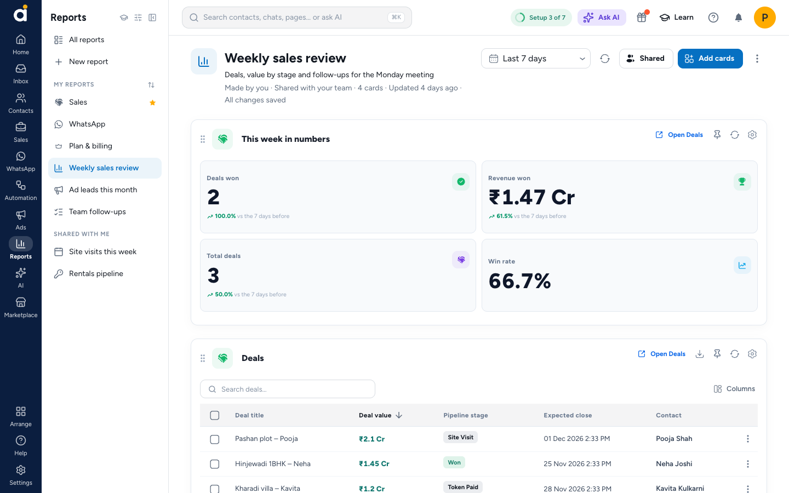

<Steps>
  <Step title="The header">
    The report’s name (a star if it is your default), its description, then one line: who made it, who can see it, how many cards and when it last changed.
  </Step>
  <Step title="Report dates">
    **Report dates** picks the time every card follows: **Each card’s own dates**, **Today**, **Last 7 days**, **Last 30 days** or **Last 90 days**. With a time picked, number cards also say how much they changed against the time just before, like *↑ 50% vs the 7 days before*. See [Filters and dates](/help/reports/filters).

    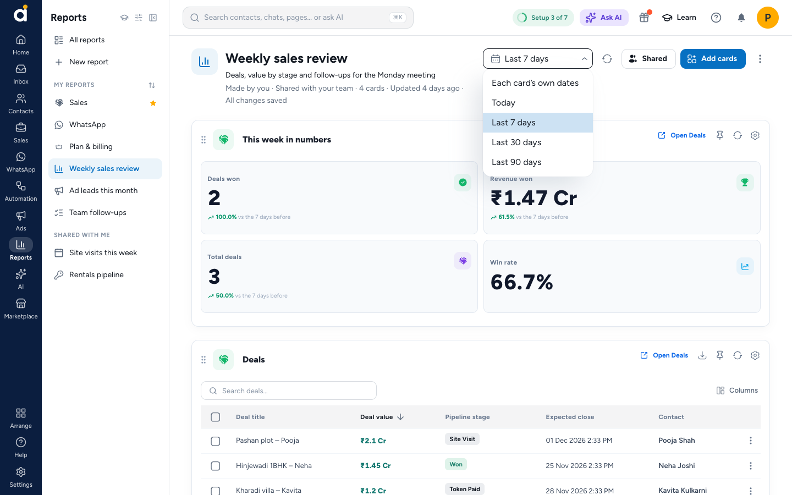
  </Step>
  <Step title="The buttons">
    | Button | What it does |
    | --- | --- |
    | **Round arrow** | Loads every card again. |
    | **Share** / **Shared** | Lets your team read this report. Click **Shared** to make it private again. See [Sharing and organising](/help/reports/sharing). |
    | **Add cards** (blue) | Add and remove cards, and link them. Move and resize cards by dragging them on the report. See [Cards](/help/reports/cards). |
    | **⋮** | Rename, Duplicate, Make private / Share, Set as default, **Auto-refresh**, Reorder reports, Help with reports, Delete. |

    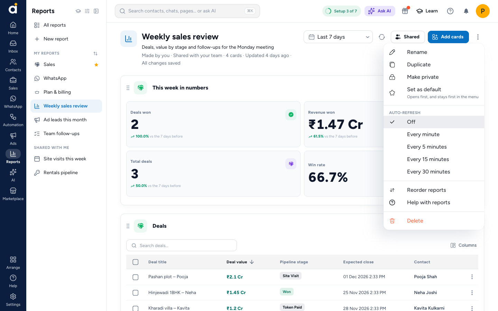
  </Step>
  <Step title="The cards">
    **Number cards** show big totals. **Chart cards** draw bars, lines, areas, a donut or a pie. **Table cards** list records you can page through, sort, search and download: see [Tables](/help/reports/tables). Each card has **Open …** (the page behind it), a round arrow (load it again), a download arrow on tables, and a gear (its settings).
  </Step>
</Steps>

### What a report can look like

<Tabs>
  <Tab title="Sales (ready-made)">
    
  </Tab>
  <Tab title="Shared with you">
    A teammate’s report: you can read it and pick its dates, but not change it. **Add a copy to my reports** gives you your own copy.

    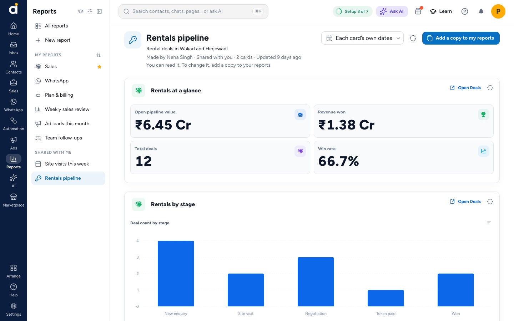
  </Tab>
  <Tab title="Loading">
    Grey placeholders while the cards load.

    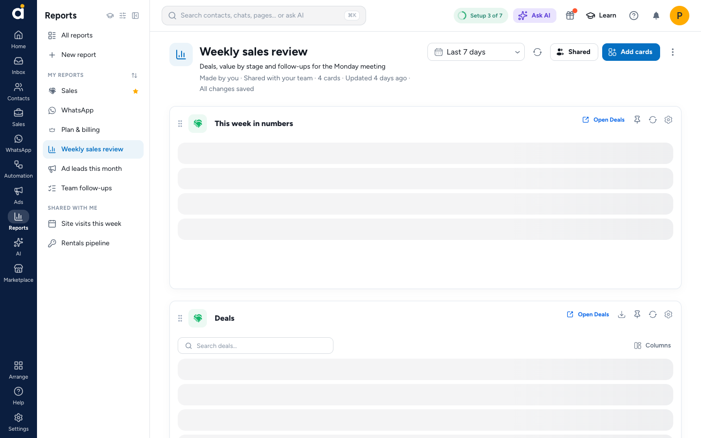
  </Tab>
  <Tab title="A card that couldn’t load">
    One card failing never blanks the others. It says what happened and has **Try again**.

    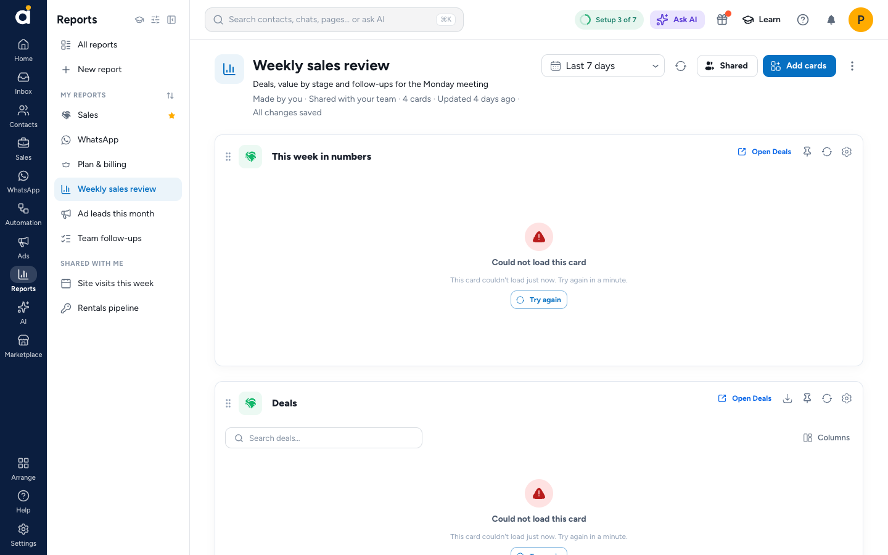
  </Tab>
  <Tab title="Report not found">
    A link to a report that was deleted, or a shared report its owner made private again.

    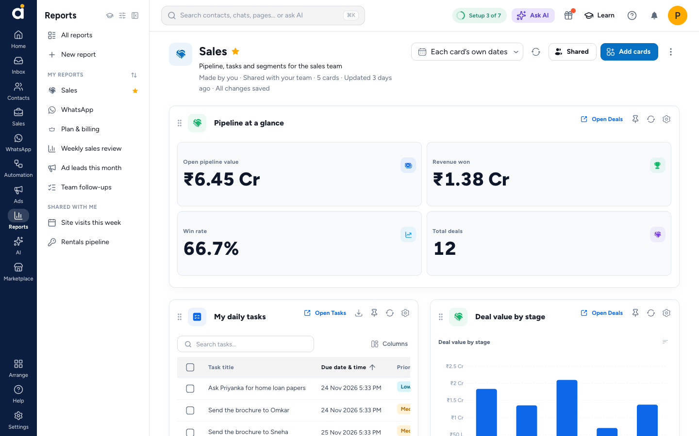
  </Tab>
  <Tab title="Smaller screens">
    On a laptop the buttons wrap under the name; on a phone cards stack one under the other and tables scroll sideways inside their card.

    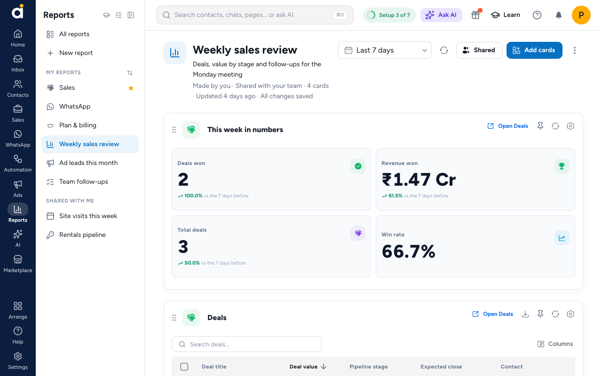

    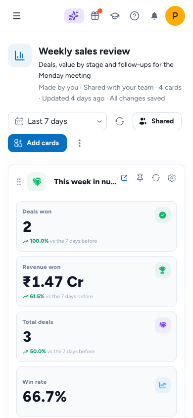
  </Tab>
</Tabs>

---

## Who can do what

| You can… | Who |
| --- | --- |
| Open and read reports, pick report dates, use tables (search, sort, pages) | Everyone whose role has **Home & reports → See Home and reports** (on by default). |
| Make, change, share, rename, duplicate, delete and reorder reports, and download a table | Roles with **Home & reports → Make and change reports** (admins always). |
| See a card’s data | Only if your role can open that area: a card about Deals shows only for roles that can see deals, and only the deals you’re allowed to see. |

A member who can only read reports doesn’t see **New report**, **Add cards**, **Share**, the card gears or the drag dots.

---

## Limits

- Up to **16 cards** in one report.
- A table card shows up to **50 rows** a page and goes up to page 200; the total stops counting at 10,000 (it says *10,000+*).
- Report names: up to 60 letters. Descriptions: up to 300.
- You must keep at least one report.

---

## Troubleshooting

| What you see | Why | What to do |
| --- | --- | --- |
| A card says **No access to …** | Your role can’t open that area. | Ask an admin for access, or remove the card. |
| **Nothing to show here yet** on a report | Every card on it is about an area you can’t open. | Ask an admin, or add a card for something you can see. |
| **Some cards are hidden…** under a report | A few cards are about areas you can’t open. | Same as above. |
| **This report isn’t here any more** | It was deleted, or its owner stopped sharing it. | Open **All reports**. |
| No **New report** or **Add cards** | Your role can only read reports. | Ask an admin to tick **Make and change reports** for your role. |
| A number didn’t change when you picked report dates | That card is about something with no date (like your WhatsApp numbers). | Nothing to fix: it always shows everything. |

---

## FAQs

<AccordionGroup>
  <Accordion title="How many reports can I make?">
    As many as you like. Each has up to 16 cards.
  </Accordion>
  <Accordion title="Do my reports change what my team sees?">
    No. Your reports are yours. A report you **share** can be read by your team; they can add a copy to their own reports, and their copy is theirs. See [Sharing and organising](/help/reports/sharing).
  </Accordion>
  <Accordion title="Where did Your cards on Home go?">
    They are your reports now, with the same cards. Old bookmarks to a view open the matching report.
  </Accordion>
  <Accordion title="More questions">
    See [Reports: questions](/help/reports/faq).
  </Accordion>
</AccordionGroup>

---

## Related

<CardGroup cols={2}>
  <Card title="Make a report" icon="wand-magic-sparkles" href="/help/reports/create">
    The 4-step New report, with a picture of every step.
  </Card>
  <Card title="Cards and card types" icon="table-cells-large" href="/help/reports/cards">
    Add, change, resize, reorder and link cards.
  </Card>
  <Card title="Tables" icon="table" href="/help/reports/tables">
    Pages, sorting, search, columns and downloads.
  </Card>
  <Card title="Sharing and organising" icon="share-nodes" href="/help/reports/sharing">
    Share, default, rename, duplicate, reorder, delete.
  </Card>
</CardGroup>
