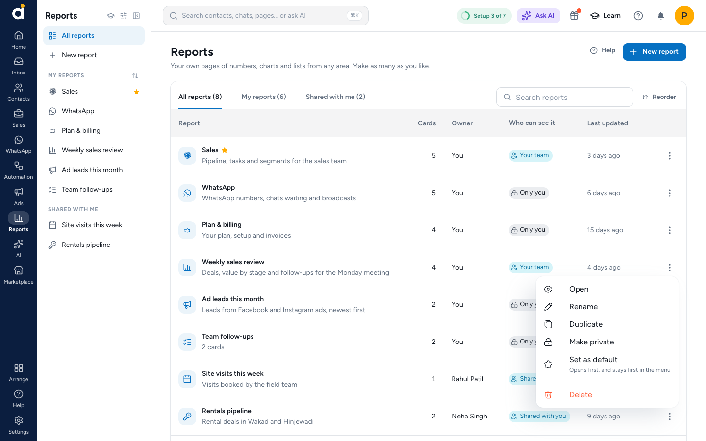
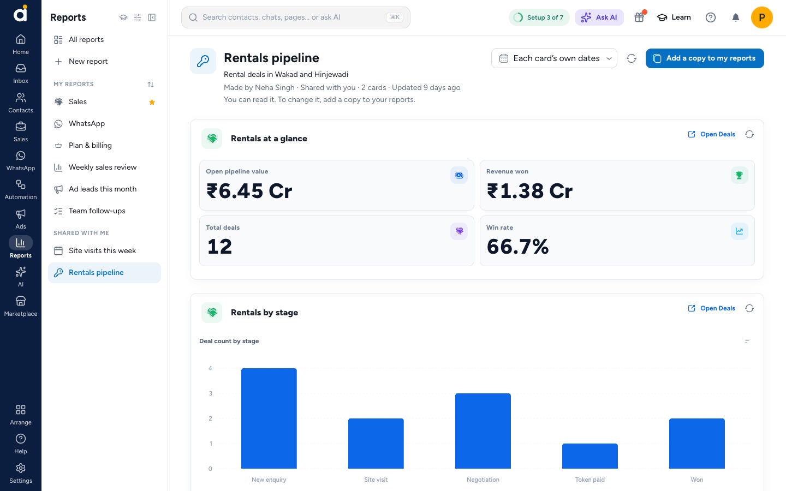
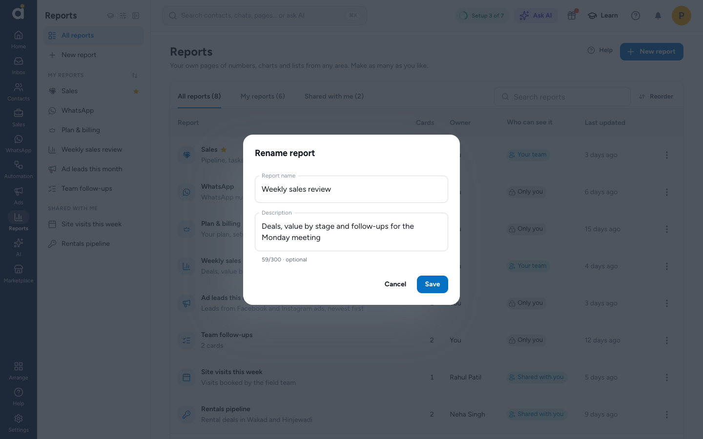
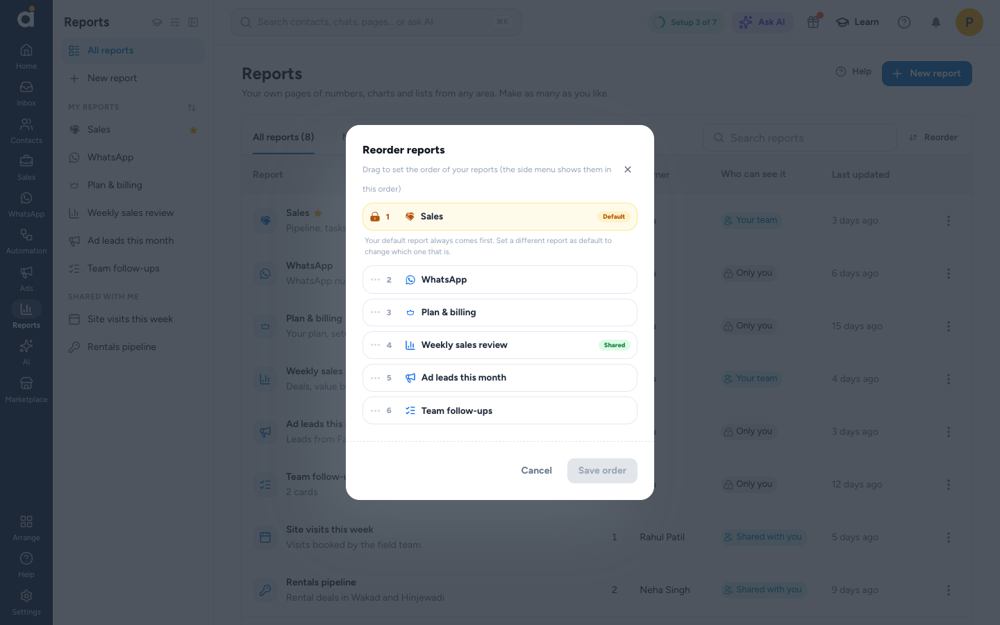
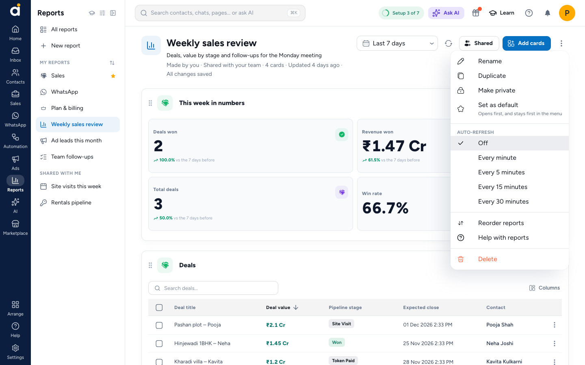
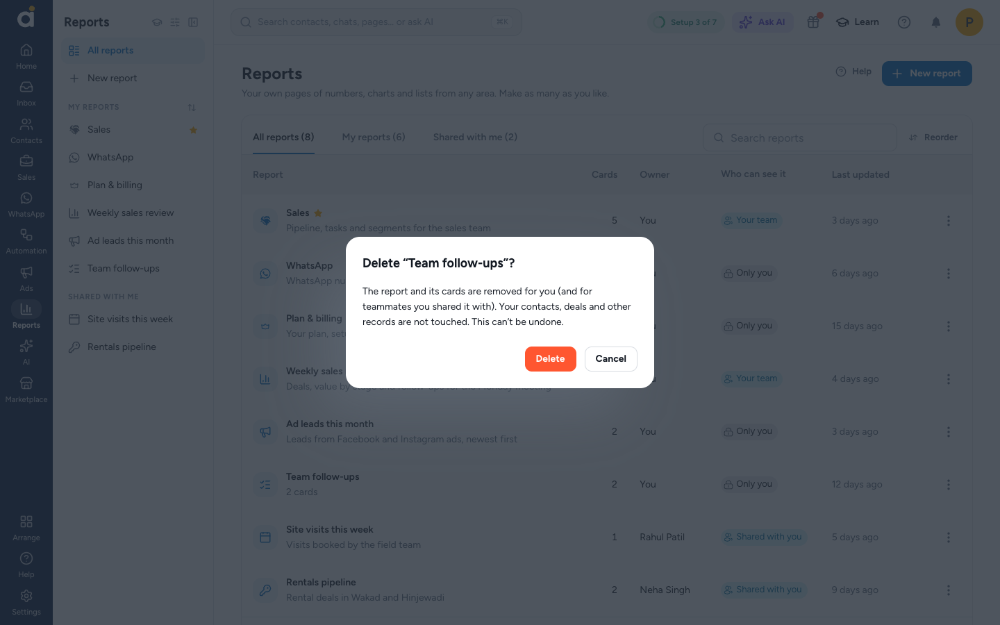

Everything you do to a whole report is in its **⋮** menu (on **All reports**, or at the top right of the report), plus **Share** at the top of the report.

| Choice | What it does |
| --- | --- |
| **Open** | Opens the report (All reports only). |
| **Rename** | Change its **Report name** and **Description**. |
| **Duplicate** | A copy with the same cards, called “… (copy)”, opened straight away. Only you see it. |
| **Share with your team** / **Make private** | Lets your team read it, or stops that. |
| **Set as default** | It opens first, has the star, is first in the side menu and on Home. |
| **Auto-refresh** (report page) | Loads the cards again **Every minute**, **5**, **15** or **30 minutes**, or **Off**. |
| **Reorder reports** (report page) | The order of your reports. |
| **Help with reports** (report page) | Opens Help for this page. |
| **Delete** | Removes the report after you confirm. |

On a teammate’s report the menu has **Open** and **Add a copy to my reports** only.

## Share a report with your team

<Steps>
  <Step title="Click Share">
    Open the report and click **Share** at the top. It turns into **Shared**, and the line under the name says *Shared with your team*. (Or **⋮ → Share with your team**.)
  </Step>
  <Step title="What your team sees">
    The report shows under **Shared with me** in their side menu and on **All reports**, with you as the owner. They can open it, pick its dates and use its tables, but not change it. **Add a copy to my reports** gives them their own copy.
  </Step>
  <Step title="Stop sharing">
    Click **Shared** (or **⋮ → Make private**). It disappears from their lists; copies they made stay theirs.
  </Step>
</Steps>

Each teammate sees only the data their role allows, even on your report: a card about an area they can’t open is left out (*Some cards are hidden…*).

## Use a report a teammate shared

Open it from **Shared with me** (side menu or the tab on All reports). You can pick **Report dates** (for this visit), refresh, page, sort and search tables, and open records. To change it, click **Add a copy to my reports**: the copy opens, and it is yours.

## Set your default report

**⋮ → Set as default.** The star moves to it. Your default report is first under **My reports**, first on Home’s **Your reports**, and `/dashboard/reports/default` always opens it. It stays first when you reorder.

## Rename a report

**⋮ → Rename**, change the **Report name** (up to 60 letters, different from your other reports) and the **Description** (up to 300), and click **Save**.

## Duplicate a report

**⋮ → Duplicate.** A copy with the same cards and links opens, called “… (copy)” (or “(copy 2)”). Rename it, drag and resize its cards, and add more with **Add cards**.

## Put your reports in order

Click the up-and-down arrows next to **My reports** in the side menu (or **Reorder** on All reports, or **⋮ → Reorder reports**). Drag the reports, then click **Save order**. Your default report stays first.

## Keep a report up to date on its own

**⋮ → Auto-refresh** on the report: **Off**, **Every minute**, **Every 5 minutes**, **Every 15 minutes** or **Every 30 minutes**. It is remembered on this computer (handy on a screen in the office) and pauses while the browser tab is hidden.

## Delete a report

**⋮ → Delete**, then **Delete** again to confirm. The report and its cards are removed (for teammates you shared it with too); your contacts, deals and other records are not touched. You must keep at least one report.

## FAQs

<AccordionGroup>
  <Accordion title="Can a teammate change my shared report?">
    No. They can read it and make their own copy.
  </Accordion>
  <Accordion title="Can I share with only some people?">
    Not yet: sharing is with your whole team. Each person still sees only what their role allows.
  </Accordion>
  <Accordion title="I deleted a report by mistake. Can I get it back?">
    No. Make it again with **New report**, or add a copy of a shared one.
  </Accordion>
</AccordionGroup>

## Related

<CardGroup cols={2}>
  <Card title="Reports" icon="chart-column" href="/help/reports">
    All reports and reading a report.
  </Card>
  <Card title="Questions" icon="circle-question" href="/help/reports/faq">
    Reports FAQs.
  </Card>
</CardGroup>
