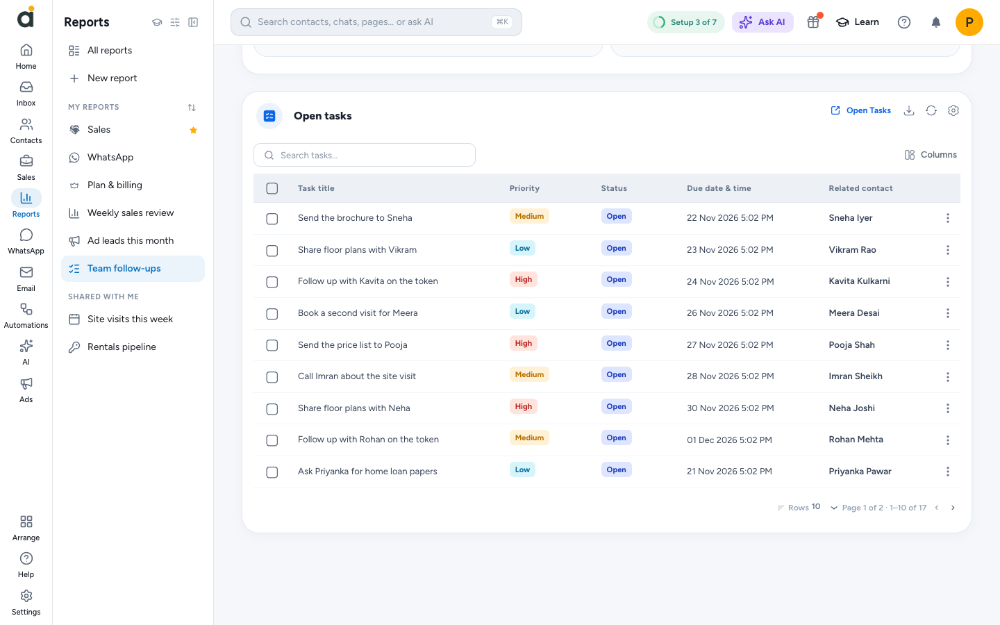
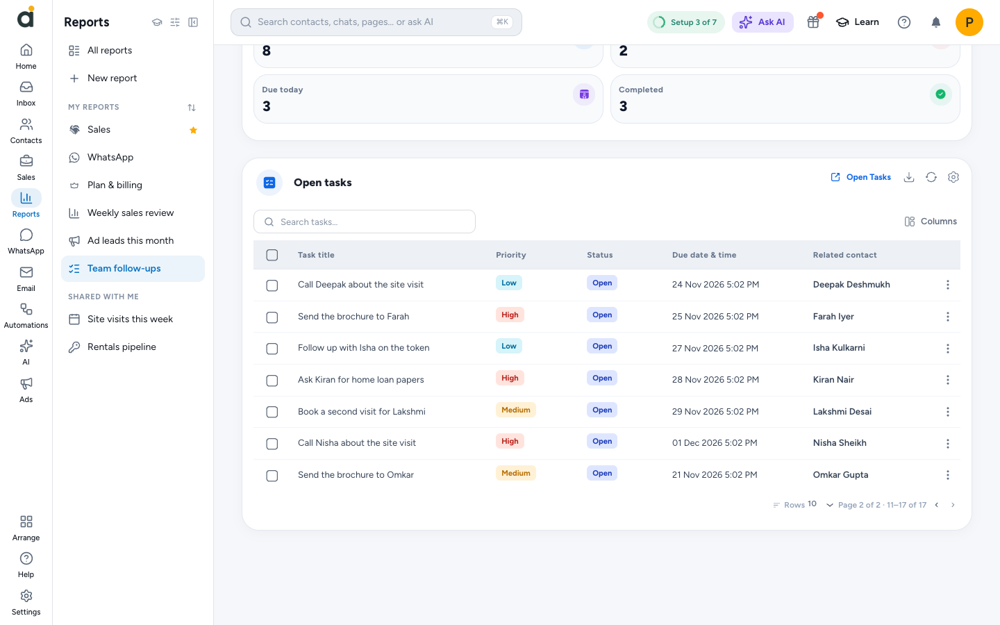
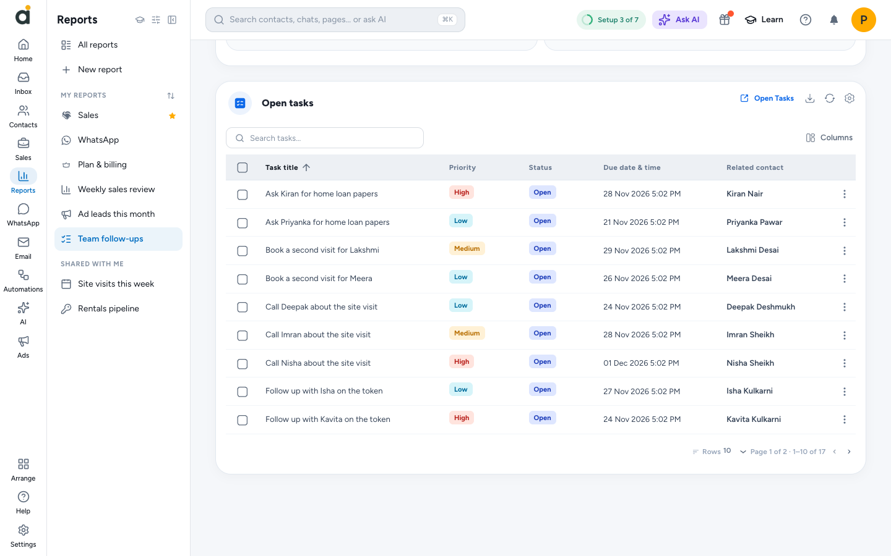
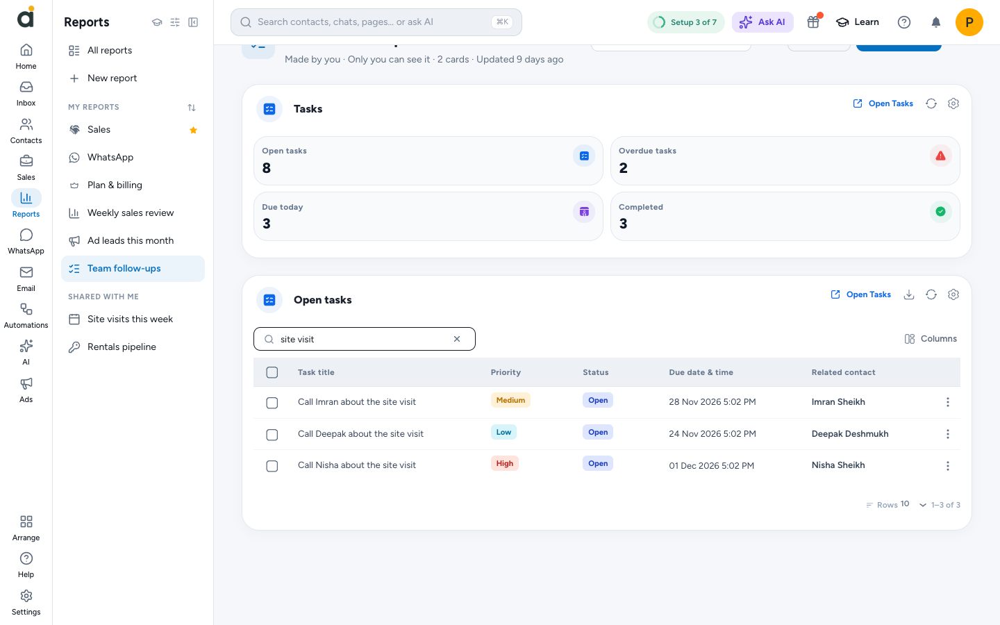
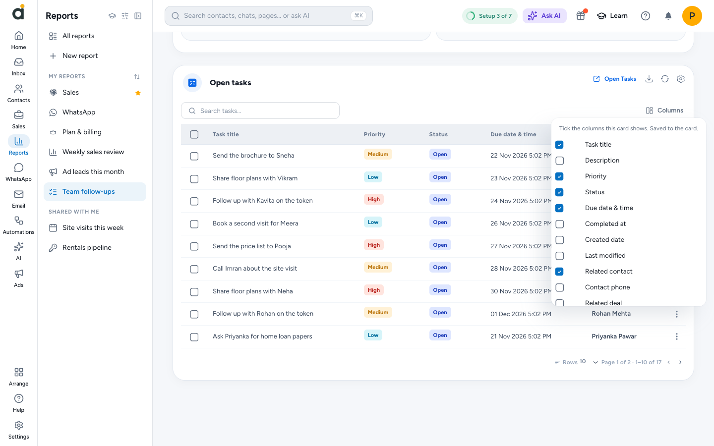
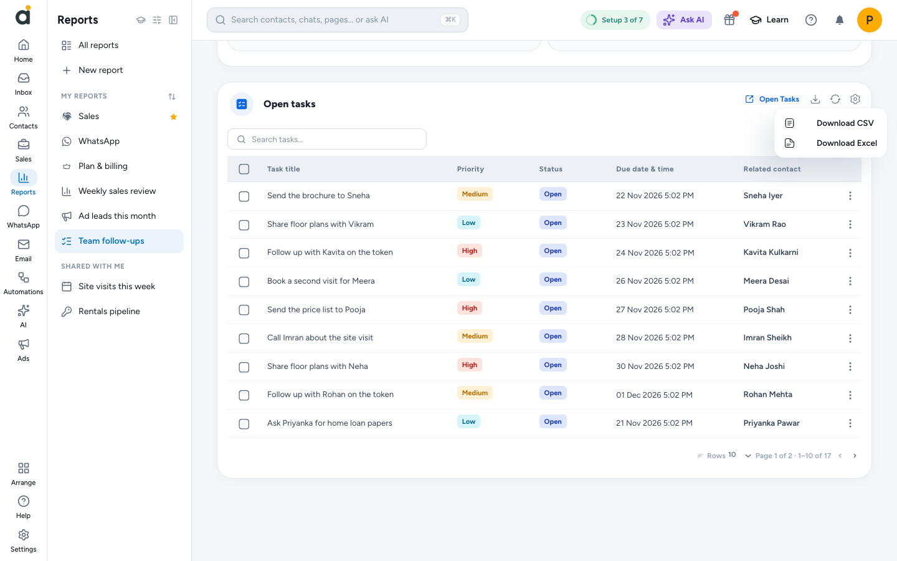

A **table card** lists records (tasks, deals, contacts, leads, chats…) with the columns you pick. It works like the Contacts list, inside a card.

**Where to find it:** any report with a table card, for example the ready-made **Sales** report’s *My daily tasks*.

| Part | What it does |
| --- | --- |
| **Search …** (top left) | Shows only rows that match a word. |
| **Columns** (top right) | Tick the columns to show; saved to the card. |
| Column names | Click to sort; click again to flip. An arrow shows the sort. |
| A row | Click to open that record. The tick box picks it for actions on many rows. **⋮** at the end: actions on that record. |
| **Rows** (bottom) | How many rows a page has: **5**, **10**, **25** or **50**. |
| **Page 1 of 5 · 1–5 of 23** | Where you are. The arrows go to the previous and next page. |
| Download arrow (card header) | Saves the rows on screen as **CSV** or **Excel**. |

The column names stay at the top while you scroll a long table, and a table wider than its card scrolls sideways inside the card, so no column is cut off.

## Go through every row

1. At the bottom of the card it says where you are, like **Page 1 of 5 · 1–5 of 23**.
2. Click the arrows to go back and forward.
3. Pick **Rows** to see more at once (up to 50).

Changing the search or sort starts again at page 1. Your page and rows choice is for this visit; the card’s usual number is **Rows to show** in its settings. Very big lists say *1–10 of 10,000+*: AdsEra stops counting there to stay fast.

## Sort by a column

Click a column name, like **Task title** or **Due date & time**. The arrow shows the order; click again to flip it. Columns you can’t sort (like lists or labels) have no arrow. The sort is for this visit; the card’s usual sort is kept.

## Search inside a card

Type in **Search …** at the top of the card. It looks through all of the card’s records (not only this page) and shows the matches. The cross clears it. Some cards (like WhatsApp chats and messages) have no search box: use their filters instead.

## Choose columns

Click **Columns** and tick or untick. It’s saved to the card straight away (a card keeps at least one column). To change the order of the columns, use the card’s gear → **What it shows**. On a teammate’s report, or if your role can only read reports, there is no **Columns** button.

## Open a record

Click a row: a contact opens the contact, a deal opens the deal, a chat opens the chat, a segment opens it in Contacts. If a card filters another (see [Link two cards](/help/reports/cards#link-two-cards)), clicking the filter icon at the start of a row filters the other card instead.

## Download (CSV or Excel)

Click the download arrow in the card’s header and pick **Download CSV** or **Download Excel**. The file holds the rows on screen: the same columns, sort, search, report dates and page. It says *Downloaded 10 rows* when it’s ready. Downloading needs **Make and change reports** on your role.

## Troubleshooting

| What you see | Why | What to do |
| --- | --- | --- |
| *Nothing matches “…”* | No record has that word. | Try another word, or click the cross. |
| No search box | That kind of card can’t be searched. | Use the card’s filters (gear → Filters). |
| Clicking a column name does nothing | That column can’t be sorted. | Sort by another column. |
| *Could not export this card* | Your role can’t download, or the connection dropped. | Ask an admin, or try again. |

## FAQs

<AccordionGroup>
  <Accordion title="Why does the table show fewer rows than the total?">
    It shows one page at a time. Use the arrows or pick more **Rows**.
  </Accordion>
  <Accordion title="Does the download include every page?">
    No: the rows on screen. Pick **Rows: 50** and go page by page, or use the area’s own export (for example Contacts) for everything.
  </Accordion>
</AccordionGroup>

## Related

<CardGroup cols={2}>
  <Card title="Cards and card types" icon="table-cells-large" href="/help/reports/cards">
    Every card setting.
  </Card>
  <Card title="Filters and dates" icon="filter" href="/help/reports/filters">
    Show only some records.
  </Card>
</CardGroup>
