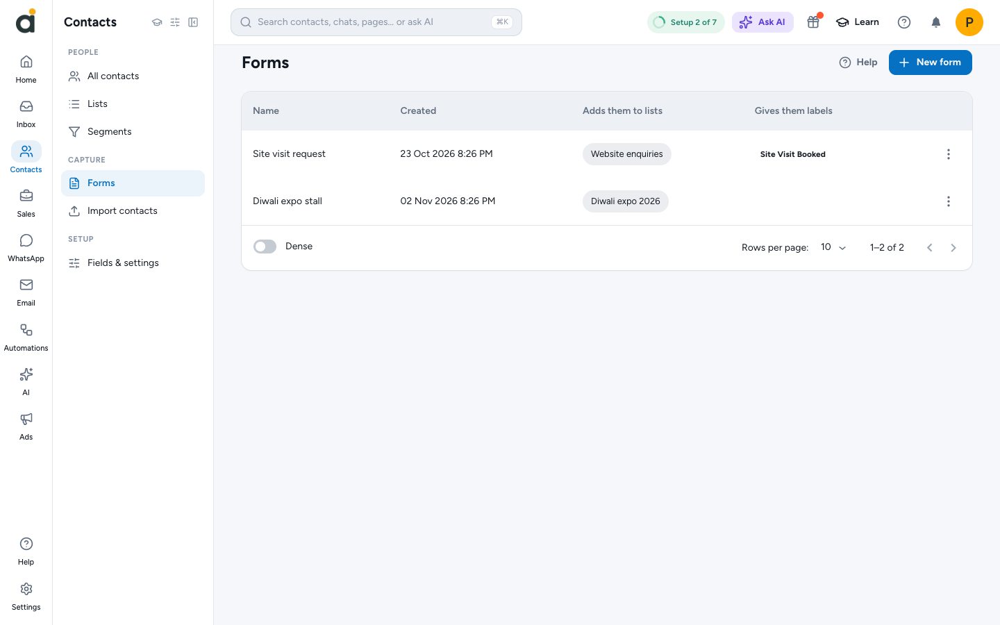
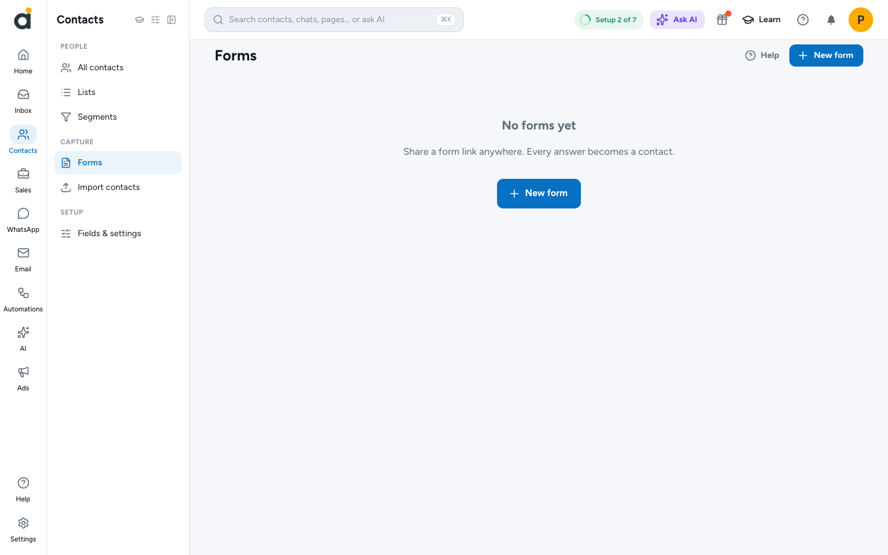
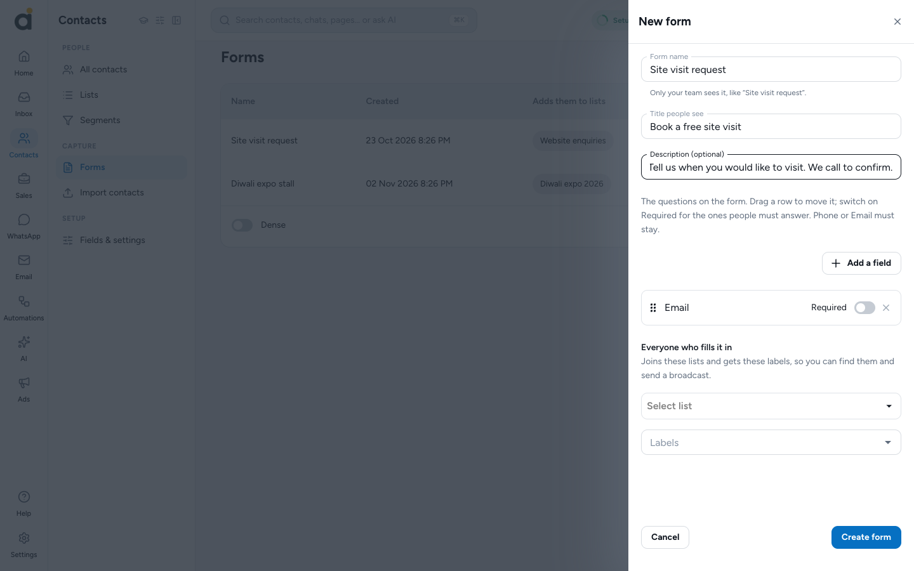
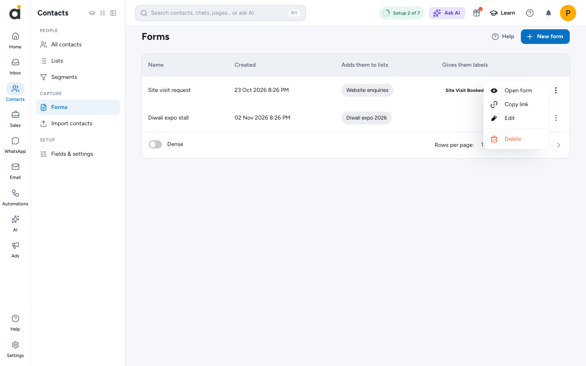
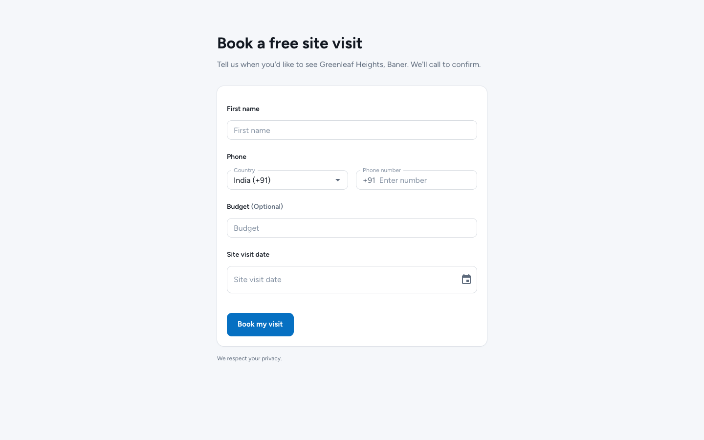

A **form** is a web page with your questions that anyone can fill in, no app or login needed. Every answer becomes a contact in AdsEra, joins the lists you pick and gets the labels you pick. Real estate example: a "Book a free site visit" form in your Instagram bio and on a QR code at your site office.

**Where:** **Contacts → Forms**. [Open it →](https://app.adsera.in/dashboard/forms/list)

## The forms list

| Column | What it shows |
| --- | --- |
| **Name** | The name your team sees. |
| **Created** | When it was made. |
| **Adds them to lists** | The lists everyone who fills it joins. |
| **Gives them labels** | The labels they get. |
| **⋮** | **Open form**, **Copy link**, **Edit**, **Delete**. |

With no forms yet the page says **No forms yet** with a **New form** button.

## Make a form

<Steps>
<Step title="Click New form">Top right. The **New form** panel opens.</Step>
<Step title="Name and title">**Form name** is for your team ("Site visit request"). **Title people see** is the heading on the form ("Book a free site visit"). **Description (optional)** is a line under it.</Step>
<Step title="Add your questions">**Add a field** lists your contact fields; each question saves into one (First name, City, Budget, Site visit date…). Drag a row to move it. Switch on **Required** for questions people must answer. Phone or Email must stay on the form.</Step>
<Step title="Everyone who fills it in">Pick the **lists** they join and the **labels** they get.</Step>
<Step title="Click Create form">It shows in the list.</Step>
</Steps>

To ask something new (like "Preferred visit day"), first make a field for it in [Fields](/help/audiance/attribute), then add it to the form.

## Share it

Open the form's **⋮** menu:

- **Copy link** copies the form's address (`https://app.adsera.in/form/…`). Paste it in a WhatsApp message or status, your Instagram bio, your website, or turn it into a QR code.
- **Open form** shows it exactly as people see it.

## What happens when someone fills it in

- **New person** (phone and email not in AdsEra): a new contact is made with their answers, the lists and the labels.
- **Someone you already have** (same phone or email): their contact gets the lists and labels, and answers for fields that were empty. Details they already have are **not** changed, so a stranger can't overwrite a customer's details by typing their phone number.
- Their answers show on the contact's **Form answers** tab. See [A contact's page](/help/audiance/view).
- They see the thank-you message and can close the page.
- A workflow that starts with **A form is submitted** can send them a WhatsApp in seconds. See [Workflows](/help/automation/workflows).

## Edit or delete

- **Edit** changes the name, title, questions, lists and labels. The link stays the same.
- **Delete** removes the form; its link stops working. Contacts it already made stay.

## Troubleshooting

| What you see | Why | What to do |
| --- | --- | --- |
| "Give the form a name" / "Add the title people see" | One of them is empty. | Fill both. |
| "At least one field is required" | No questions. | Add Phone or Email at least. |
| The question you want isn't in **Add a field** | There's no field for it yet, or it's already on the form. | Make the field in Fields & settings. |
| Someone filled it but their old details didn't change | Existing details are never overwritten by a form. | Change them on the contact. |

## FAQ

<AccordionGroup>
  <Accordion title="Can I put the form on my website?">
    Yes: link to it from a button, or paste the link where your website builder lets you add one.
  </Accordion>
  <Accordion title="Do form leads get a WhatsApp automatically?">
    Only if you build a workflow that starts with **A form is submitted**. Without one, they just become contacts.
  </Accordion>
</AccordionGroup>

## Related

<CardGroup cols={2}>
  <Card title="Fields" icon="table-list" href="/help/audiance/attribute" />
  <Card title="Lists and folders" icon="list" href="/help/audiance/list" />
  <Card title="Workflows" icon="diagram-project" href="/help/automation/workflows" />
  <Card title="A contact's page" icon="address-card" href="/help/audiance/view" />
</CardGroup>
