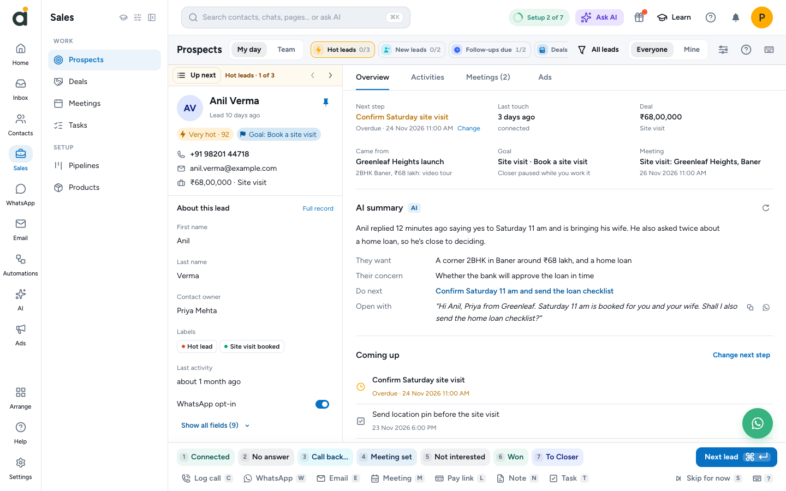
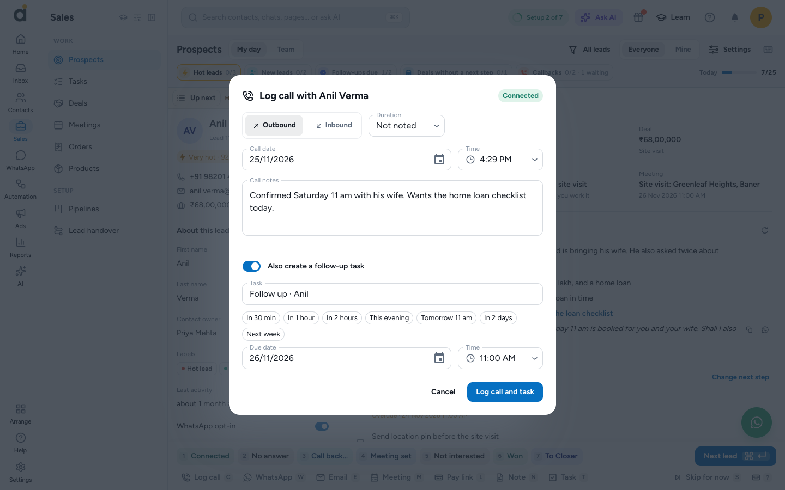
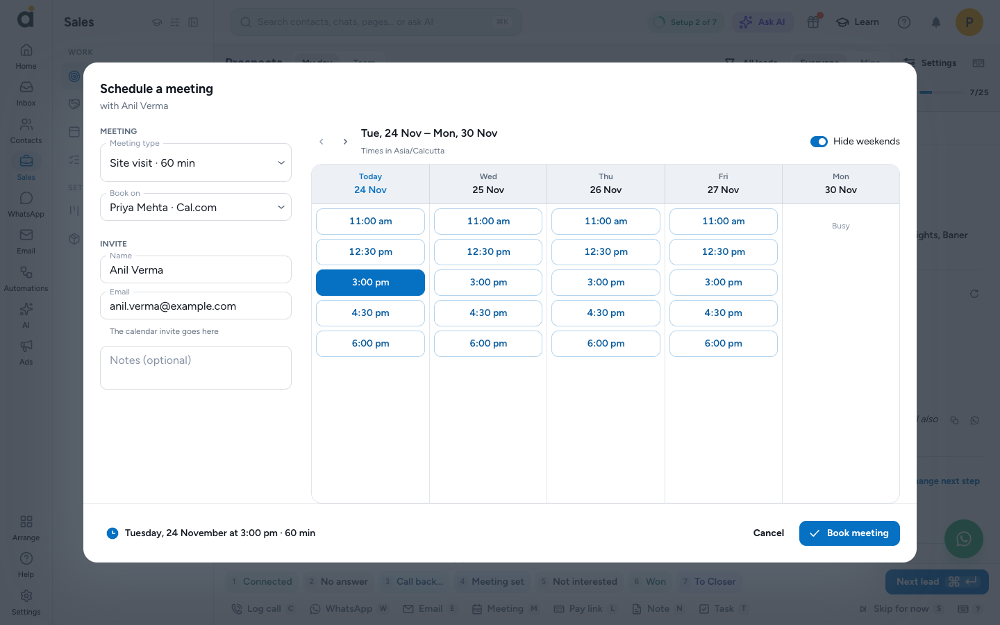
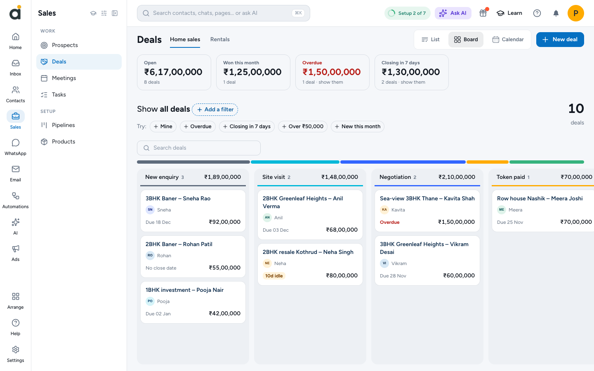
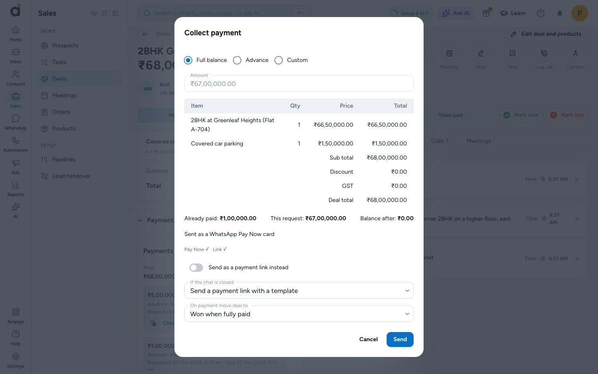

This page follows one buyer through AdsEra, the way a real-estate business uses it every day. Each step links to the full guide.

**The setup, done once:** a [pipeline](/help/crm/pipeline) (New enquiry → Site visit → Negotiation → Token paid → Won / Lost), your [products](/help/crm/product) (the flats), Cal.com or Calendly connected for [meetings](/help/sales/meetings), WhatsApp Pay or Razorpay for [payments](/help/crm/deal-payments), and each salesperson set up to [get their own leads](/help/sales/own-leads).

<Steps>
<Step title="A lead arrives">
Anil sees your ad "2BHK in Baner from ₹68 lakh" and taps **Send message**. He lands in your WhatsApp inbox as a new contact. Round-robin gives him to Priya. A [workflow](/help/automation/workflows) or [Addy](/help/ai/addy) can answer him at once.
</Step>
<Step title="Prospects puts him first">
Priya opens **Sales → Prospects** and clicks **Start with hot leads**. Anil is first: *"Replied on WhatsApp 12 min ago"*. The AI summary says he wants a corner 2BHK and a home loan, and gives her an opening line.

See [Prospects](/help/sales/prospects).
</Step>
<Step title="She calls and logs it">
Priya calls, then taps **Connected** and writes "Coming Saturday 11 am with his wife". She adds a follow-up task for Friday.

</Step>
<Step title="She books the site visit">
She clicks **Meeting**, picks **Site visit · 60 min** and Saturday 11 am. The invite goes to Anil and the link goes in his WhatsApp. She taps **Meeting set**.

See [Meetings](/help/sales/meetings).
</Step>
<Step title="A deal tracks the sale">
On **Sales → Deals** she adds **New deal** "2BHK Greenleaf Heights – Anil Verma" at **Site visit**, with the flat and covered parking as products: ₹68,00,000. After the visit she drags it to **Negotiation**.

See [Deals](/help/crm/deal).
</Step>
<Step title="The token is paid on WhatsApp">
Anil agrees. Priya opens the deal, clicks **Collect payment**, picks **Advance** of ₹1,00,000 and **Send**. Anil pays with UPI inside WhatsApp. The request turns **Paid**; Priya moves the deal to **Token paid**.

See [Collect a payment](/help/crm/deal-payments).
</Step>
<Step title="The rest is collected and the deal is won">
When the loan comes through, **Full balance** asks for exactly what's left. With **Won when fully paid**, the deal moves to **Won** by itself and shows in **Won this month**.
</Step>
</Steps>

## What the manager sees

- **Prospects → Team**: each person's calls today against the daily goal.
- **Deals**: money by stage, what's **Overdue** and what's **Closing in 7 days**.
- **Tasks → Everyone's tasks**: who has what due.

## Related

<CardGroup cols={3}>
<Card title="Prospects" icon="list-check" href="/help/sales/prospects" />
<Card title="Deals" icon="handshake" href="/help/crm/deal" />
<Card title="Collect a payment" icon="indian-rupee-sign" href="/help/crm/deal-payments" />
</CardGroup>
