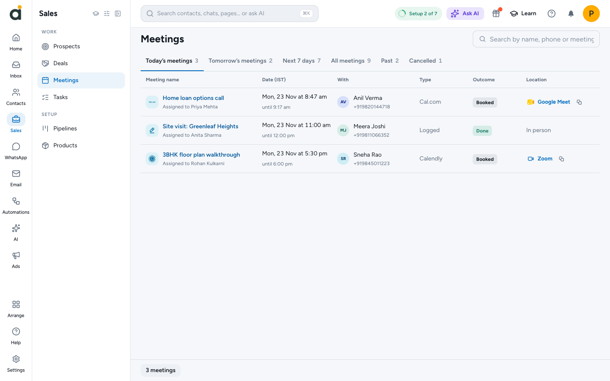
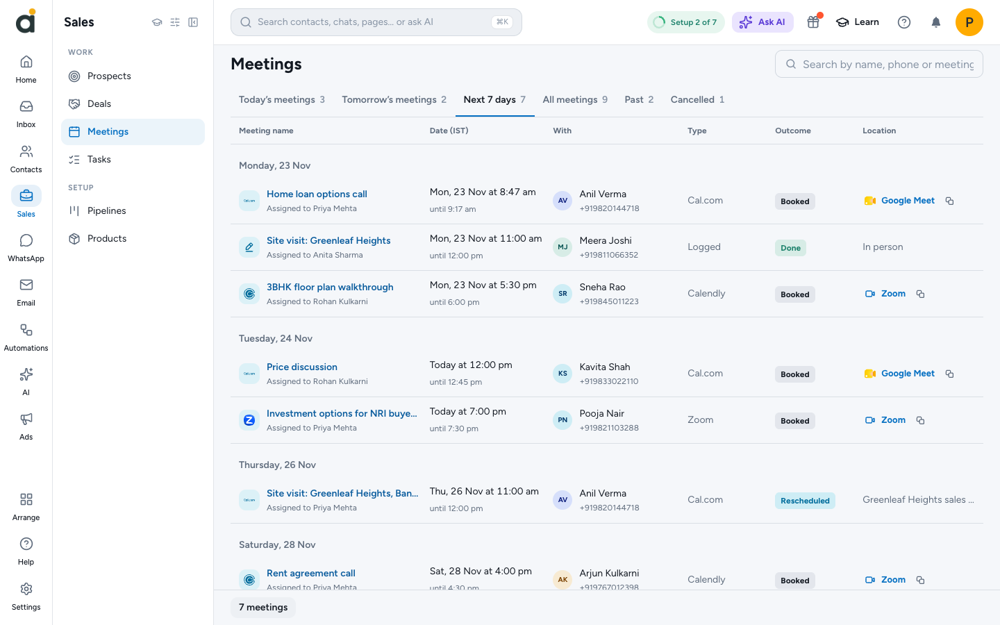
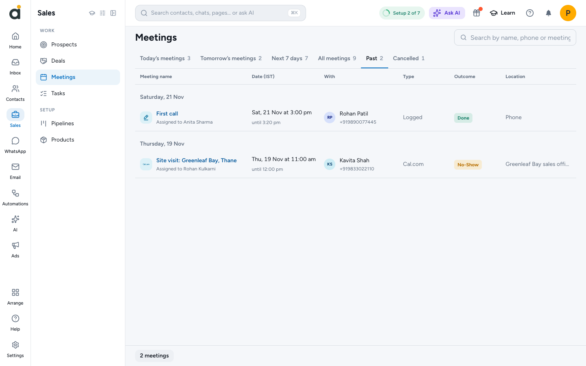
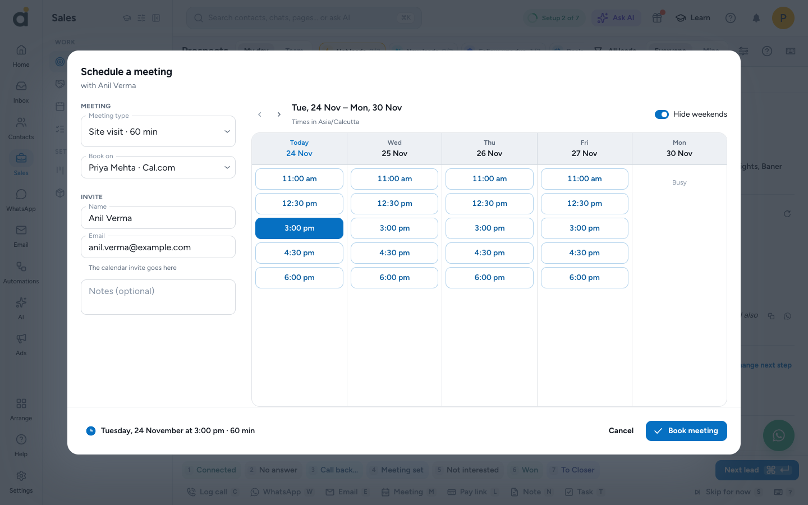
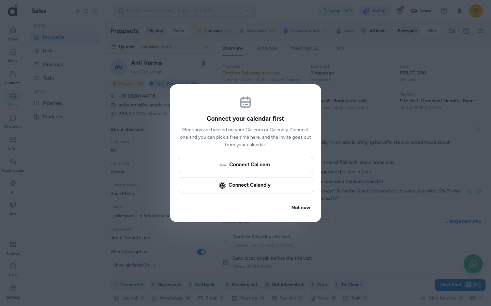
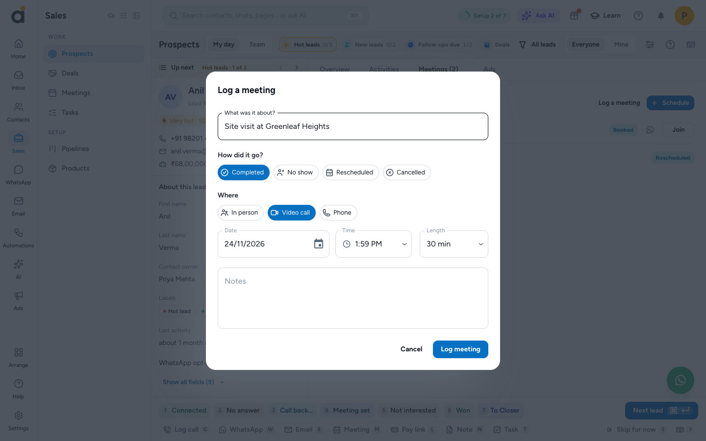
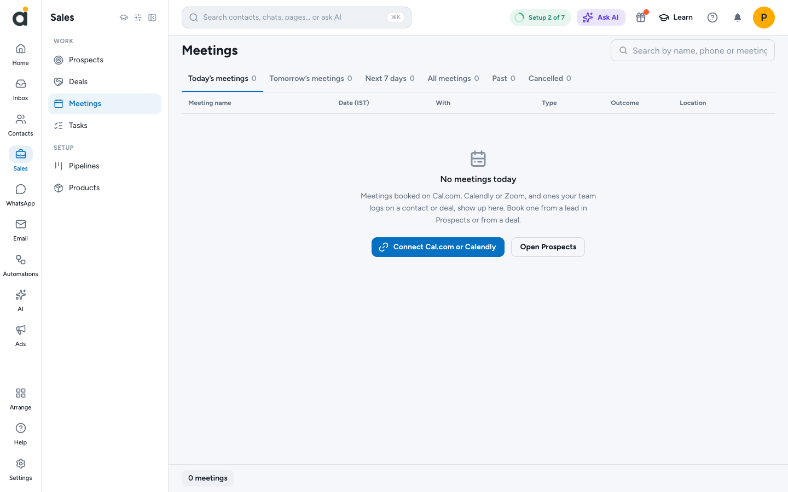

**Meetings** lists every meeting with your contacts: site visits, calls, video walkthroughs. Bookings made on Cal.com, Calendly or Zoom appear here by themselves, next to the meetings your team logs by hand. Book a new meeting from a lead in Prospects or from a deal: you pick a free time from your own calendar and the invite goes out for you.

**Where:** **Sales → Meetings** in the menu on the left. [Open it →](https://app.adsera.in/dashboard/crm/meetings)

**Before you start:** connect **Cal.com** or **Calendly** (and Zoom, if you use it) under **Automations → Apps & integrations**, so bookings show up and you can book from AdsEra.

## The list

| Tab | What it shows |
| --- | --- |
| **Today's meetings** | Today, not cancelled. |
| **Tomorrow's meetings** | Tomorrow. |
| **Next 7 days** | Today and the next 6 days, grouped by day. |
| **All meetings** | Everything that isn't cancelled. |
| **Past** | Meetings that already happened, newest first. |
| **Cancelled** | Cancelled bookings. |

The number next to each tab is how many. **Search by name, phone or meeting** finds one.

| Column | Meaning |
| --- | --- |
| **Meeting name** | The title, and **Assigned to** the host. |
| **Date (IST)** | When, like "Today at 5:30 pm until 6:00 pm". |
| **With** | The person, with their phone or email. |
| **Type** | Where it came from: **Cal.com**, **Calendly**, **Zoom** or **Logged** (written down by your team). |
| **Outcome** | **Booked**, **Rescheduled**, **Requested**, **Done**, **No-show**, **Cancelled**, **Declined** or **Moved**. |
| **Location** | The video link (**Google Meet**, **Zoom**…) with a copy icon, or the place, like "In person". |

15 minutes before a meeting starts, its link turns into a blue **Join now** button. Click a row to open the contact's page. The count at the bottom says how many meetings are on the tab.

## Book a meeting

You book from a lead or a deal, so the meeting is linked to the right person.

<Steps>
<Step title="Open the scheduler">
- In **Prospects**: open the lead and click **Meeting** (or press **M**), or the **Meetings** tab → **Schedule**.
- On a **deal**: click **Meeting** → **Schedule a meeting**.
</Step>
<Step title="Pick the Meeting type and Book on">
The meeting types (like **Site visit · 60 min**) come from your Cal.com or Calendly. **Book on** picks the calendar. AdsEra remembers your last choice.
</Step>
<Step title="Check the invite">**Name**, **Email** (the calendar invite goes here) and **Notes (optional)**.</Step>
<Step title="Pick a free time">
The week shows your free times. The arrows show an earlier or the next week; **Hide weekends** shows or hides Saturday and Sunday.

</Step>
<Step title="Click Book meeting">You see **Booked with …** and the meeting link. Copy it, or **Send link in WhatsApp** (from Prospects). If your calendar needs the guest to confirm, you get a link to send them instead.</Step>
</Steps>

If no calendar is connected, you see **Connect your calendar first** with **Connect Cal.com** and **Connect Calendly**. **Not now** closes it.

## Log a meeting that happened

Met at the office, or spoke on a call that wasn't booked? Log it so the team knows.

<Steps>
<Step title="Open Log a meeting">In Prospects: the lead's **Meetings** tab → **Log a meeting**. On a deal: **Meeting** → **Log a meeting**, or **Meetings** → **Log**.</Step>
<Step title="Fill it in">

| Field | What to put | Required? |
| --- | --- | --- |
| **What was it about?** | Like "Site visit" or "Price discussion". | No (it's called "Meeting" if empty) |
| **How did it go?** | **Completed**, **No show**, **Rescheduled** or **Cancelled**. | Yes (Completed by default) |
| **Where** | **In person**, **Video call** or **Phone**. | Yes (Video call by default) |
| **Date** and time | When it happened. Now by default. | Yes |
| **Length** | How long it took, in minutes. | Yes (30 min by default) |
| **Notes** | What was discussed, what they want, the next step. | No |

</Step>
<Step title="Click Log meeting">You see "Meeting logged". It shows in Meetings with the type **Logged** and its outcome (Completed shows as **Done**).</Step>
</Steps>

## When there are no meetings

Each tab says so in plain words ("No meetings today", "Nothing booked for tomorrow"…), with **Connect Cal.com or Calendly** and **Open Prospects**.

## Who sees what

Meetings is open to everyone who can open Contacts. Team members see meetings with the contacts they're allowed to see.

## Troubleshooting

| What you see | What to do |
| --- | --- |
| "This calendar has no meeting types yet" | Add a meeting type (event type) in Cal.com or Calendly, then open the scheduler again. |
| A calendar shows "(reconnect it in Apps & integrations)" | Its connection expired: reconnect it under Apps & integrations. |
| "No free time this week" | Try the next week, or switch off **Hide weekends**. |
| The time you picked is taken | Someone booked it first. The free times reload: pick another. |
| A Cal.com or Calendly booking isn't listed | Check the calendar is connected in Apps & integrations. Bookings by people who aren't contacts still show, named from the booking. |

## FAQs

<AccordionGroup>
<Accordion title="Can I move or cancel a booked meeting here?">
Not from AdsEra: move or cancel it in Cal.com or Calendly. The change shows here as **Rescheduled** or **Cancelled**.
</Accordion>
<Accordion title="Do meetings from Addy show here?">
Yes. Meetings Addy books on your Cal.com appear like any other booking.
</Accordion>
</AccordionGroup>

## Related

<CardGroup cols={2}>
<Card title="Prospects" icon="list-check" href="/help/sales/prospects">Book a meeting from a lead.</Card>
<Card title="Deals" icon="handshake" href="/help/crm/deal">Meetings on a deal.</Card>
</CardGroup>
