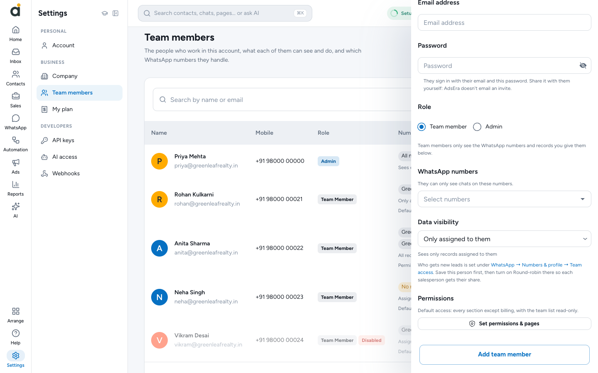
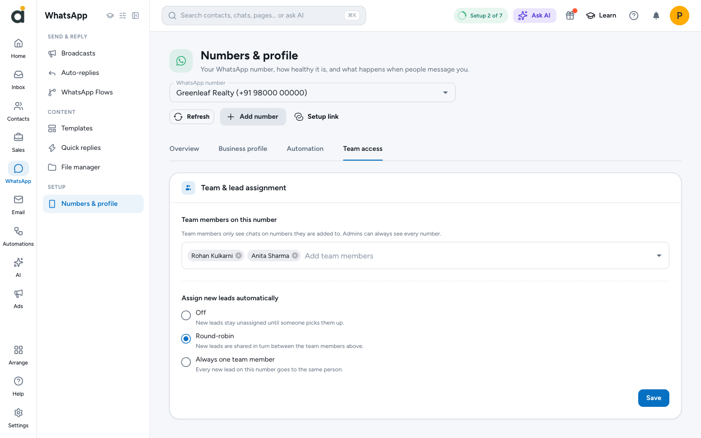

You have two or more salespeople and you want each of them to see **only their own leads**, with new leads shared out fairly. AdsEra does this with two settings in two places. You need both:

1. **Data visibility** on each team member: what they can see. Set it in **Settings → Team members**.
2. **Assign new leads automatically** on your WhatsApp number: who gets each new lead. Set it in **WhatsApp → Numbers & profile → Team access**.

With only the first, new leads stay unassigned and nobody sees them. With only the second, everyone still sees everyone's leads.

<Tip>The **Data visibility** part of the team member window now has a link straight to **Team access**, and this lesson has a "Do it with me" guide in the Education hub (Sales → Give each salesperson only their own leads).</Tip>

## Step 1: what each salesperson can see

<Steps>
<Step title="Open Settings → Team members">[Open it →](https://app.adsera.in/setting/agents/list). Click **Add member** for a new salesperson, or **⋮ → Edit** on someone already there.</Step>
<Step title="Pick Team member as the Role">Admins always see everything, whatever you pick below.</Step>
<Step title="Under Data visibility pick Only assigned to them">

</Step>
<Step title="Save">Click **Add team member** (or **Save changes**).</Step>
</Steps>

| Data visibility | What they see | Use it when |
| --- | --- | --- |
| **All records** | Every contact, chat, deal and task on the WhatsApp numbers they can use. | A manager or a small team that shares everything. |
| **Assigned to them + unassigned** | Their own records, plus anything nobody has yet. | Salespeople pick up new leads themselves from a shared pool. |
| **Only assigned to them** | Only contacts, chats, deals and tasks given to them. | Each salesperson must see only their own leads. |

The WhatsApp numbers you tick for them under **WhatsApp numbers** also limit what they see: a team member sees nothing from a number they're not on.

## Step 2: who gets new leads

<Steps>
<Step title="Open WhatsApp → Numbers & profile">[Open it →](https://app.adsera.in/dashboard/channel/whatsapp?tab=team). Or click the link under Data visibility.</Step>
<Step title="Click the Team access tab">Only admins see it. Pick the **WhatsApp number** at the top if you have more than one.</Step>
<Step title="Add your salespeople to Team members on this number">Only these people get leads from this number.</Step>
<Step title="Under Assign new leads automatically pick Round-robin">

</Step>
<Step title="Click Save">You see "Team access saved". From now on, when someone with no owner sends a WhatsApp message to this number, they're given to the next person in turn.</Step>
</Steps>

| Assign new leads automatically | What happens |
| --- | --- |
| **Off** | New leads stay unassigned until someone picks them up. With **Only assigned to them**, nobody sees them: don't use Off with that setting. |
| **Round-robin** | A lead with no owner who messages this number goes to the next team member on the number, in turn. |
| **Always one team member** | Every lead with no owner who messages this number goes to the same person. Pick them under **Team member who gets every lead**. |

<Warning>Leads are given out **when they send a WhatsApp message to the number**. A lead that only filled in a form or a Meta lead form, and never messaged you, stays without an owner until it does. Give those an owner yourself (see the FAQ below), or start a [workflow](/help/automation/workflows) that sends them a WhatsApp first.</Warning>

## What changes for your salespeople

- **Prospects** lists only their leads. **Mine** isn't needed: everything they see is theirs.
- **Inbox**, **Contacts**, **Deals** and **Tasks** show only what's assigned to them.
- Admins still see everything, and can give a lead to someone else by changing its **owner** (on the contact, or **About this lead** in Prospects).

## Troubleshooting

| What you see | Why, and what to do |
| --- | --- |
| A salesperson sees nothing at all | They're on **Only assigned to them** but nothing is assigned yet: turn on Round-robin (Step 2), or give them some contacts by changing the owner. Also check they're ticked under **WhatsApp numbers**. |
| New leads aren't shared out | Check **Team access** on the right WhatsApp number: Round-robin on, and the person listed under **Team members on this number**. |
| A salesperson sees someone else's leads | Their Data visibility is **All records** or **Assigned to them + unassigned**. |
| The **Team access** tab is missing | Only admins see it. |

## FAQs

<AccordionGroup>
<Accordion title="Does Round-robin give out my old contacts too?">
Only when they message the number again: any contact with no owner who sends a message is given out. Contacts that already have an owner keep it. To share out older contacts now, in Contacts tick them and use **More actions → Assign owner**.
</Accordion>
<Accordion title="Can a manager see everyone's leads but not change settings?">
Make them a Team member with **All records**, and limit what they can open with **Set permissions & pages** in the same window.
</Accordion>
<Accordion title="I have two WhatsApp numbers.">
Team access is per number. Set it on each one.
</Accordion>
</AccordionGroup>

## Related

<CardGroup cols={2}>
<Card title="Prospects" icon="list-check" href="/help/sales/prospects">Each salesperson's daily list.</Card>
<Card title="Work as a team in the inbox" icon="users" href="/help/inbox/team">Assign chats, take over and hand back.</Card>
</CardGroup>
