**Prospects** is where a salesperson spends the day. It looks at every lead you can see, decides who is worth contacting today and why, and puts them in order: people who just replied first, new enquiries next, promised follow-ups after that. You open one lead at a time, reach out, tap what happened, and move on. Prospects plans the next step for you, so nobody is forgotten.

**Where:** **Sales → Prospects** in the menu on the left. [Open it →](https://app.adsera.in/dashboard/crm/prospects)

**Who can use it:** anyone with access to Contacts. Everyone sees the leads they are allowed to see (see [Give each salesperson their own leads](/help/sales/own-leads)). Only admins see the **Team** view and **Prospects settings**.

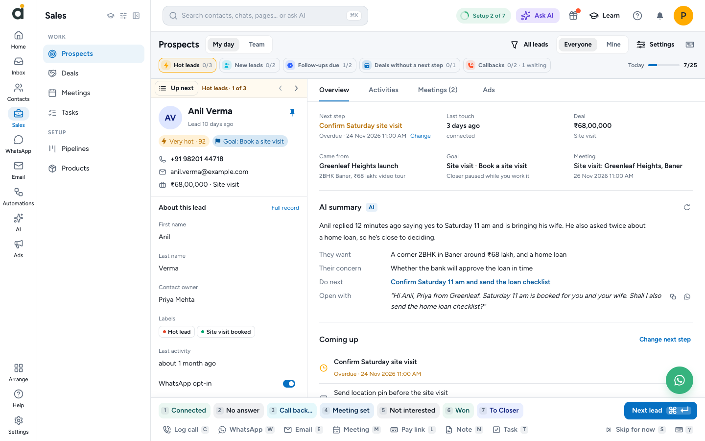

## Start your day

When you open Prospects in the morning you see **today's mission**: how many leads are waiting, split into **levels**.

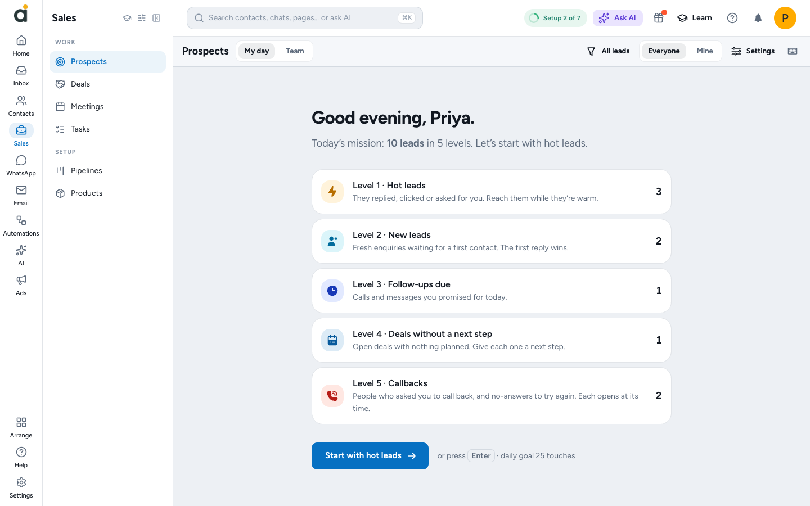

| Level | Who is in it | Why this order |
| --- | --- | --- |
| **Hot leads** | People who replied, clicked your email, came back to your website or asked for a person. | Reach them while they're warm. |
| **New leads** | Fresh enquiries from WhatsApp, forms and ads that nobody has contacted yet. | The first business to reply usually wins. |
| **Follow-ups due** | Calls and messages you promised for today. | You said you would. |
| **Deals without a next step** | Open deals with nothing planned for over 2 days. | Give each one a next step. |
| **Everyone else** | The best 40 of the rest. | A nudge when the rest is done. |
| **Callbacks** | People who asked you to call back, and no-answers to try again. | Each one opens at its own time, with an alert. |

<Steps>
<Step title="Click Start with…">The button names your first level, like **Start with hot leads**. You can also press **Enter**. Your first lead opens.</Step>
<Step title="Work the lead">Read why they're on your list, then call, WhatsApp or email them. See below.</Step>
<Step title="Tap what happened">One of the seven outcome buttons at the bottom. Prospects plans the next step.</Step>
<Step title="Click Next lead">The next open lead in the level opens. When a level is finished you see **… cleared** with a **Start level N** button. When every level is done you see **Mission complete**.</Step>
</Steps>

The bar at the top shows each level with its progress (like **Hot leads 1/3**) and, on the right, **Today**: the outcomes you logged against your daily goal (like **7/25**). Click a level to see its leads.

<Note>New leads that arrive during the day join their level by themselves. A lead you already worked today doesn't come back unless a callback or retry for it comes due.</Note>

## Read a lead

| Part | What it shows |
| --- | --- |
| **Score chip** (left, under the name) | How likely they are to act now: **Very hot**, **Hot**, **Warm** or **Cool**, with a score from 0 to 100. It goes up when they reply on WhatsApp, click your email, visit your website, have a payment link waiting or a big deal open; it goes down when you reached them a moment ago or they ignore Closer's follow-ups. |
| **Goal chip** | The [Closer](/help/ai/closer) goal they belong to, if any. |
| Phone, email | Click to copy. |
| Deal line | The open deal's value and stage. Click it to open the deal. |
| **About this lead** | Every field, editable in place: owner, labels, city, budget… **Full record** opens the contact page. |
| **Pin** (top right of the lead) | Keeps the lead at the top of today's list. Press **P**. |
| **Next step** | What's planned and when. **Overdue** in orange when it's late. **Change** plans another. |
| **Last touch** | When someone last logged an outcome, and which one. |
| **Deal**, **Came from**, **Goal**, **Meeting** | The deal value and stage, the ad or source they came from, the Closer goal and the next booked meeting. |
| **Why they're on your list** | The reasons Prospects picked them today, like "Replied on WhatsApp 12 min ago" or "New ad lead · waiting 6 min for a first contact". |
| **Coming up** | The next step, open tasks and upcoming meetings. |
| **Recent activity** | The last five things that happened. **All activities** opens the full list. |

### The AI summary

The **AI summary** is written from their chats, calls, notes, emails and deal:

| Line | Example |
| --- | --- |
| First paragraph | Why they're worth calling now, with facts. |
| **They want** | "A corner 2BHK in Baner around ₹68 lakh, and a home loan" |
| **Their concern** | "Whether the bank will approve the loan in time" |
| **Do next** | "Confirm Saturday 11 am and send the loan checklist" |
| **Open with** | The first sentence to say, in the language they use (English, Hindi or Hinglish). Copy it, or click the WhatsApp icon to put it in their chat box. |

A summary is kept for 6 hours. Click the refresh icon to write it again from the latest messages. Writing a summary uses [AI credits](/help/ai/credits).

### The tabs

| Tab | What's in it |
| --- | --- |
| **Overview** | Everything above. |
| **Activities** | Every note, email, call, meeting, WhatsApp message and task, grouped by month. Filter with **All activities**, **Notes**, **Emails**, **Calls & meetings**, **WhatsApp**, **Tasks**. |
| **Meetings** | Booked and logged meetings with **Join** and a WhatsApp button to send the link. **Schedule** books one; **Log a meeting** records one that happened. |
| **Ads** | The Meta ad they came from: campaign, ad, picture or video. |

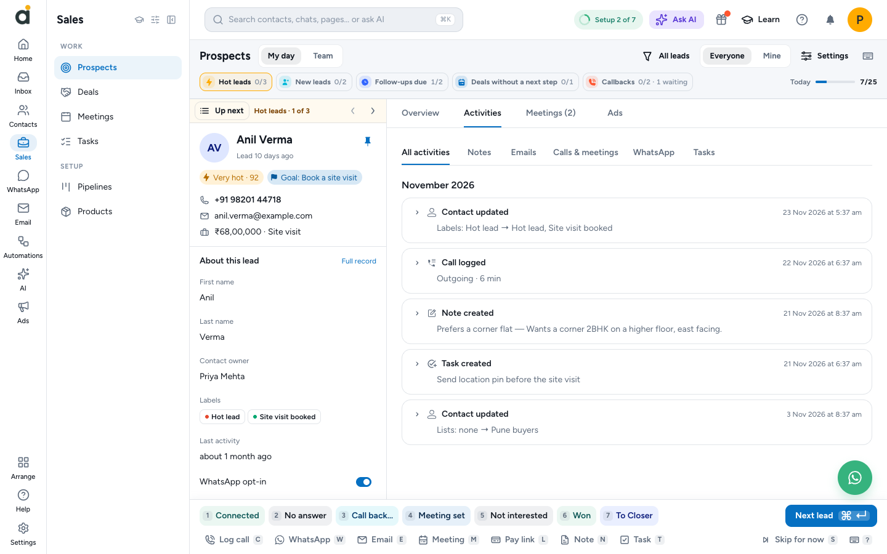

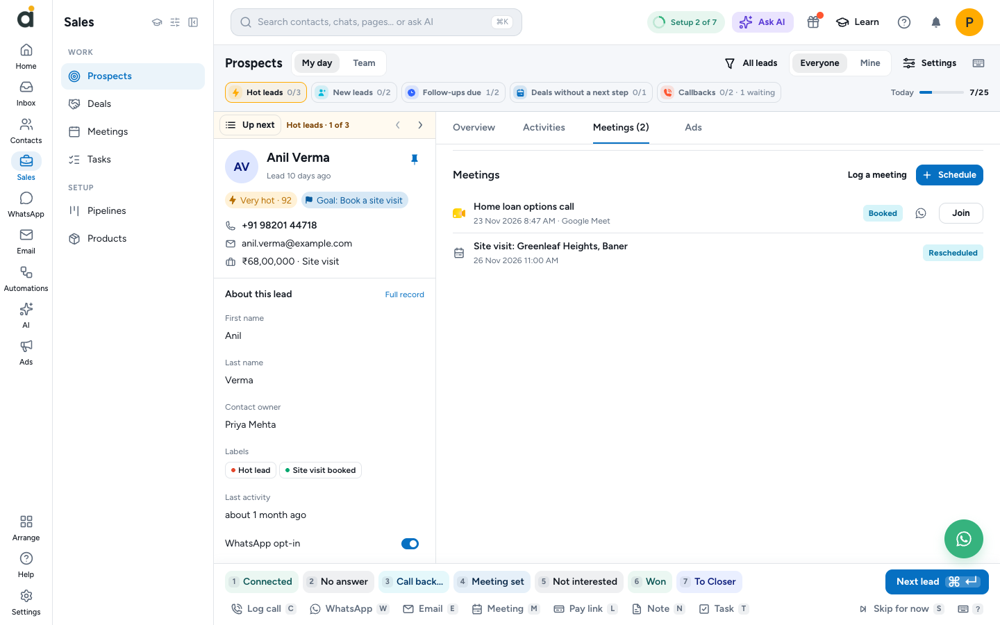

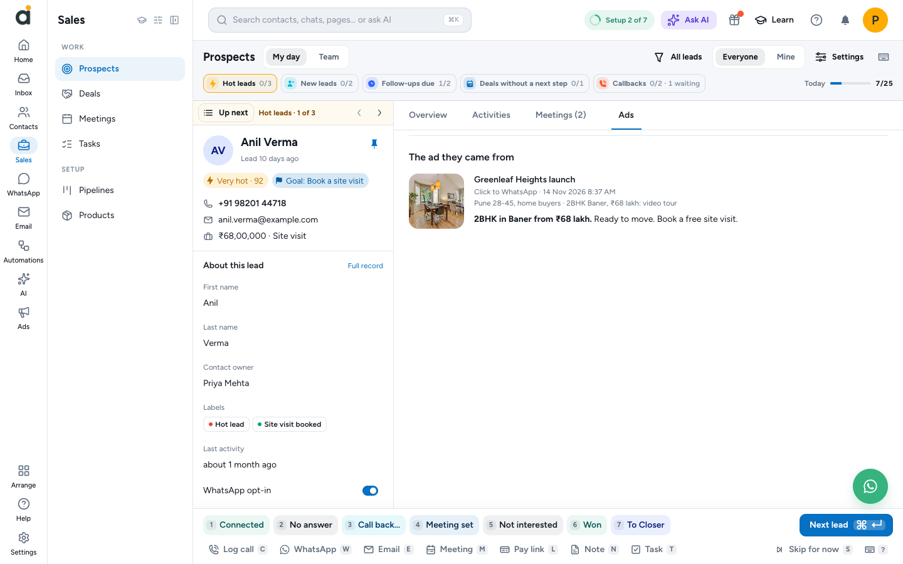

## Reach out

The second row of the bottom bar. Each button shows its keyboard key.

| Button | Key | What it does |
| --- | --- | --- |
| **Log call** | C | Write down a call you made from your phone. |
| **WhatsApp** | W | Opens their chat beside the lead (on a narrow screen, the green button on the right). |
| **Email** | E | Writes an email from your connected mailbox. Greyed out when they have no email address. |
| **Meeting** | M | Books a time on your Cal.com or Calendly. See [Meetings](/help/sales/meetings). |
| **Pay link** | L | Sends a payment request for their open deal. Greyed out without an open deal. See [Collect a payment](/help/crm/deal-payments). |
| **Note** | N | Adds a note to the lead. |
| **Task** | T | Adds a task, already named "Follow up with …". |

### WhatsApp with an AI draft

<Steps>
<Step title="Open the chat">Click **WhatsApp** or press **W**. On a wide screen the chat is already on the right; on a smaller one it slides in.</Step>
<Step title="Say what the message should say">Type it in **What should the message say?**, like "confirm Saturday 11 am and send the loan checklist". Leave it empty and AI writes the best next message from the conversation.</Step>
<Step title="Click Draft">
The draft lands in the reply box. Read it, change anything, and send it.

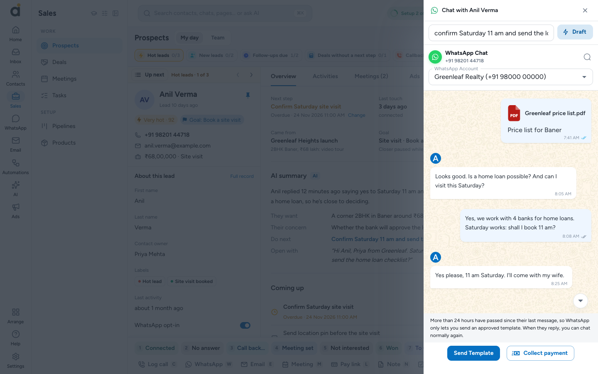
</Step>
</Steps>

You can reply freely for 24 hours after the lead's last message. After that, WhatsApp only allows an approved template: see [The 24-hour rule](/help/inbox/24-hour-window). Drafts use AI credits.

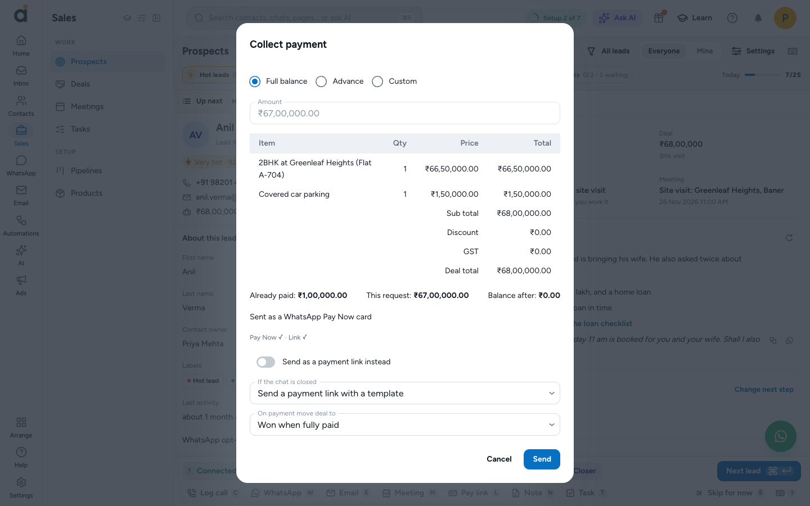

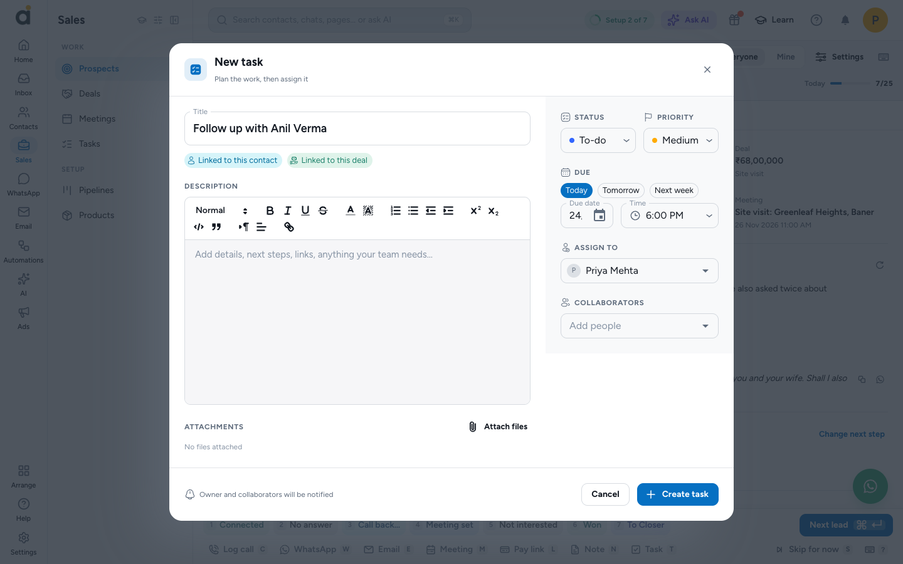

## Log what happened

The top row of the bottom bar. Tap one after every call or message. Each one counts as a **touch** towards your daily goal.

| Outcome | Key | What happens |
| --- | --- | --- |
| **Connected** | 1 | You spoke. The call log opens: notes and, if you like, a follow-up task. |
| **No answer** | 2 | Saved at once, no window. Prospects plans the next try: **in 2 hours** (tomorrow 11 am if that's after 7 pm), then **tomorrow at the other end of the day**, then **in 2 days**, then **every 3 days** with a hint to try WhatsApp or Closer. The lead waits in **Callbacks**. |
| **Call back…** | 3 | They asked for a time. Pick it; a call-back task is made and the lead waits in **Callbacks** until then. |
| **Meeting set** | 4 | A meeting is booked. If your pipeline has a meeting stage after the deal's current one (a name with meet, demo, visit, appointment or consult), you can move the deal there in the same step. |
| **Not interested** | 5 | Pick why: **Too expensive**, **Bought elsewhere**, **Not the right time**, **Just browsing**, **Wrong number** or **Other**. The lead leaves your list and Closer stops following them. |
| **Won** | 6 | The sale is done. You can move the deal to its Won stage. With no open deal, the lead is marked won and leaves your list. |
| **To Closer** | 7 | Hands the lead to [Closer](/help/ai/closer), the AI that keeps following up on WhatsApp. Needs a Closer goal. |

After you log an outcome you stay on the same lead, so you can still send a message or add a task. Click **Next lead** when you're done.

### The call log

Every outcome except No answer opens **Log call with …**:

| Field | What to put | Required? |
| --- | --- | --- |
| **Outbound** / **Inbound** | Outbound if you called them, Inbound if they called you. | Yes (Outbound by default) |
| **Duration** | 1 to 60 minutes, or **Not noted**. | No |
| **Call date** and **Time** | Now by default. Change it to log an earlier call. | Yes |
| **Why not?** | Only for Not interested: pick a reason. | Yes, for Not interested |
| **Move the deal to "…"** | Only for Meeting set and Won, when the stage exists. Ticked by default. | No |
| **Call notes** | What they said, what they need, anything to remember. | No |
| **Also create a follow-up task** | Switch on to add a task: its name, a quick time (**In 30 min**, **In 1 hour**, **In 2 hours**, **This evening**, **Tomorrow 11 am**, **In 2 days**, **Next week**) or a date and time. Always on for Call back. | No |

Click **Log call** (or **Log call and task**).

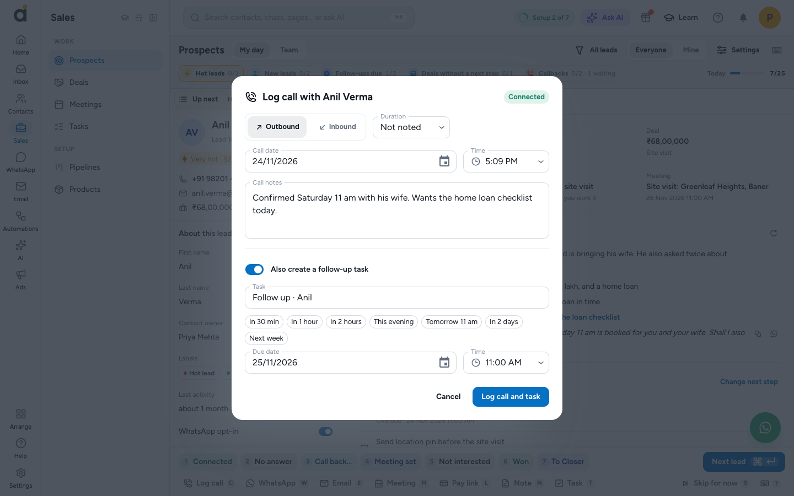

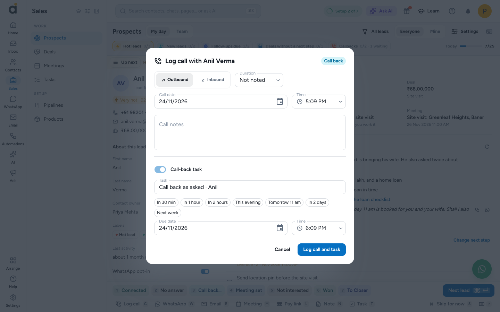

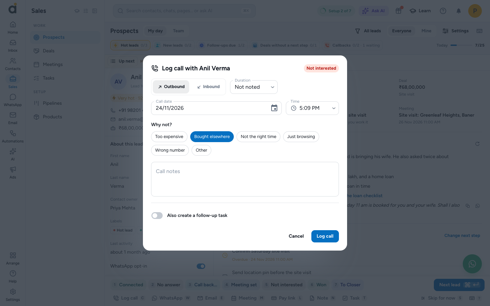

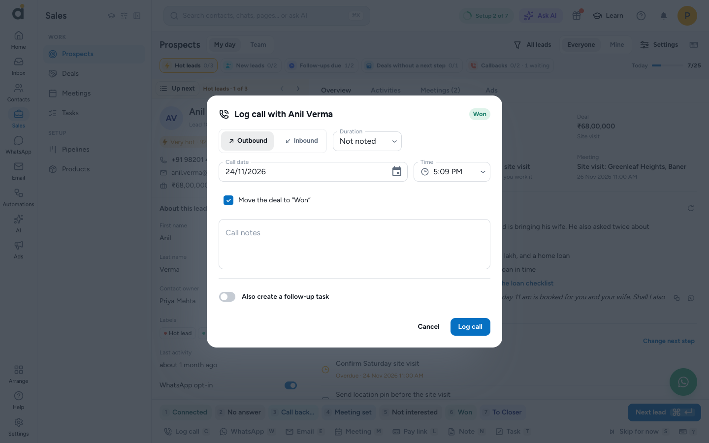

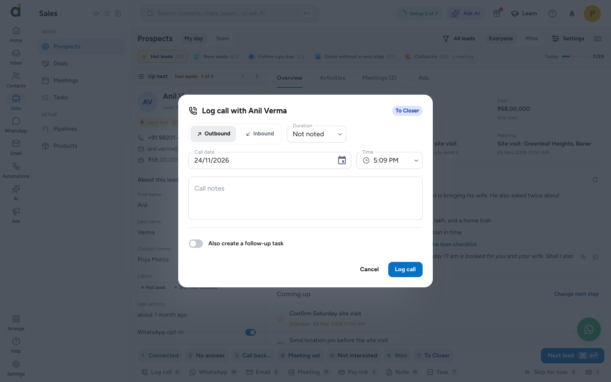

## Callbacks

- The red chip at the top shows the next callback today, like **Callback 5:30 pm, Rohan Patil** (or **3 callbacks · next 5:30 pm…**). Point at it to see all of them; click it to open that lead now.
- At the time, a message pops up: "Rohan Patil asked you to call back now (5:30 pm)" with **Call now**. If your browser allows notifications and AdsEra is in another tab, you get a notification too.
- A lead waiting for its time shows **Waiting · Call back at 5:30 pm, as they asked** in the list and is never offered as the next lead before then.

## Plan the next step

**Coming up** has **Plan next step** (or **Change next step**). It opens **Plan the next step**: a task name, quick times and a date. Click **Save**. It becomes a task on that day.

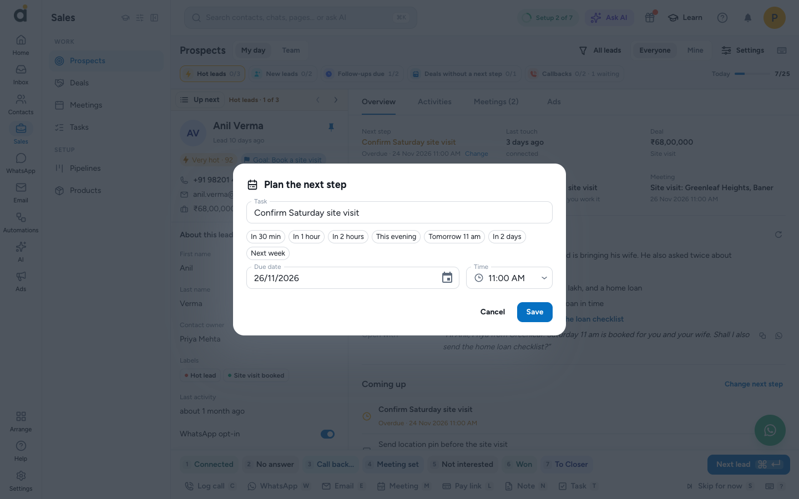

## Move around

| Button | Key | What it does |
| --- | --- | --- |
| **Next lead** | J, or ⌘ ↵ on a Mac / Ctrl ↵ on Windows | Next open lead in the level. |
| Arrows next to the level name | K / J | Previous / next lead in the level. |
| **Up next** | U | Every level and its leads. Click one to jump to it; **Back** returns. |
| **Skip for now** | S | Puts the lead aside for today. |
| Pin | P | Keeps the lead at the top of today's list. |

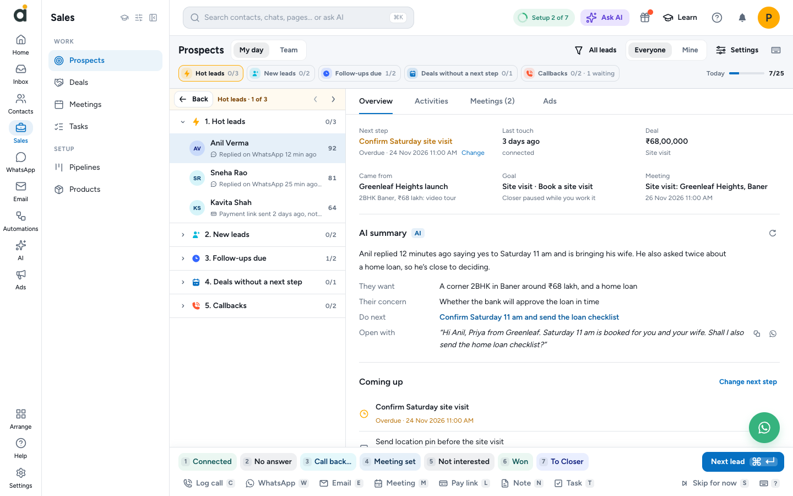

## Choose which leads you get

- **All leads** (the funnel button at the top) opens **Take leads from**: pick one or more [segments](/help/audiance/segment) and click **Apply**. Your list then only takes leads from those segments. **Show all leads** clears it. This only changes your own list.
- Admins also see **Everyone** / **Mine**. **Mine** keeps only the leads assigned to you.

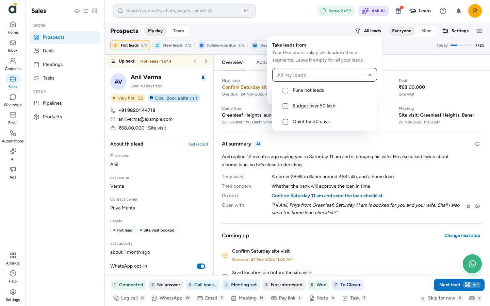

## Team view (admins)

Click **Team** at the top. Each row is a team member who logged an outcome in the last 7 days:

| Column | Meaning |
| --- | --- |
| **Team member** | Their name. |
| **Today vs goal** | Outcomes logged today against the daily goal, with a bar. |
| **Connected**, **Meetings**, **Won** | How many of today's outcomes were Connected, Meeting set and Won. |
| **This week** | Outcomes logged in the last 7 days. |

Change **Daily goal per person** (1 to 500, 25 to start) and click **Save**. Click **My day** to go back to your own leads.

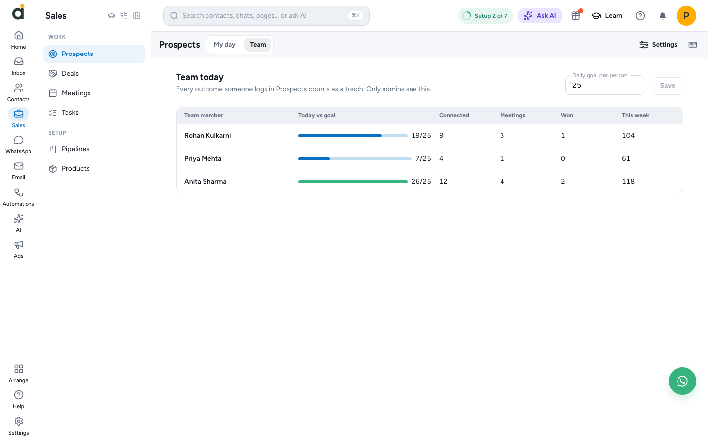

## Prospects settings (admins)

Click **Settings** at the top right. Three tabs:

| Tab | What you set | What it does |
| --- | --- | --- |
| **Good leads** | Pick a question from your lead forms (like **Budget range**) and tick the answers your best customers give. Up to 6 questions. | Leads with those answers rank higher in everyone's Prospects, with "Good fit: …" as the reason. |
| **Junk** | Answers that mean junk, like Lead status **Junk** or **Wrong number**. | Those leads never show in Prospects, and Closer stops following them. Leads marked Not interested are treated the same way. |
| **Rules** | "When **[outcome]** set **[field]** to **[value]**", or "When **No answer, days in a row** (2 to 30 days) set …". Up to 20 rules. | Keeps fields up to date as people call, like Connected → Lead status "Contacted". |

Click **Save**. The number next to each answer is how many leads gave it.

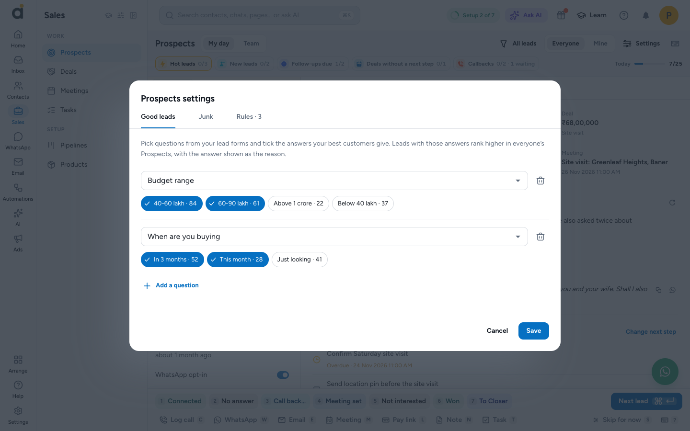

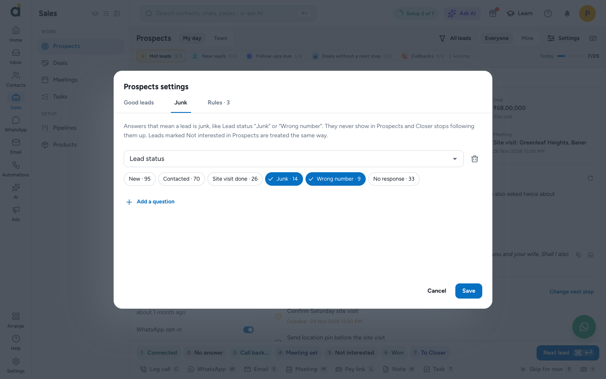

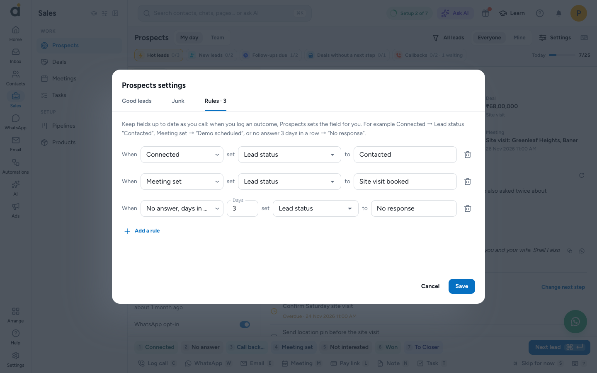

## Keyboard shortcuts

Press **?** or click the keyboard icon. Keys don't work while you are typing in a box.

| Group | Keys |
| --- | --- |
| Move | **J** next lead (or ⌘ ↵ / Ctrl ↵), **K** previous, **S** skip, **P** pin, **U** up next |
| Reach out | **C** call, **W** WhatsApp, **E** email, **M** meeting, **L** pay link, **N** note, **T** task |
| Log what happened | **1** Connected, **2** No answer, **3** Call back, **4** Meeting set, **5** Not interested, **6** Won, **7** To Closer |
| Help | **?** shows the shortcuts |

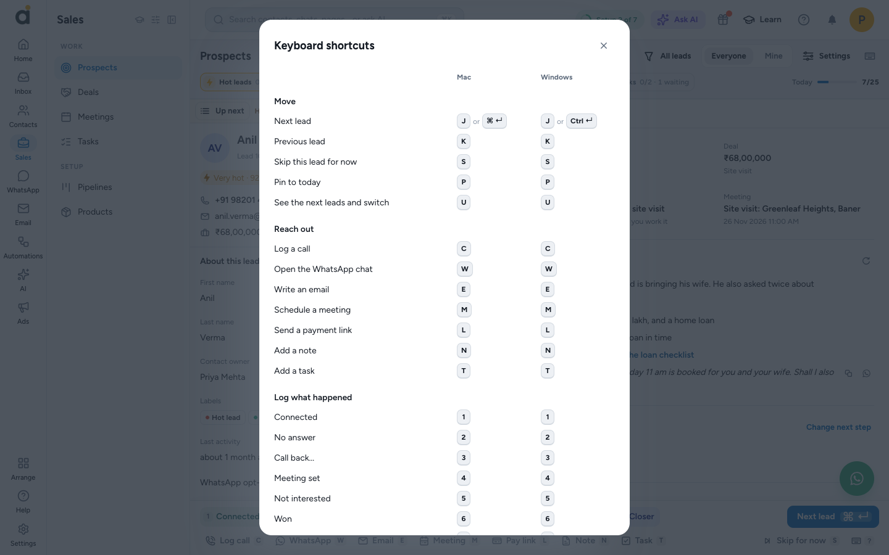

## When there's nothing to do

A brand-new account has no leads yet. Prospects says "Nothing waiting right now" with **Connect WhatsApp** and **Add contacts**. New leads from WhatsApp, forms and ads, and the follow-ups you plan, show up here.

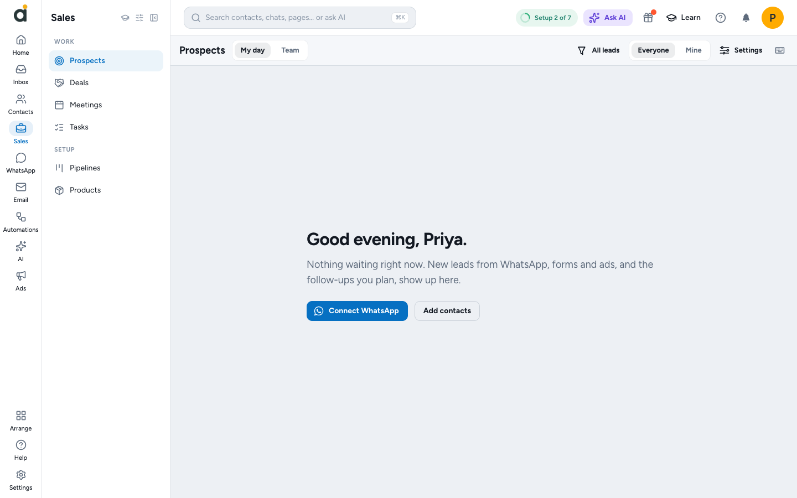

## Troubleshooting

| What you see | What to do |
| --- | --- |
| "Set up a Closer goal first, then hand leads to it" | To Closer needs an active Closer goal. Make one under **AI → Closer**. |
| **Pay link** is greyed out: "Needs an open deal" | Add a deal for the lead (Sales → Deals → New deal), then try again. |
| **Email** is greyed out: "No email address" | Add their email under **About this lead**. |
| "The summary couldn't be written. Try again" | Click **Try again**. Check you have AI credits left (AI → AI credits). |
| A salesperson sees leads that aren't theirs | Their Data visibility is "All records" or "Assigned to them + unassigned". See [Give each salesperson their own leads](/help/sales/own-leads). |
| I don't see Team or Settings | Only admins see them. |

## FAQs

<AccordionGroup>
<Accordion title="How does Prospects decide who's hot?">
It adds points for signals: a WhatsApp reply in the last hour (the most), a new enquiry waiting for a first reply, a callback or follow-up that's due, a good-fit answer, a click on your email, a payment link not yet paid, a recent website visit, a big deal open or close to the end. It takes points off when you reached them in the last 4 hours or they ignore Closer. 80 and over is **Very hot**, 60 to 79 **Hot**, 40 to 59 **Warm**, below 40 **Cool**.
</Accordion>
<Accordion title="Does logging an outcome send anything to the lead?">
No. Outcomes are notes for your team and plan your next step. Only WhatsApp, Email, Meeting and Pay link reach the lead.
</Accordion>
<Accordion title="What counts towards the daily goal?">
Every outcome you log (all seven buttons). Notes, tasks and messages alone don't count.
</Accordion>
<Accordion title="I skipped a lead by mistake.">
Open **Up next**, find it in its level and click it.
</Accordion>
<Accordion title="Do AI summaries cost money?">
They use AI credits, like the rest of AdsEra's AI. A summary is kept for 6 hours, so opening the same lead again is free.
</Accordion>
</AccordionGroup>

## Related

<CardGroup cols={2}>
<Card title="Give each salesperson their own leads" icon="user-lock" href="/help/sales/own-leads">Data visibility plus Round-robin.</Card>
<Card title="From lead to payment" icon="route" href="/help/sales/lead-to-payment">The whole journey, step by step.</Card>
<Card title="Deals" icon="handshake" href="/help/crm/deal">Track every sale by stage.</Card>
<Card title="Meetings" icon="calendar" href="/help/sales/meetings">Book and log meetings.</Card>
</CardGroup>
