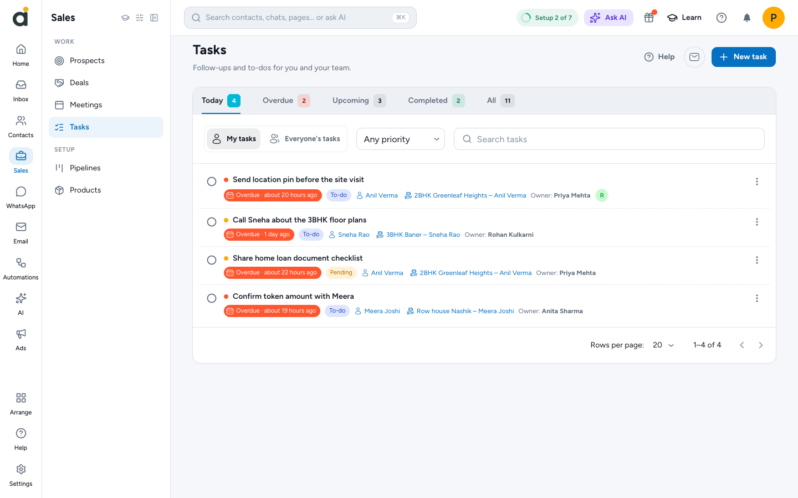
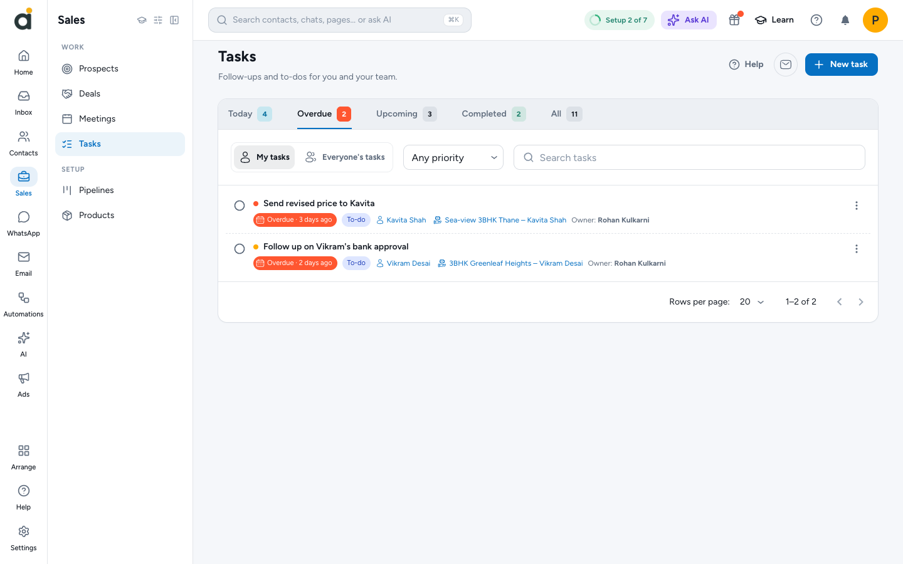
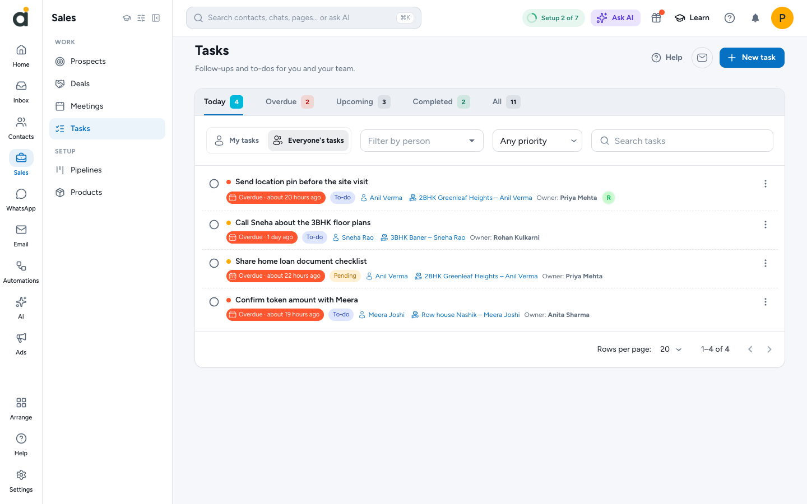
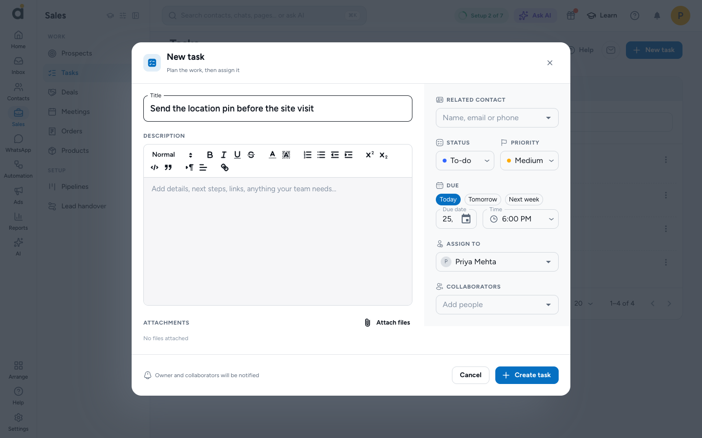
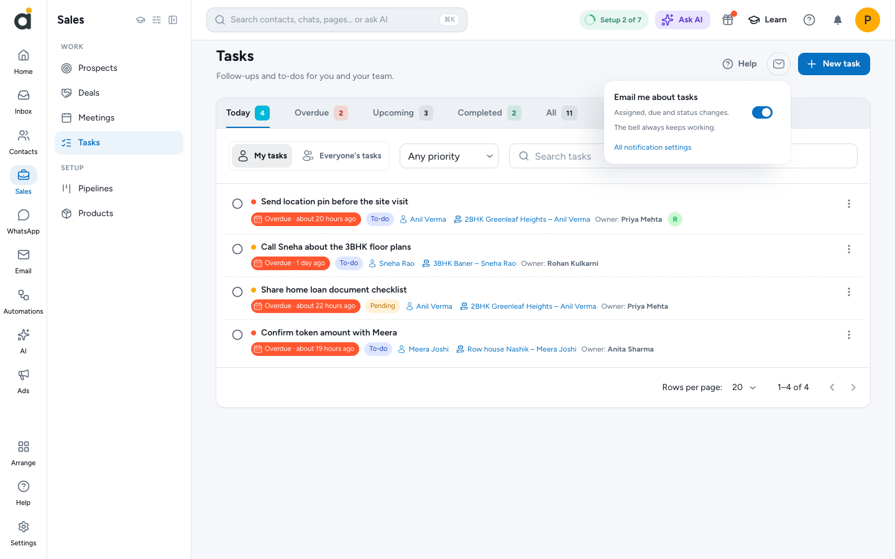
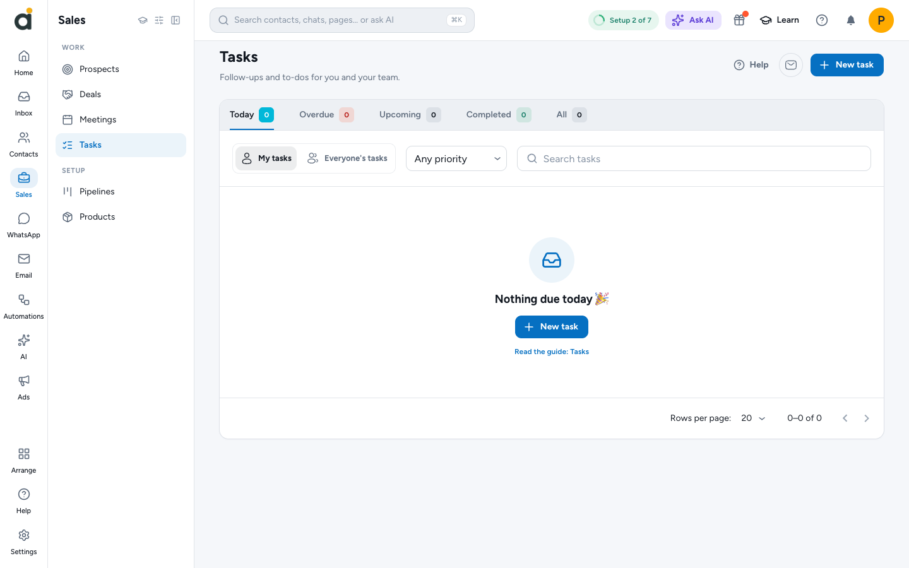

**Tasks** are the things your team has to do, each with a due date and an owner: call a lead back, send the floor plan, collect the token cheque. The owner gets a reminder when it's due. Tasks are made by:

- your team, here or on a contact, a deal or in [Prospects](/help/sales/prospects) (key **T**, or the follow-up task after a call),
- Prospects itself, when you log **Call back…** or **No answer**,
- [Closer](/help/ai/closer), when a lead is ready for a person ("Call … now"),
- [workflows](/help/automation/workflows), with the **Create a task** step,
- [Addy](/help/ai/addy), when a customer asks something it can't answer.

**Where:** **Sales → Tasks** in the menu on the left. [Open it →](https://app.adsera.in/dashboard/crm/tasks)

## The list

| Tab | What it shows |
| --- | --- |
| **Today** | Due today. Ones already late today show their time in orange. |
| **Overdue** | Due before today and not done. |
| **Upcoming** | Due after today. |
| **Completed** | Done. |
| **All** | Everything. |

The number on each tab is how many.

| Filter | What it does |
| --- | --- |
| **My tasks** | Tasks you own or help with (collaborate on). |
| **Everyone's tasks** | Every task in your company. Only admins and team members who see all records have it. |
| **Filter by person** | With Everyone's tasks: only one person's. |
| **Any priority** | Only High, Medium or Low. |
| **Search tasks** | Finds tasks by their words. |

Each task shows a coloured dot for its priority (red High, orange Medium, blue Low), its title, when it's due, its status, the contact and deal it's about (click to open them), the owner and the collaborators' initials. Click a task to open it.

## Make a task

<Steps>
<Step title="Click New task">The **New task** window opens.</Step>
<Step title="Fill it in">
| Field | What to put | Required? |
| --- | --- | --- |
| **Title** | What to do: "Send the location pin before the site visit". | Yes |
| **Description** | Steps, links, anything the person needs. | No |
| **Attach files** | A brochure, an agreement, a photo. Pick from your files or upload one. | No |
| **Related contact** | The person it's about. The task shows on their record too. | No |
| **Status** | **To-do** (not started), **Pending** (started or waiting on someone) or **Completed**. | Yes (To-do by default) |
| **Priority** | **High**, **Medium** or **Low**. | Yes (Medium by default) |
| **Due** | **Today**, **Tomorrow**, **Next week**, or a **Due date** and time. | Yes |
| **Assign to** | The owner: the person who does it. You by default. | Yes |
| **Collaborators** | People who help or should know. | No |

</Step>
<Step title="Click Create task">The owner and collaborators get a notification in AdsEra and an email, and a reminder when it's due.</Step>
</Steps>

A task made from a deal or a lead is linked to it: you see a chip like "Linked to this deal".

## Work through your tasks

- Click the **circle** at the start of a task to mark it done. Click again to undo.
- **⋮ → Edit** opens it. Change anything and click **Save changes**. "Changes notify the people involved."
- **⋮ → Delete** asks "Delete "…"? This cannot be undone." Click **Delete**.

## Task emails

The envelope next to **New task** turns task emails on or off for you: **Email me about tasks** (assigned, due and status changes). The bell in AdsEra keeps working either way. **All notification settings** opens the rest of your notifications.

## When there are no tasks

Each tab says so ("Nothing due today 🎉", "No overdue tasks"…), with a **New task** button.

## Troubleshooting

| What you see | What to do |
| --- | --- |
| "Give the task a title" | The title is required. |
| A teammate didn't get the email | They may have turned task emails off (envelope on their Tasks page). The bell still shows it. |
| I don't see Everyone's tasks | Only admins and team members who see all records have it. |

## FAQs

<AccordionGroup>
<Accordion title="What's the difference between To-do and Pending?">
**To-do** hasn't started. **Pending** has started but is waiting, like "sent the agreement, waiting for the signature". Both show on Today, Overdue and Upcoming until they're **Completed**.
</Accordion>
<Accordion title="Can a workflow react to a task?">
Yes. A workflow with the trigger **A task changes** can act when a task is made, done or becomes overdue.
</Accordion>
</AccordionGroup>

## Related

<CardGroup cols={2}>
<Card title="Prospects" icon="list-check" href="/help/sales/prospects">Follow-up tasks after every call.</Card>
<Card title="Deals" icon="handshake" href="/help/crm/deal">Tasks on a deal.</Card>
</CardGroup>
