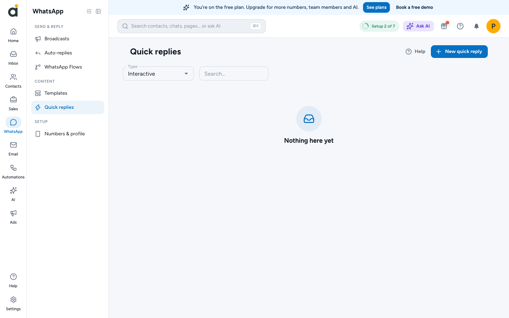

Creating quick replies in AdsEra allows you to build a library of powerful, reusable message blocks that your agents can use to respond to customers quickly and consistently. The creator provides a live preview on the right, so you can see your message take shape as you build it.

Open [WhatsApp → Quick replies &rarr;](https://app.adsera.in/dashboard/snippets/list) and click **New quick reply**.

### The quick reply creation process

After navigating to the [Quick replies](https://app.adsera.in/dashboard/snippets/list) page and clicking **"New quick reply"**, you will be guided through the following steps.

<Steps>

<Step title="1. Basic Setup: Name and Type">
  Every quick reply starts with two essential settings:

  - **Name:** A clear, internal name for the quick reply (e.g., "Welcome Message," "Pricing Inquiry"). This is what your agents will search for in the Chat Inbox to find the right quick reply.
  - **Type:** The kind of message you want to create. The options available in the builder will change based on the type you select here. The available types are:
    - **Text:** A simple text-only message.
    - **Image:** An image with an optional caption.
    - **Video:** A video with an optional caption.
    - **Document:** A document (like a PDF) with an optional caption.
    - **Interactive:** A message that includes a header, body, footer, and interactive buttons or lists.
</Step>

<Step title="2. Composing Your Quick reply Content">
  This is where you'll build the actual message. The interface will adapt based on the **Type** you selected in Step 1.

  <Tabs>
  <Tab title="Text replies">
    This is the most straightforward quick reply type, perfect for simple text replies.

    - **Text:** Write your message in the main text box. You have up to 4096 characters.
    - **Add personalization:** Click this button to insert variables like `{{FIRSTNAME}}` or `{{CODE}}` that will be automatically replaced with the contact's data.
    - **Link Preview:** If your text contains a URL (e.g., `https://adsera.in`), check this box to automatically generate a rich link preview thumbnail in the WhatsApp chat.
  </Tab>

  <Tab title="Media replies (Image/Video/Document)">
    These quick replies allow you to send files as quick replies.

    - **Adding Media:** You have two options to attach your file:
        - **Link:** Paste a direct public URL to your media file.
        - **Select Media:** Click this button to open the **File Manager** and choose a file you've already uploaded to AdsEra.
    - **Caption:** Add an optional text message (up to 1024 characters) that will be sent along with your media file. This field also supports personalization.
  </Tab>

  <Tab title="Interactive replies">
    These are the most powerful quick replies for guiding a conversation and prompting specific user actions.

    First, choose the **Interactive Type**:
    - **Button:** A message with up to 3 quick reply buttons.
    - **List:** A message with a single button that, when tapped, opens a list of up to 10 options for the user to choose from.

    Next, configure the components of your message:
    <AccordionGroup>
      <Accordion title="Header (Optional)">
        Add a header to your message. The header type can be **Text**, **Image**, **Video**, or **Document**. This is great for adding a title or visual element to grab attention.
      </Accordion>
      <Accordion title="Body">
        Write the main text content of your message (up to 1024 characters). You can use formatting (like `*bold*` and `_italic_`) and personalization variables here.
      </Accordion>
      <Accordion title="Footer (Optional)">
        Add a short line of text (up to 60 characters) at the bottom of your message, often used for a signature or a brief closing note.
      </Accordion>
      <Accordion title="Action: Buttons or List">
        This is where you configure the interactive elements:
        - **If Button Type:** You can add up to 3 quick reply buttons. Each button has a title with a 20-character limit.
        - **If List Type:** You must first set the main **Button Text** (e.g., "View Options"). Then, you can create one or more **Sections**, each with its own title. Within each section, you can add up to 10 **Rows**, each with a title and an optional description.
      </Accordion>
    </AccordionGroup>
  </Tab>
  </Tabs>
</Step>

<Step title="3. Finalize and Create">
  As you build your quick reply, use the **live Preview** on the right side of the screen to see exactly how your message will look on a mobile device.

  Once you are satisfied with your quick reply, click the **"Create"** button at the bottom to save it to your library. It will now be available for your agents to use in the [WhatsApp Chat Inbox](/help/inbox/chat).
</Step>
</Steps>