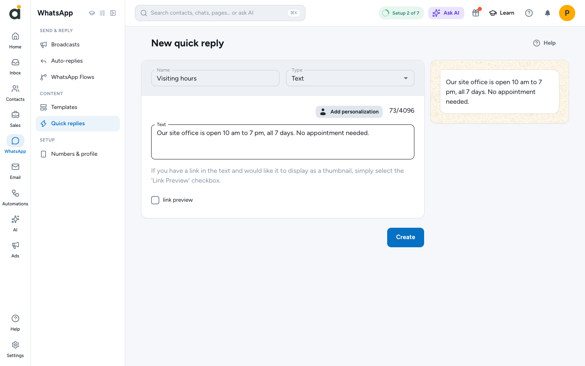
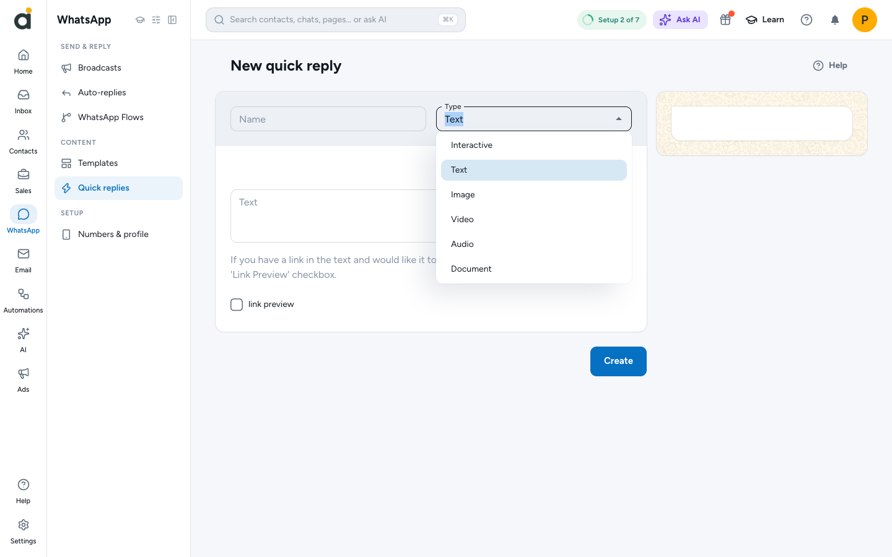
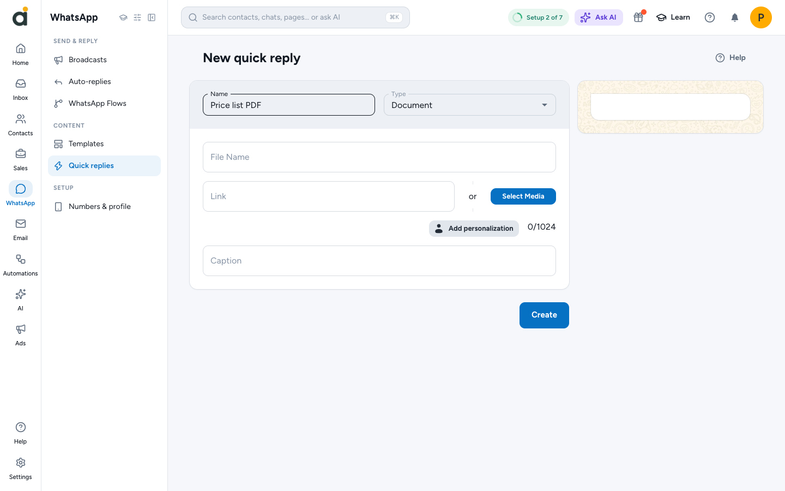
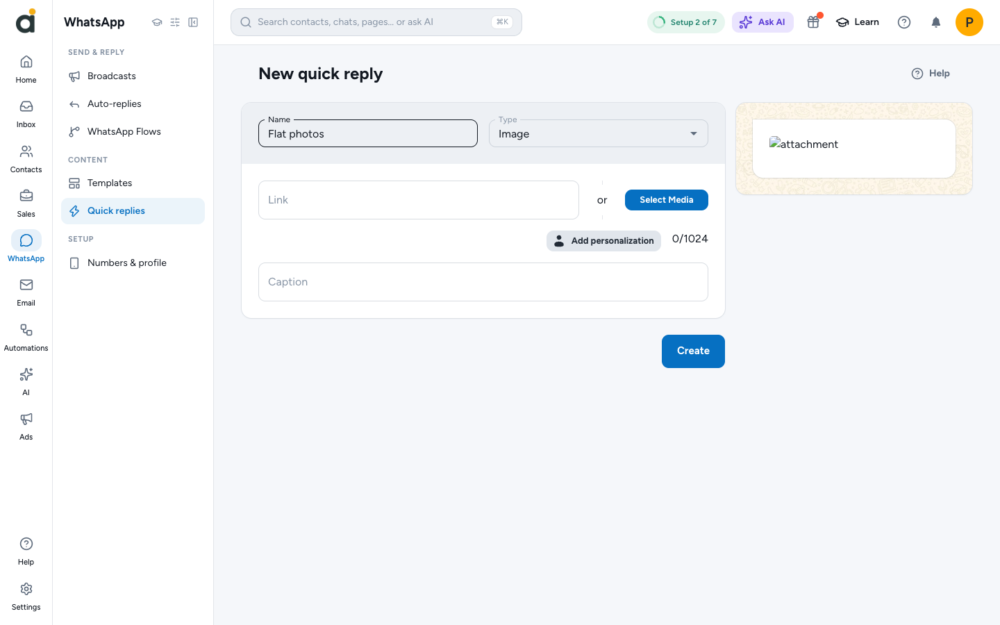

**Where:** **WhatsApp → Quick replies → New quick reply**. [Open it →](https://app.adsera.in/dashboard/snippets/create)

## Step by step

<Steps>
<Step title="Name it">In **Name**, something you will search when you type / in a chat, like “Visiting hours”.</Step>
<Step title="Pick the type">
  In **Type**, choose one:

  

  | Type | What it sends | Fields |
  | --- | --- | --- |
  | **Text** | Words only | **Text** (up to 4,096 characters), **Add personalization**, **Link preview** |
  | **Image** | A photo with a caption | **Select Media** (or **Link**), **Caption** |
  | **Video** | A video with a caption | **Select Media**, **Caption** |
  | **Audio** | A voice note or audio file | **Select Media** |
  | **Document** | A PDF or file | **Select Media**, **File Name**, **Caption** |
  | **Interactive** | Buttons, a list menu, a link button, a carousel, Pay Now and more | See [Buttons, lists and Pay Now](/help/snippet/interactive) |
</Step>
<Step title="Write it or add the file">
  For text, write it the way you would type it in a chat. **Add personalization** inserts the person’s name or another contact field, so it reads “Hi Ravi!”. Tick **Link preview** to show a preview of the first link.

  For media, click **Select Media** to upload or pick a file from your files, and add a caption.

  

  
</Step>
<Step title="Check the preview">The phone on the right shows how it looks.</Step>
<Step title="Create">Click **Create**. You land on the list for that type.</Step>
</Steps>

## Limits

| What | Limit |
| --- | --- |
| Text | 4,096 characters |
| Images | JPG or PNG, up to 5 MB |
| Video | MP4, up to 16 MB |
| Audio | Up to 16 MB |
| Documents | Up to 100 MB |

## Related

<CardGroup cols={2}>
  <Card title="Quick replies" icon="bolt" href="/help/snippet/list">Find, edit and use them.</Card>
  <Card title="Buttons, lists and Pay Now" icon="hand-pointer" href="/help/snippet/interactive">Interactive types.</Card>
</CardGroup>
