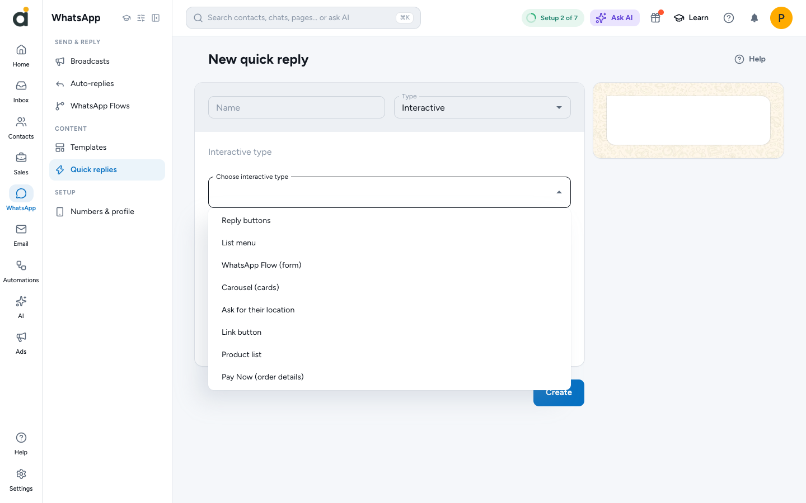
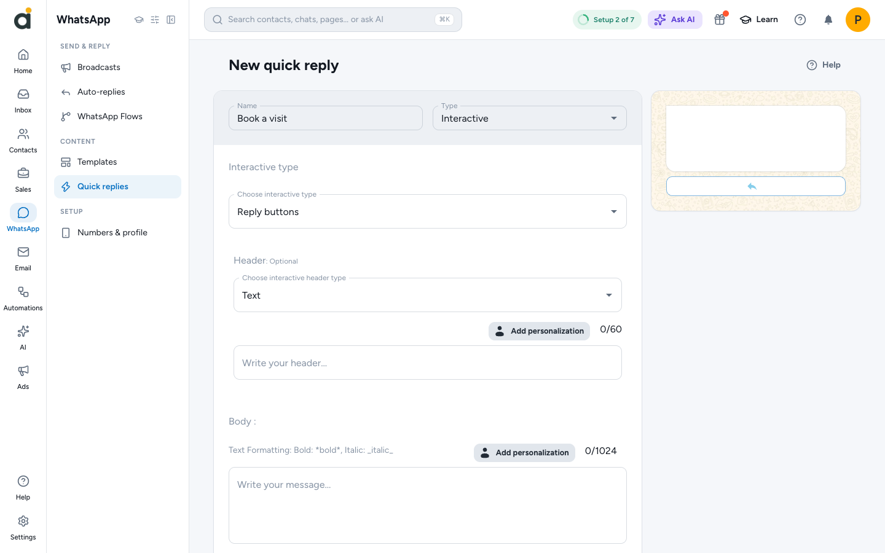
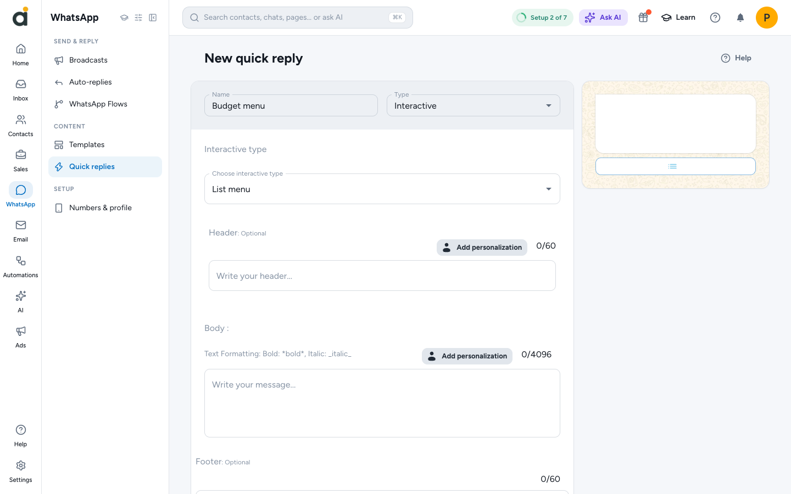
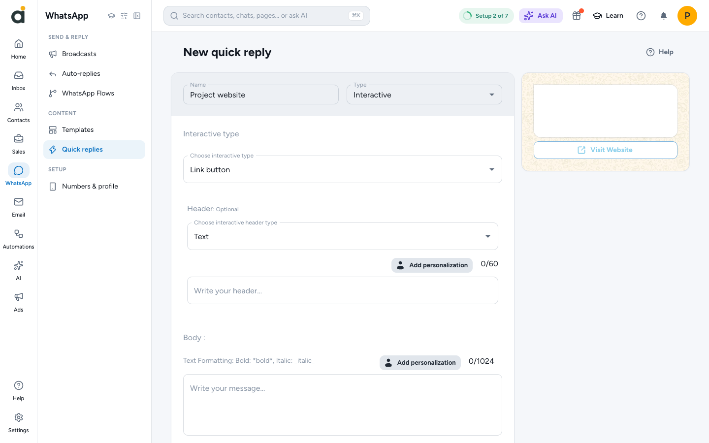
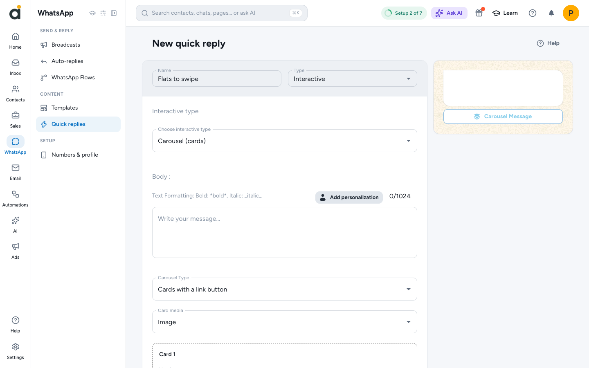
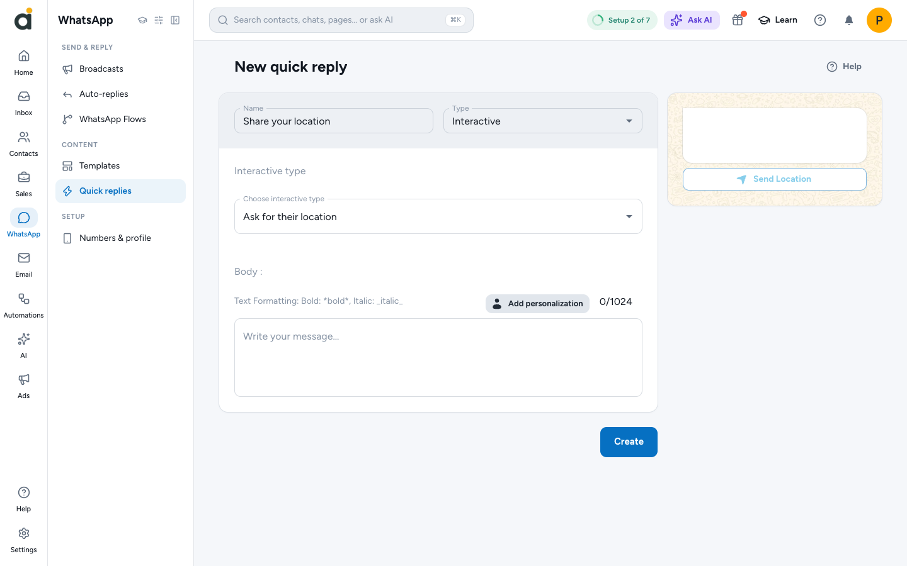
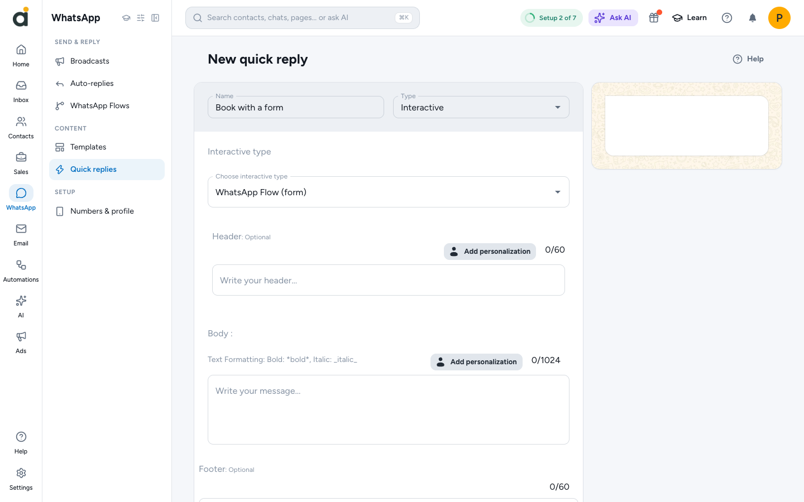
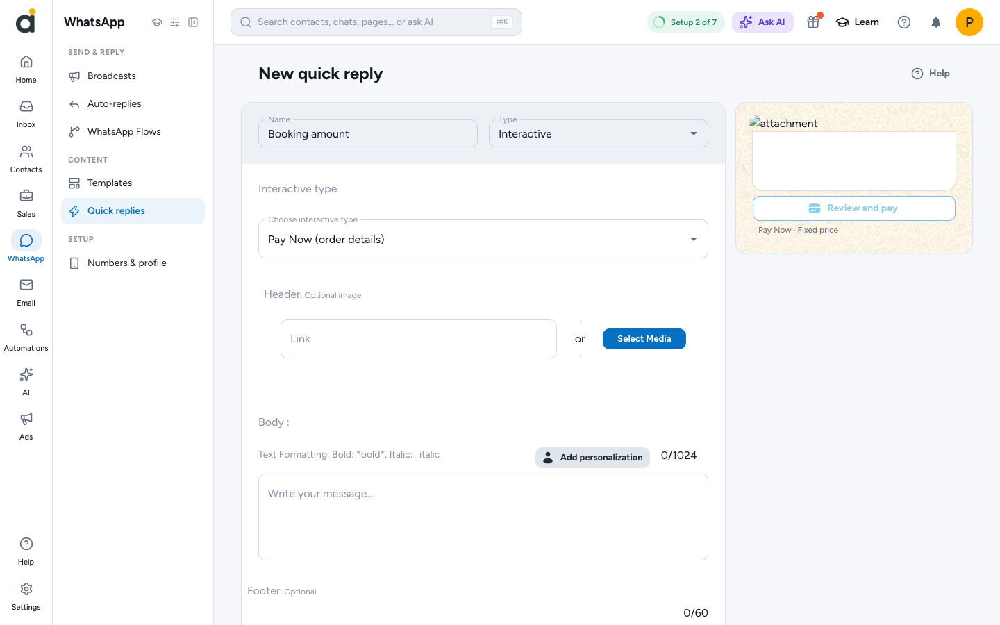

An **interactive** quick reply has buttons or a menu people tap. Answers arrive in your inbox like normal replies, and auto-replies can react to them.

**Where:** **WhatsApp → Quick replies → New quick reply** → **Type: Interactive** → **Choose interactive type**.

## The interactive types

| Type | What people see | You fill in | Good for |
| --- | --- | --- | --- |
| **Reply buttons** | Up to 3 buttons under the message | Header (optional: text, image, video or document), body, footer, button titles | “This Saturday / This Sunday / Call me” |
| **List menu** | A button that opens a menu of up to 10 choices in sections | **Button Text**, **Section Title**, **Row Title** and **Row Description** for each choice | Budgets, courses, branches |
| **Link button** | One button that opens a website | Header (optional), body, **Display Text**, **URL** | Project page, payment link |
| **Carousel (cards)** | 2–10 cards people swipe, each with media and a button | Each card’s image or video, text and button | Several flats or products |
| **Ask for their location** | A “Send location” button | Body | Home visits, deliveries |
| **WhatsApp Flow (form)** | A button that opens one of your published flows | **Button Text (Required)**, **Flow Action**, flow and **Starting Screen** per number | Bookings and sign-ups |
| **Product list** | Products from your Meta catalog | Header (required), body, **Catalog ID (from Meta Commerce Manager)**, sections with **Product ID (Content ID in your catalog)** | Showing products from your catalog |
| **Pay Now (order details)** | An order with a **Review and pay** button; they pay inside WhatsApp | Price from, Collect, items (see below) | Booking amounts, fees |

## Pay Now (order details)

Collect a payment inside WhatsApp (India, WhatsApp Pay). Your number needs WhatsApp Pay set up: see [WhatsApp Pay](/help/integrations/whatsapp-pay).

| Field | Options |
| --- | --- |
| **Price from** | **Fixed price: products or items set here**, or **The contact’s open deal** (the amount of their deal) |
| **Collect** | **Full amount**, or **An advance** (a fixed amount or a percent of the total) |
| **Items** | Pick a **Product** (and its billing option) with **Add product**, or **Add a custom item** with **Item name**, **Price (₹)**, **GST %** and **Qty** |
| **Total** | Worked out for you |

Pay Now can be sent from a chat or a WhatsApp Flow. It is not sent as an opt-in/opt-out reply, because it needs an order.

## Make one

<Steps>
<Step title="New quick reply">Click **New quick reply**, type a **Name**, choose **Interactive** in **Type**.</Step>
<Step title="Pick the interactive type">Choose it in **Choose interactive type** (see the table).</Step>
<Step title="Fill it">Header (when offered), **Body** (with **Add personalization**), footer, and the buttons or rows. Body text supports *bold* and _italic_.</Step>
<Step title="Create">Check the preview and click **Create**.</Step>
</Steps>

## Related

<CardGroup cols={2}>
  <Card title="Create a quick reply" icon="pen" href="/help/snippet/create">Text and media.</Card>
  <Card title="WhatsApp Flows" icon="diagram-project" href="/help/automation/whatsapp-flows">Forms inside WhatsApp.</Card>
</CardGroup>
