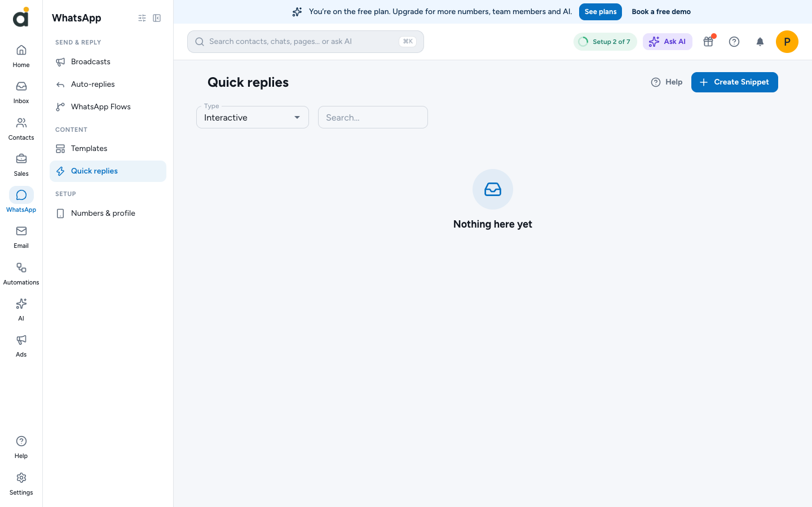

**Quick replies** are pre-written, reusable message blocks that your agents can quickly insert into conversations in the **WhatsApp Chat Inbox**. Type <kbd>/</kbd> in the reply box to find one and send it in one tap.

Open [WhatsApp → Quick replies &rarr;](https://app.adsera.in/dashboard/snippets/list) in AdsEra.

Using quick replies is a powerful way to:
- **Save Time:** Drastically reduce the time it takes to answer frequently asked questions.
- **Ensure Consistency:** Maintain a consistent brand voice and ensure accuracy across all agent responses.
- **Improve Efficiency:** Allow your team to handle more conversations by streamlining their workflow.

### Managing Your quick reply library

This page provides a visual gallery of all your quick replies, allowing you to quickly find, review, and manage your saved replies.

#### Filtering and Searching
At the top of the page, you can filter the gallery to find specific quick replies:
- **Type:** Filter by the type of quick reply. The most common type is **Interactive**, which can include text, media, and buttons.
- **Search:** Use the search bar to find a quick reply by its title or content.

#### Quick reply actions

<CardGroup>
  <Card title="Create a new quick reply" icon="plus" href="/help/snippet/create">
    Click the **"New quick reply"** button to build a new reusable message. Our step-by-step guide will walk you through the entire creation process.
  </Card>
  <Card title="Edit or Delete" icon="ellipsis-vertical">
    Use the **three-dots (...) menu** on any quick reply card to open the editor and make changes, or to permanently delete it from your library.
  </Card>
</CardGroup>

---

## How to use quick replies

<Card title="Speed Up Your Conversations" icon="comments" href="/help/inbox/chat">
  Quick replies are designed to be used directly within the **WhatsApp Chat Inbox**. When composing a reply to a customer, your agents can access the quick reply library, search for the appropriate response, and insert it into the conversation with a single click.
</Card>