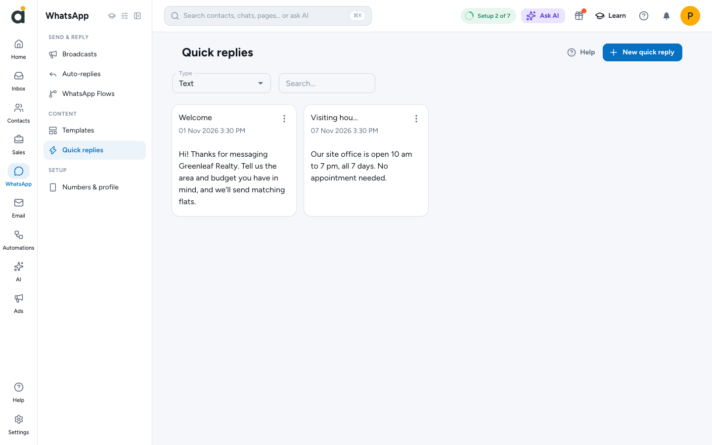
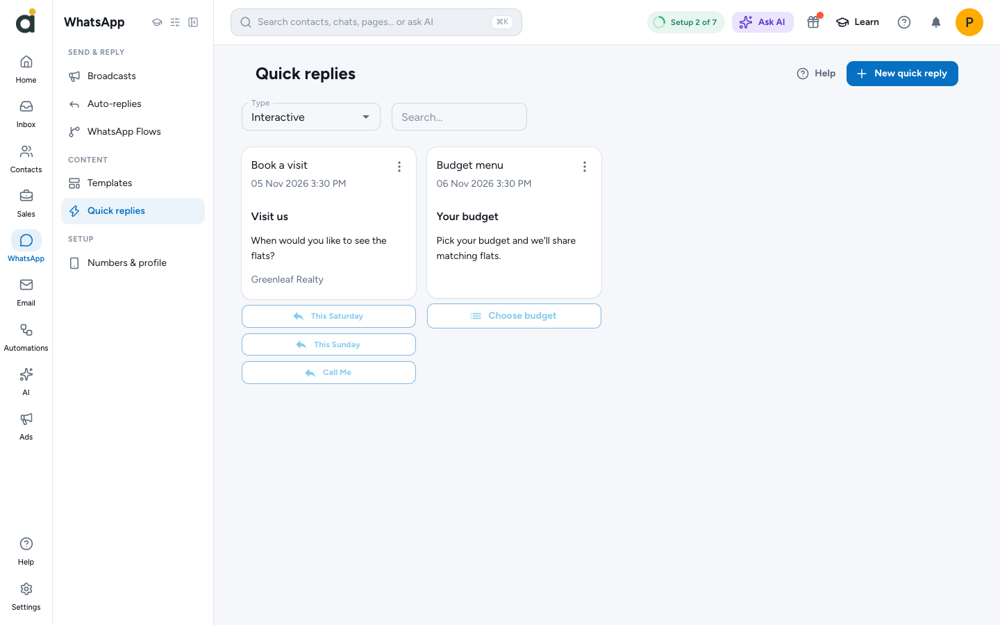
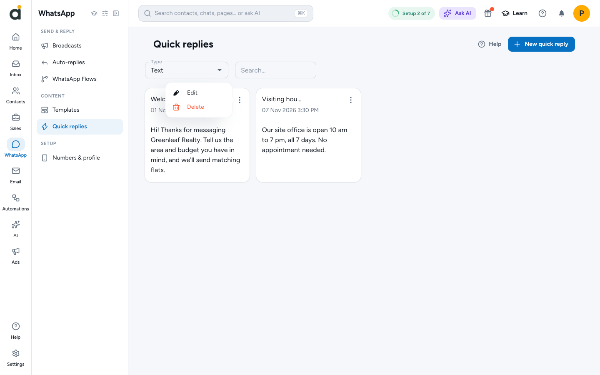
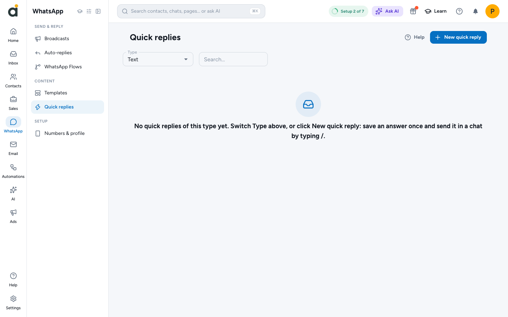

A **quick reply** is a message you save once and reuse: your address, price list, visiting hours, a booking menu. In any chat, type <kbd>/</kbd> in the reply box, pick it, and it is sent. [Auto-replies](/help/autoreply/wa) send quick replies too.

**Where:** **WhatsApp → Quick replies** (side menu, under **Content**). [Open it →](https://app.adsera.in/dashboard/snippets/list)

## The list

| Control | What it does |
| --- | --- |
| **New quick reply** | Make a new one. See [Create a quick reply](/help/snippet/create). |
| **Type** | The list shows one type at a time: **Text**, **Image**, **Video**, **Audio**, **Document** or **Interactive**. It starts on Text. |
| **Search…** | Find one by name. |
| Card | Shows the name, date and the message as it looks. |
| **⋮** on a card | **Edit** or **Delete**. |

<Note>Can’t find a quick reply you made? Switch **Type**: the list shows only one type at a time.</Note>

## Use a quick reply

- **In a chat**: type <kbd>/</kbd> and a word of its name, then pick it.
- **In an auto-reply**: step 2 of an auto-reply lists your quick replies. See [Auto-replies](/help/autoreply/wa).
- **As an opt-out or opt-in reply**: see [Opt-in & opt-out keywords](/help/channel/whatsapp/opt).

Quick replies are free-form messages: in a chat they can only be sent within 24 hours of the customer’s last message. After that, send a [template](/help/template/wa).

## Edit or delete

Click **⋮ → Edit** on the card, change it and click **Update**. **⋮ → Delete** removes it; auto-replies that used it stop sending it.

## Related

<CardGroup cols={2}>
  <Card title="Create a quick reply" icon="pen" href="/help/snippet/create">Text and media.</Card>
  <Card title="Buttons, lists and Pay Now" icon="hand-pointer" href="/help/snippet/interactive">Interactive quick replies.</Card>
</CardGroup>
