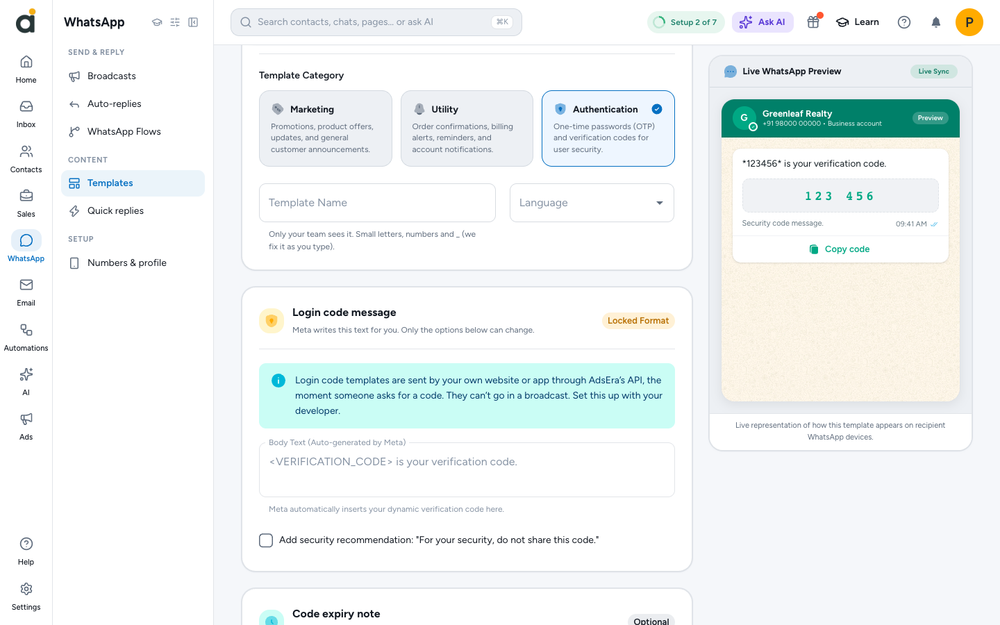
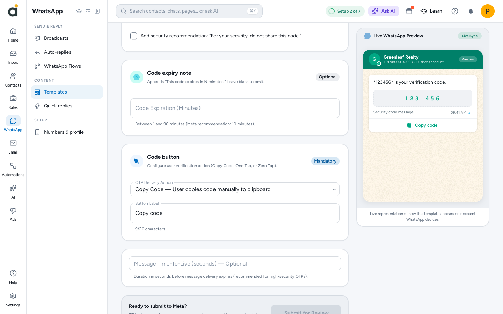
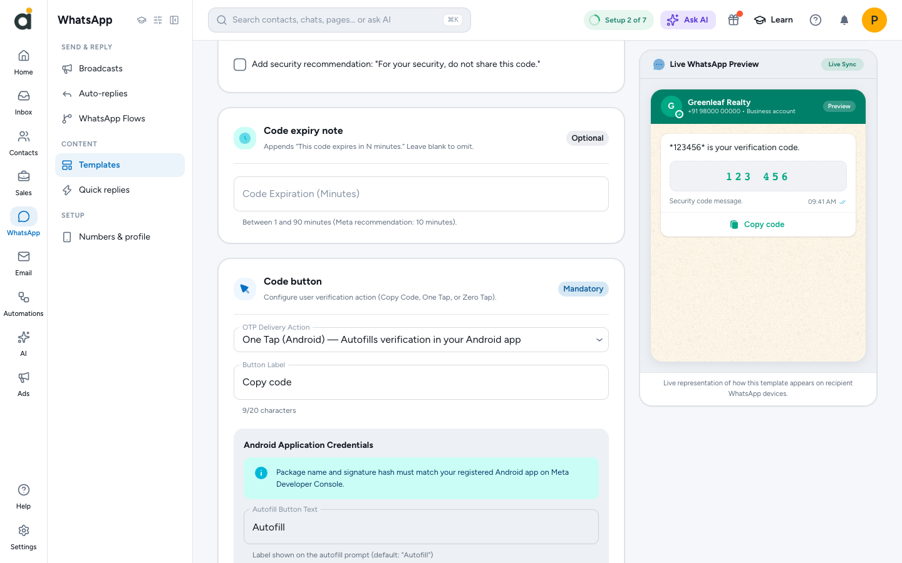
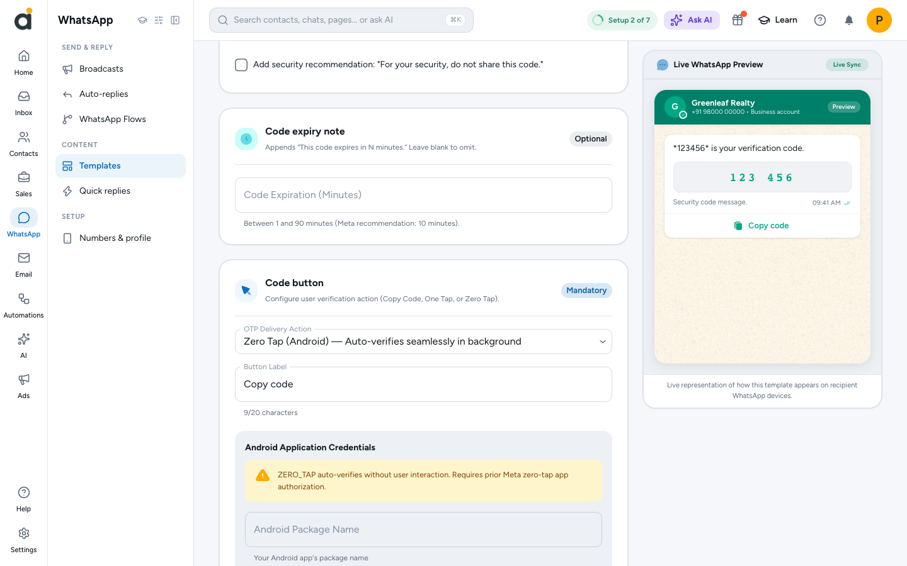

An **authentication** template sends a one-time login code, like “482913 is your verification code.” Meta writes the text; you only choose a few options.

<Warning>These templates are sent by **your own website or app** through AdsEra’s API, the moment someone asks for a code. They can’t be sent in a broadcast or from a chat. Set this up with your developer. See [API reference](/api-reference/introduction).</Warning>

| | |
| --- | --- |
| Category | **Authentication** |
| Message | Fixed by Meta: “`<code>` is your verification code.” |
| Options | Safety line, code expiry note, button type, message time-to-live |
| Button | One: **Copy Code**, **One Tap** or **Zero Tap** |

**Where:** **WhatsApp → Templates → New template** → click **Authentication**.

## Make one

<Steps>
<Step title="Pick Authentication">Click **New template**, then the **Authentication** category. Name it (like `login_code`) and pick the language.</Step>
<Step title="Safety line (recommended)">Tick **Add security recommendation** to add “For your security, do not share this code.”</Step>
<Step title="Code expiry">In **Code Expiration (Minutes)** type 1 to 90 (10 is common). The message adds “This code expires in 10 minutes.”</Step>
<Step title="Pick the button">
  In **OTP Delivery Action** choose how the code reaches the person (see the table), and its **Button Label**.

  
</Step>
<Step title="Message Time-To-Live (optional)">If the phone is offline longer than this many seconds, the code isn’t delivered at all (it would be expired anyway).</Step>
<Step title="Submit for Review">Click **Submit for Review**.</Step>
</Steps>

## Copy code, One-tap or Zero-tap?

| Option | What happens | Needs |
| --- | --- | --- |
| **Copy Code** | The person taps the button to copy the code, then pastes it in your site or app. | Nothing more. Works everywhere. Pick this if unsure. |
| **One Tap (Android)** | Your Android app shows an **Autofill** button; one tap fills the code. Other phones get Copy code. | Your Android app’s **Android Package Name** and **App Signature Hash** (from your developer), and **Autofill Button Text** |
| **Zero Tap (Android)** | Your Android app fills the code by itself, no tap. Other phones get Copy code. | Package name and signature hash, and your app set up for it |

## Fields

| Field | What it does | Example | Required? |
| --- | --- | --- | --- |
| Body Text (Auto-generated by Meta) | Meta’s fixed text | `<code>` is your verification code. | Shown only |
| Add security recommendation | Adds the “do not share” line | Ticked | No |
| Code Expiration (Minutes) | Adds the expiry line | 10 | No |
| OTP Delivery Action | Copy Code, One Tap or Zero Tap | Copy Code | Yes |
| Button Label | The button text | Copy code | Yes |
| Autofill Button Text | One Tap only | Autofill | One Tap |
| Android Package Name | Your app’s ID | com.greenleaf.app | One/Zero Tap |
| App Signature Hash | 11 characters, from your developer | K8a7S1yZy3e | One/Zero Tap |
| Message Time-To-Live (seconds) | Drop the code if not delivered in time | 600 | No |

## FAQs

<AccordionGroup>
<Accordion title="Can I write my own text?">
  No. Meta fixes the text of login code templates so people trust them.
</Accordion>
<Accordion title="Can I send a login code from AdsEra without a developer?">
  No. The code must be created by your website or app when the person logs in, and sent at that moment through the API.
</Accordion>
</AccordionGroup>

## Related

<CardGroup cols={2}>
  <Card title="API reference" icon="code" href="/api-reference/introduction">Send templates from your system.</Card>
  <Card title="Templates: overview" icon="file-lines" href="/help/template/wa">All template types.</Card>
</CardGroup>
