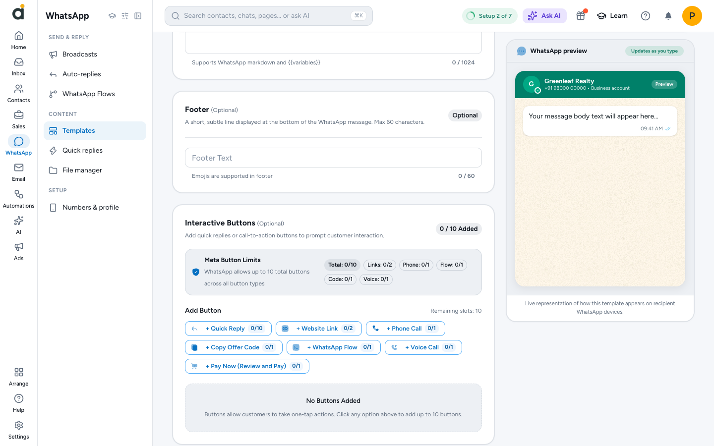
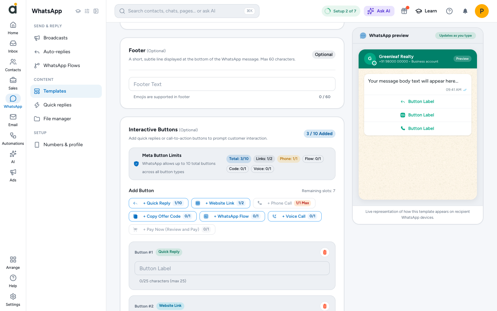
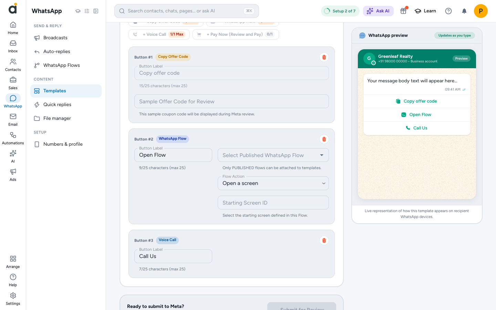
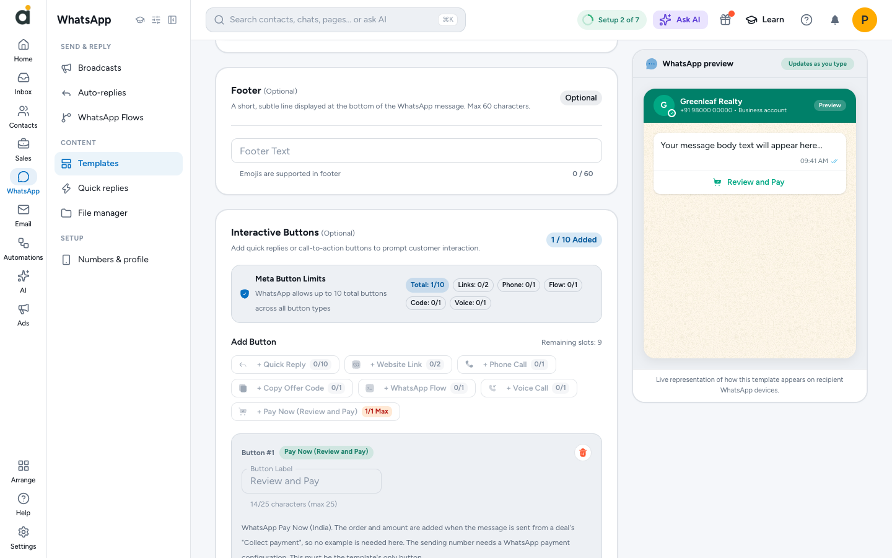

Buttons let people act with one tap: answer you, open your website, call you, copy a code, fill a form or pay. Add them in the template editor under **Interactive Buttons (Optional)**.

**Where:** **WhatsApp → Templates → New template**, section **Interactive Buttons**.

## Limits

| Limit | Number |
| --- | --- |
| Buttons in total | 10 |
| Website Link | 2 |
| Phone Call | 1 |
| Copy Offer Code | 1 |
| WhatsApp Flow | 1 |
| Voice Call | 1 |
| Pay Now | 1, and it must be the template’s only button |
| Button label | 25 characters |
| Carousel cards | 2 buttons, shared by all cards (Quick Reply and at most 1 Website Link) |
| Limited-time offer | 3 buttons: Copy Offer Code + Website Link (+1) |
| Call permission | No buttons |

The counters (for example **Links: 0/2**) in **Meta Button Limits** show what is left. A full type shows **1/1 Max** and can’t be added again.

## The 7 button types

| Button | What the customer sees and does | Fields | Good for |
| --- | --- | --- | --- |
| **Quick Reply** | A button with your words. Tapping it sends those words back to you. | Button Label | “Book site visit”, “Call me”, “Not interested” |
| **Website Link** | Opens a web page. | Button Label, Website URL, Sample URL for Review (when the URL ends with `{{1}}`) | Project page, payment link, booking page |
| **Phone Call** | Dials your phone number. | Button Label, Country, Phone number | “Call the office” |
| **Copy Offer Code** | Copies a code to the clipboard. | Sample Offer Code for Review | Discount and coupon codes |
| **WhatsApp Flow** | Opens one of your published WhatsApp Flows (a form inside WhatsApp). | Button Label, Select Published WhatsApp Flow, Flow Action (**Open a screen** or **Data exchange**), Starting Screen ID | Booking, sign-up, survey |
| **Voice Call** | Starts a WhatsApp voice call to your number. | Button Label | “Talk to an advisor” (needs calling on a new number) |
| **Pay Now (Review and Pay)** | A **Review and Pay** button: they see the order and pay inside WhatsApp (India). The order and amount are added when you send it from a deal’s **Collect payment**. | None (the label is fixed) | Booking amounts, fees. Must be the only button; your number needs WhatsApp Pay set up |

## Add a button

<Steps>
<Step title="Click the type">Under **Add Button**, click **+ Quick Reply**, **+ Website Link** and so on.</Step>
<Step title="Fill its fields">The button appears as **Button #1**, **Button #2**… with its own fields (see the table).</Step>
<Step title="Check the preview">It shows under the message in **WhatsApp preview**.</Step>
<Step title="Remove one">Click the red bin on the button.</Step>
</Steps>

## Website links that change per person

End the URL with `{{1}}`, like `https://greenleaf.example/flat/{{1}}`, and give Meta a **Sample URL for Review** (`https://greenleaf.example/flat/B-704`). When you send, fill `{{1}}` like any variable.

## WhatsApp Flow button

Pick a flow from **Select Published WhatsApp Flow** (only published flows show). **Flow Action**:

- **Open a screen**: opens the flow at the **Starting Screen ID** you choose. Use this for most forms.
- **Data exchange (your system answers)**: the flow asks your booking tool or server for data first, like free time slots.

See [WhatsApp Flows](/help/automation/whatsapp-flows).

## FAQs

<AccordionGroup>
<Accordion title="Where do quick reply taps go?">
  To your inbox, as the customer’s reply. A broadcast report shows them under **Replies**, and an auto-reply can answer a tap the same way it answers a keyword.
</Accordion>
<Accordion title="Why is Pay Now greyed out?">
  Pay Now must be the template’s only button. Remove the other buttons first. And once Pay Now is added, no other button can be added.
</Accordion>
<Accordion title="Why is Voice Call missing for Utility templates?">
  AdsEra offers the Voice Call button on Marketing templates. Use Phone Call on Utility templates.
</Accordion>
<Accordion title="How do I send a Pay Now template?">
  Open the deal and use **Collect payment**: AdsEra adds the order and amount and sends the template. See the Sales docs for deals.
</Accordion>
</AccordionGroup>

## Related

<CardGroup cols={2}>
  <Card title="Create a template" icon="pen" href="/help/template/create">The whole editor.</Card>
  <Card title="Limited-time offer" icon="clock" href="/help/template/limited-time-offer">Copy code and link buttons.</Card>
  <Card title="Carousel" icon="images" href="/help/template/carousel">Buttons shared by all cards.</Card>
  <Card title="WhatsApp Flows" icon="diagram-project" href="/help/automation/whatsapp-flows">Forms inside WhatsApp.</Card>
</CardGroup>
