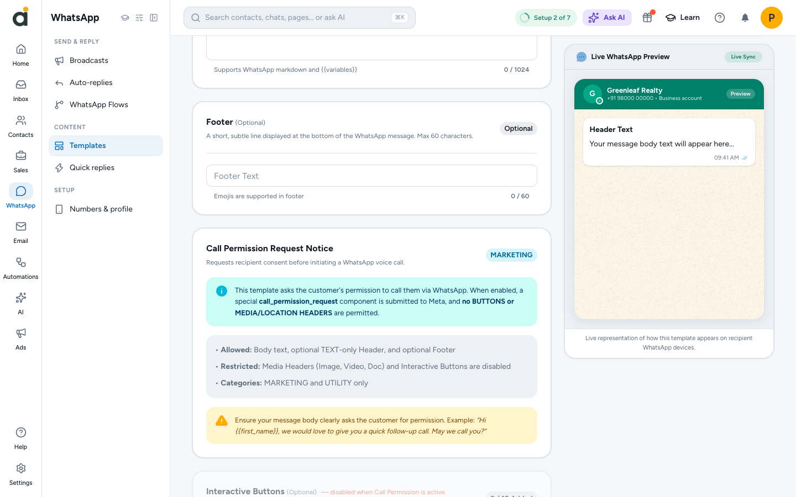

WhatsApp only lets a business call a customer who said yes. A **call permission** template asks for that: the customer sees your message with **Allow** and **Don’t allow**. When they allow it, the call button in their chat turns on. See [WhatsApp calling](/help/channel/whatsapp/calling).

| | |
| --- | --- |
| Category | **Marketing** or **Utility** |
| Header | Text only (optional) |
| Buttons | None (WhatsApp adds the Allow buttons) |
| Number | Needs WhatsApp calling: a new (Cloud API) number |

**Where:** **WhatsApp → Templates → New template** → **Utility** (or Marketing) → click the **Call Permission** card under **Special formats (optional)**.

## Make one

<Steps>
<Step title="Start a template">Click **New template**. Pick **Utility** when you ask because they enquired (most cases), or **Marketing**.</Step>
<Step title="Switch on Call Permission">Click the **Call Permission** card. The header becomes **Header (Text Only)** and buttons are switched off.</Step>
<Step title="Say why you want to call">In **Body Message**: “Hi `{{name}}`, can our property advisor call you on WhatsApp about your flat enquiry?”</Step>
<Step title="Submit for Review">Check the preview, with the **Call Permission Request Notice**, and click **Submit for Review**.</Step>
</Steps>

## After they allow

Open their chat: the WhatsApp call button is active while the permission is valid. If it is greyed out, send the template again.

## Related

<CardGroup cols={2}>
  <Card title="WhatsApp calling" icon="phone" href="/help/channel/whatsapp/calling">Who answers and how to call.</Card>
  <Card title="Create a template" icon="pen" href="/help/template/create">The standard template.</Card>
</CardGroup>
