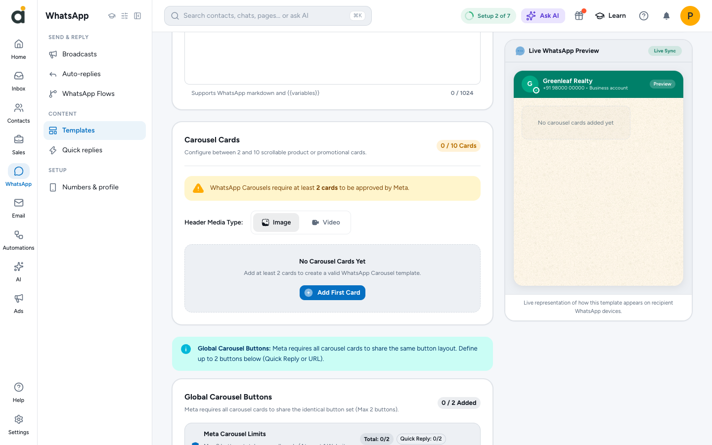
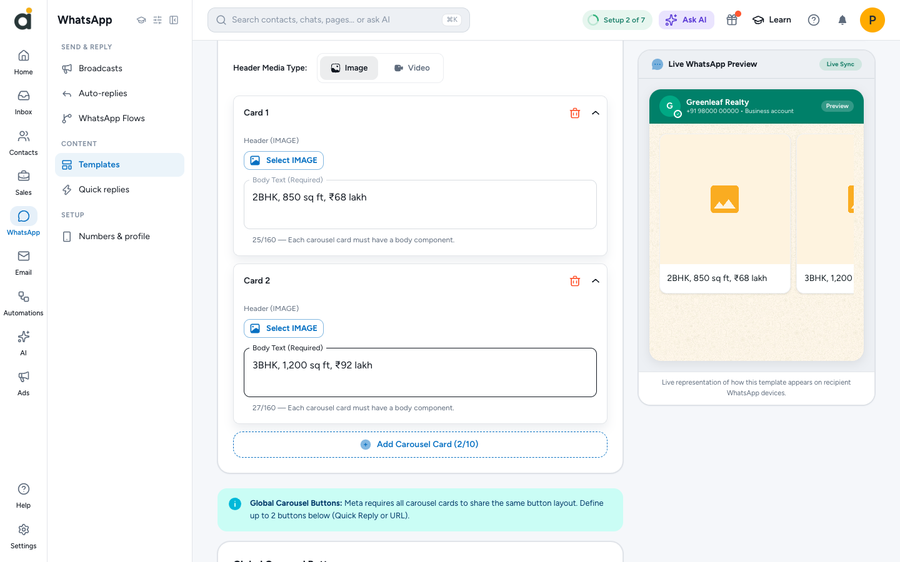
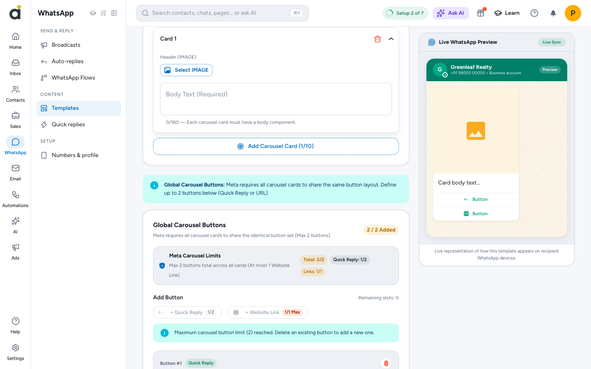
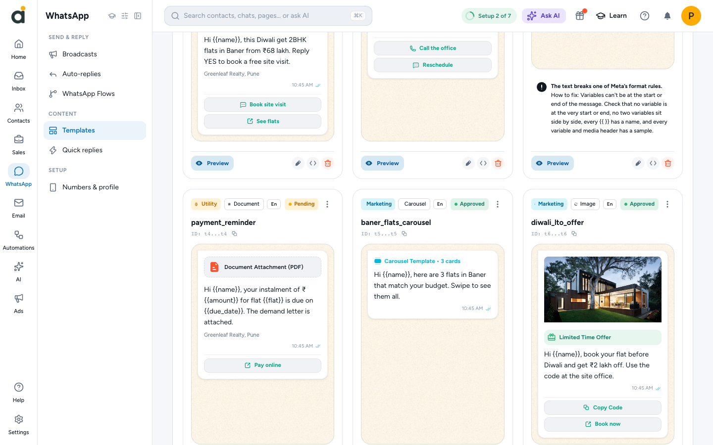

A **carousel** template has a short message, then **2 to 10 cards** people swipe sideways. Each card has a photo or video, a short text and buttons. Use it to show several flats, products or courses at once.

| | |
| --- | --- |
| Category | **Marketing** only |
| Cards | 2 to 10 |
| Media | All cards use the same kind: **Image** or **Video** |
| Card text | Up to 160 characters each, required |
| Buttons | Up to 2, the same on every card: **Quick Reply** and at most 1 **Website Link** |
| Header and footer | None (the cards replace them) |

**Where:** **WhatsApp → Templates → New template** → **Marketing** → click the **Carousel Cards** card under **Special formats (optional)**.

## Make a carousel

<Steps>
<Step title="Start a Marketing template">
  Click **New template**, keep **Marketing**, type the name (like `baner_flats_carousel`) and the language.
</Step>
<Step title="Switch on Carousel Cards">
  Under **Special formats (optional)**, click the **Carousel Cards** card. The header and footer sections disappear.
</Step>
<Step title="Write the message above the cards">
  In **Body Message**, a short intro: “Hi `{{name}}`, here are 3 flats in Baner that match your budget.” Give the variable a sample.
</Step>
<Step title="Pick photos or videos">
  In **Header Media Type**, choose **Image** or **Video**. Every card uses this kind.
</Step>
<Step title="Add the cards">
  Click **Add First Card**, then **Add Carousel Card** for each one (up to 10). On each card:
  - pick its photo or video (**Select IMAGE** / **Select VIDEO**),
  - type its text in **Body Text (Required)**: this is where the details and price go, like “2BHK, 850 sq ft, ₹68 lakh”.

  
</Step>
<Step title="Add the buttons">
  Under **Global Carousel Buttons**, add up to 2: **+ Quick Reply** (like “Book site visit”) and **+ Website Link** (like “Details”). Every card gets the same buttons. A link can end with `{{1}}` so each card opens its own page; give each card its URL example under **URL Variable Examples for this Card**.

  
</Step>
<Step title="Submit for Review">
  Check the preview and click **Submit for Review**. It needs at least 2 cards, each with media and text.
</Step>
</Steps>

On the Templates page a carousel card is labelled **Carousel** and shows how many cards it has.

## Sending it

In a broadcast, pick the carousel template like any other. You can change each card’s photo and fill the variables. See [Create a broadcast](/help/campaign/wa/create).

## Troubleshooting

| Problem | Fix |
| --- | --- |
| **Submit for Review** stays grey | Add at least 2 cards, and give every card a photo (or video) and text |
| Can’t add a third button | Carousels allow 2 buttons, shared by all cards |
| Some cards need a link and others don’t | Not possible: every card has the same buttons. Use a link with `{{1}}` and point each card to its own page |
| Carousel Cards card is missing | You picked Utility or Authentication. Carousels are Marketing only |

<AccordionGroup>
<Accordion title="Can each card have different buttons?">
  No. Meta requires the same button layout on every card. The link on each card can open a different page.
</Accordion>
<Accordion title="Can I mix photos and videos?">
  No. Pick Image or Video for the whole carousel.
</Accordion>
</AccordionGroup>

## Related

<CardGroup cols={2}>
  <Card title="Create a template" icon="pen" href="/help/template/create">The standard template.</Card>
  <Card title="Buttons" icon="hand-pointer" href="/help/template/buttons">Every button type.</Card>
</CardGroup>
