This guide makes a **standard** template: an optional header, your message, an optional footer and buttons. For carousels, offers, call requests or login codes, the first steps are the same; then see their own pages.

**Where:** **WhatsApp → Templates → New template**. [Open it →](https://app.adsera.in/dashboard/template/whatsapp/list)

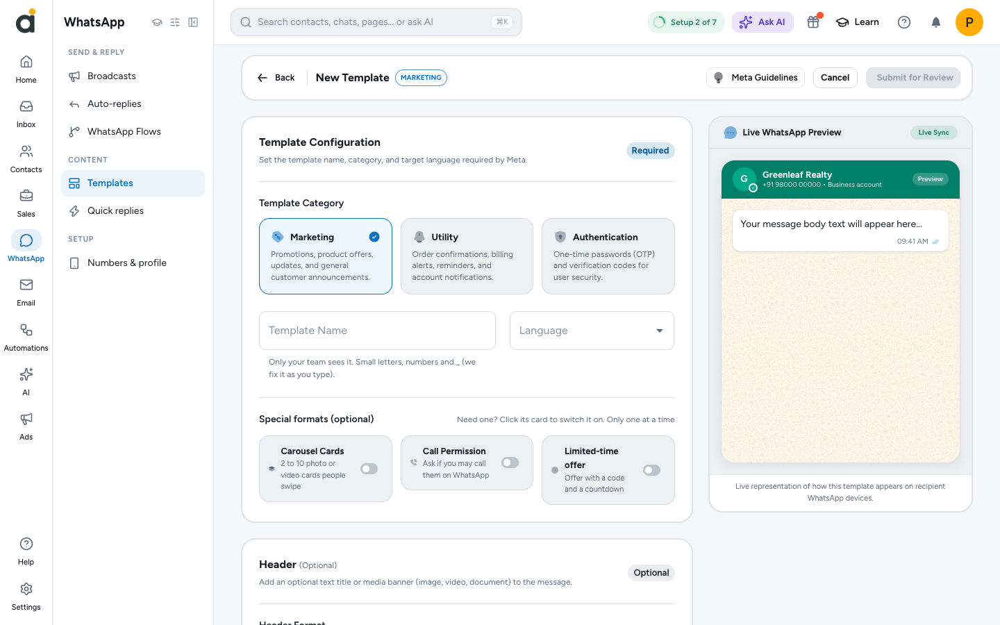

## Step by step

<Steps>
<Step title="Click New template">
  On **Templates**, pick the WhatsApp Business account at the top, then click **New template**.
</Step>
<Step title="Pick the category">
  Click **Marketing**, **Utility** or **Authentication**. It can’t be changed later, and Meta checks it. Offers and news are always Marketing. See [the categories](/help/template/wa#the-3-categories).

  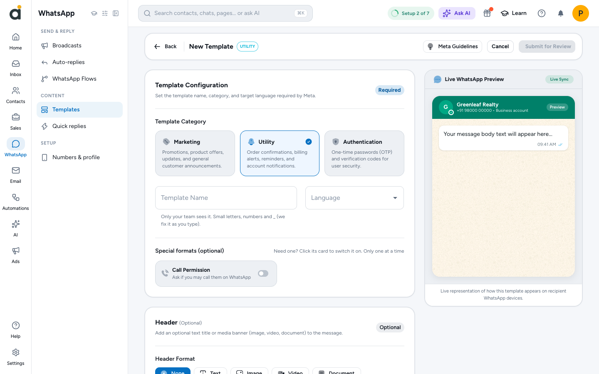
</Step>
<Step title="Name it and pick the language">
  **Template Name**: small letters, numbers and `_` only, like `site_visit_reminder` (spaces and capitals are changed for you). Only your team sees it, and it can’t be renamed later.

  **Language**: the language you write in. Need English and Hindi? Make two templates with the same name, one per language.

  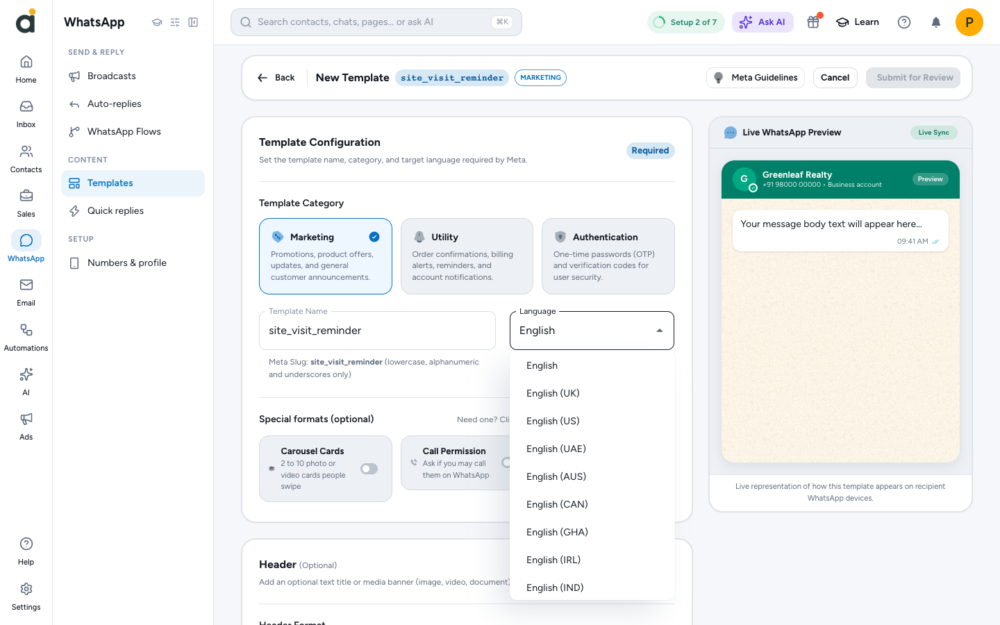
</Step>
<Step title="Choose a special format (optional)">
  Under **Special formats (optional)**, click a card to switch it on: **Carousel Cards**, **Call Permission** or **Limited-time offer**. Only one at a time. Skip this for a standard template.
</Step>
<Step title="Add a header (optional)">
  In **Header Format** pick **None**, **Text**, **Image**, **Video**, **Document** or **Location**. See the table below.

  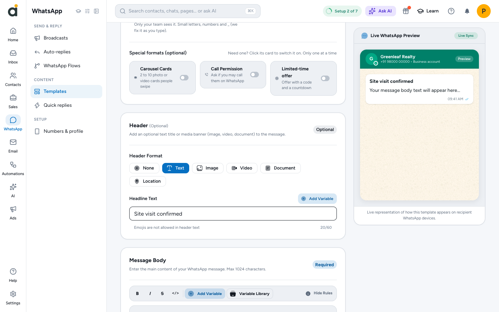
</Step>
<Step title="Write the message">
  Type it in **Body Message** (up to 1,024 characters). Use the **B**, **I**, **S** and **&lt;/&gt;** buttons for bold, italic, strikethrough and monospace.

  For parts that change per person, click **Add Variable**, or pick a contact field from **Variable Library**. Then type a sample for each variable under **Variable Sample Values (Required by Meta)**. See [Variables and samples](/help/template/variables).

  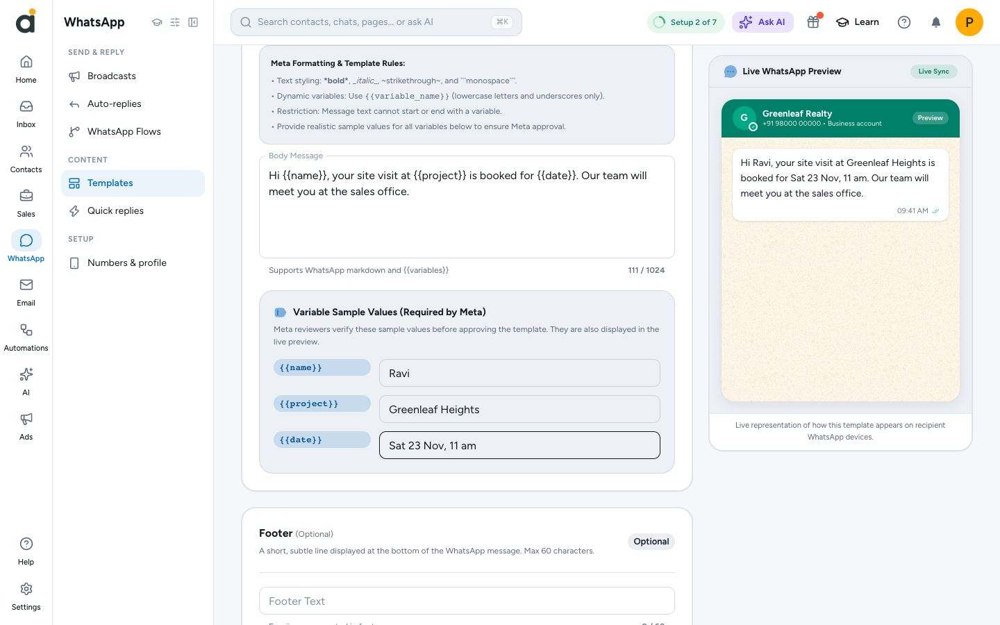
</Step>
<Step title="Add a footer (optional)">
  A small grey line under the message, up to 60 characters, like your business name or “Reply STOP to opt out”.

  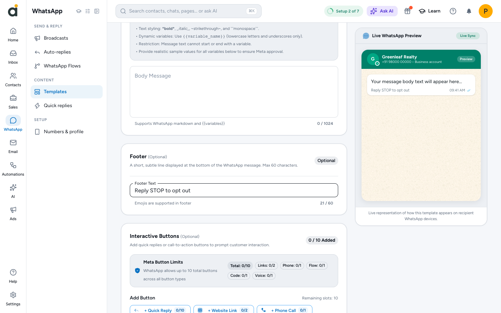
</Step>
<Step title="Add buttons (optional)">
  Click a button type under **Add Button**: **+ Quick Reply**, **+ Website Link**, **+ Phone Call**, **+ Copy Offer Code**, **+ WhatsApp Flow**, **+ Voice Call** or **+ Pay Now (Review and Pay)**. See [Buttons](/help/template/buttons).

  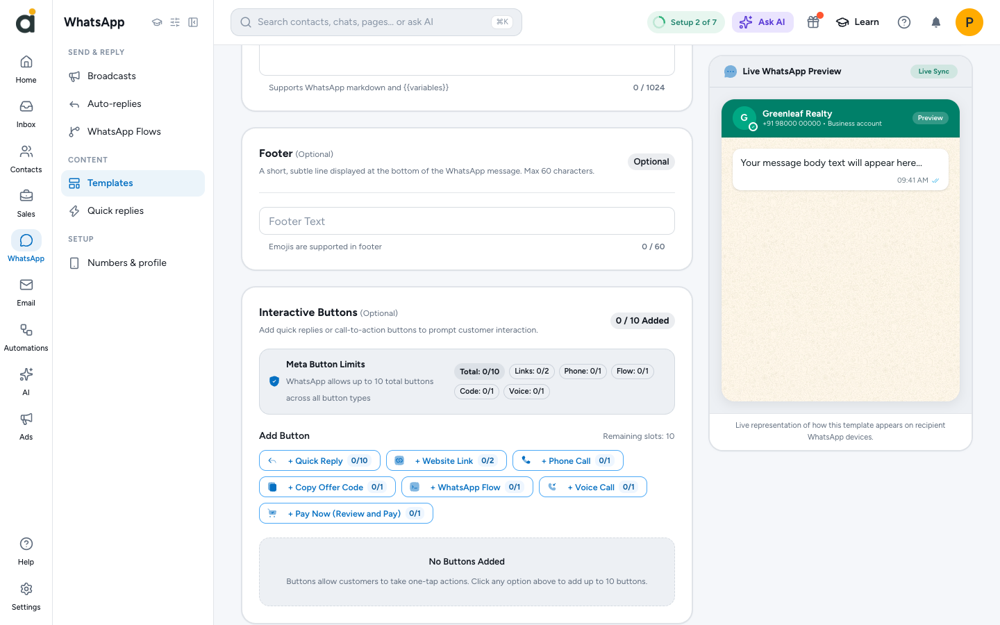
</Step>
<Step title="Check the preview">
  **Live WhatsApp Preview** on the right shows exactly what customers will see.

  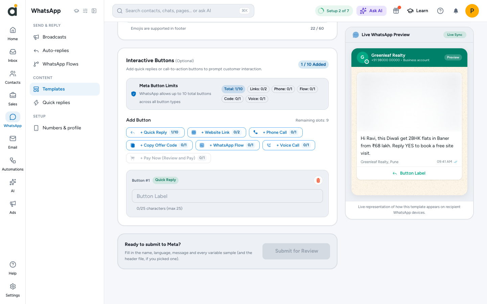
</Step>
<Step title="Submit for Review">
  Click **Submit for Review** (at the top or the bottom). It stays grey until the name, language, message and every sample are filled in. Meta usually answers within minutes.
</Step>
</Steps>

<Tip>**Meta Guidelines** (top right of the editor) opens a summary of Meta’s rules for each category.</Tip>

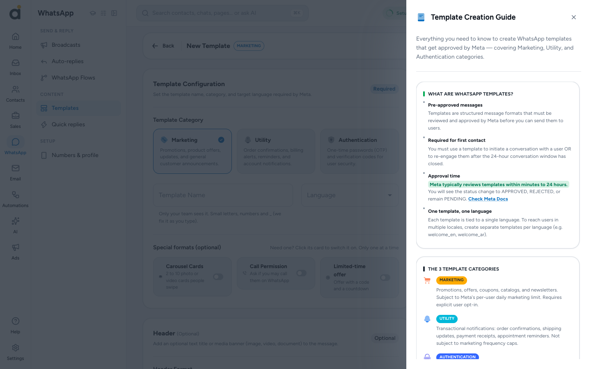

## Header formats

| Header | What it is | Files and limits | When to use |
| --- | --- | --- | --- |
| **None** | No header. The message starts with the text. | — | Short reminders and updates |
| **Text** | A bold first line. It can have one variable (with a sample). | Up to 60 characters, no emojis | “Site visit confirmed”, “Diwali offer” |
| **Image** | A photo above the message | JPG or PNG, up to 5 MB | Flats, products, offers: gets the most replies |
| **Video** | A video above the message | MP4, up to 16 MB | Walkthroughs, events |
| **Document** | A PDF people can open | PDF, up to 100 MB | Brochures, price lists, invoices, demand letters |
| **Location** | A map pin | You type the place each time you send | Office or site address, event venue |

For image, video and document headers, upload a file or click **Browse Media Library**. Meta only uses it as a sample: in each broadcast you can send a different file.

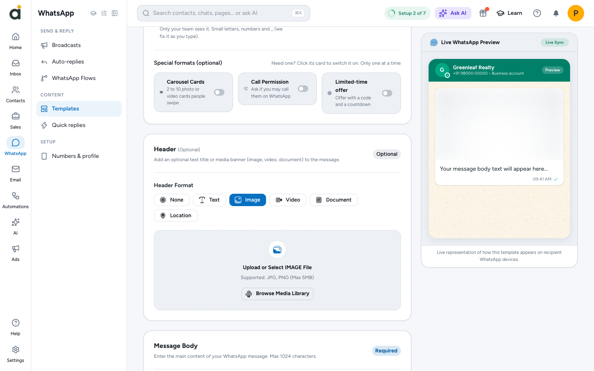

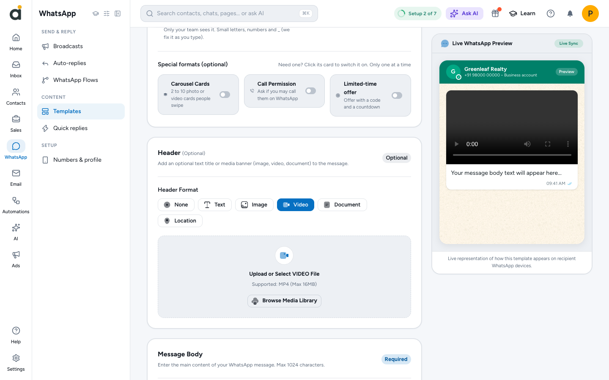

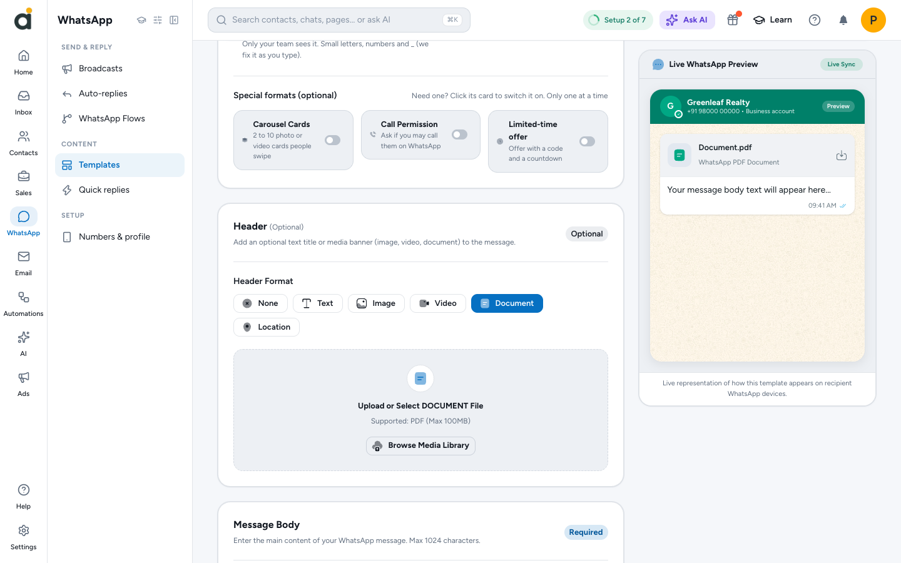

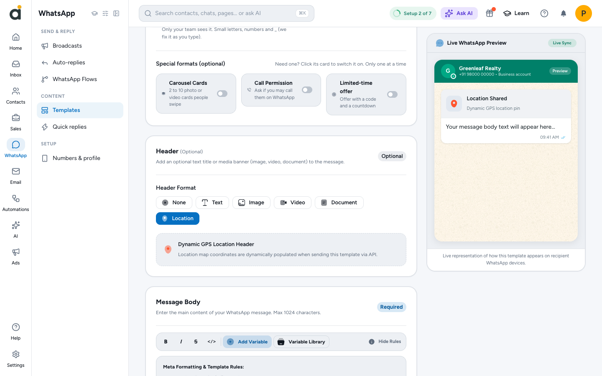

## All fields

| Field | What it does | Example | Required? |
| --- | --- | --- | --- |
| Template Category | Marketing, Utility or Authentication | Utility | Yes |
| Template Name | Your name for it: small letters, numbers, `_`, up to 512 characters | `site_visit_reminder` | Yes |
| Language | The message language | English | Yes |
| Special formats | Carousel Cards, Call Permission, Limited-time offer | — | No |
| Header Format + content | Text, image, video, document or location | Image of the flat | No |
| Body Message | The message, up to 1,024 characters | Hi `{{name}}`, your visit… | Yes |
| Variable samples | One example per variable | Ravi | Yes, when you use variables |
| Footer Text | Up to 60 characters | Greenleaf Realty, Pune | No |
| Buttons | Up to 10 | Book site visit | No |

## What happens after you submit

1. You are back on **Templates**. The new template shows as **Pending**.
2. Meta reviews it, usually within minutes (at most 24 hours). AdsEra updates the status by itself; you also get a notification.
3. **Approved**: use it in broadcasts, chats, auto-replies and workflows.
4. **Rejected**: the card says why and how to fix it. See [Statuses and rejections](/help/template/status).

Can’t see the change? Click **Sync Templates**.

## Troubleshooting

| What you see | Why | What to do |
| --- | --- | --- |
| **Submit for Review** stays grey | Something required is empty | Fill Template Name, Language, Body Message and every sample; pick a file for a media header, or choose **None** |
| “There’s an empty `{{}}`” under the message | A half-typed variable | Type a name inside it, like `{{name}}`, or delete it |
| **Submission Error:** a message from Meta | Meta refused it straight away | Read the message: often a duplicate name (use a new name) or a variable at the start or end |
| Name already exists | Same name and language exists | Use a different name, or the same name with another language |

## FAQs

<AccordionGroup>
<Accordion title="Can I save a template without sending it to Meta?">
  No. Every template goes to Meta when you click Submit for Review. Keep your text in a note until you are ready.
</Accordion>
<Accordion title="How do I make a copy of a template?">
  There is no copy button yet. Click **New template** and paste the text from the old one (open it with **View Details**).
</Accordion>
<Accordion title="Can I use emojis?">
  Yes in the message and footer, not in a text header.
</Accordion>
</AccordionGroup>

## Related

<CardGroup cols={2}>
  <Card title="Variables and samples" icon="brackets-curly" href="/help/template/variables">Personalise each message.</Card>
  <Card title="Buttons" icon="hand-pointer" href="/help/template/buttons">All 7 button types.</Card>
  <Card title="Carousel" icon="images" href="/help/template/carousel">Several photos people swipe.</Card>
  <Card title="Statuses and rejections" icon="circle-check" href="/help/template/status">What happens after you submit.</Card>
</CardGroup>
