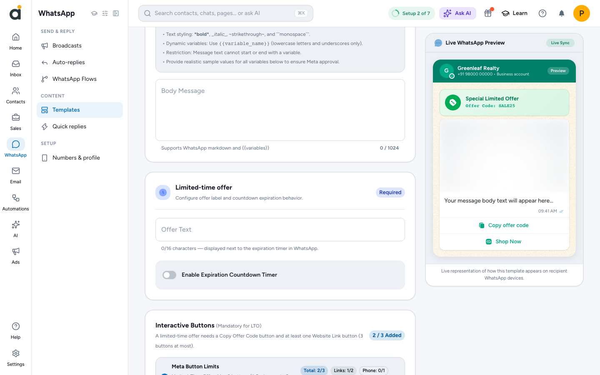
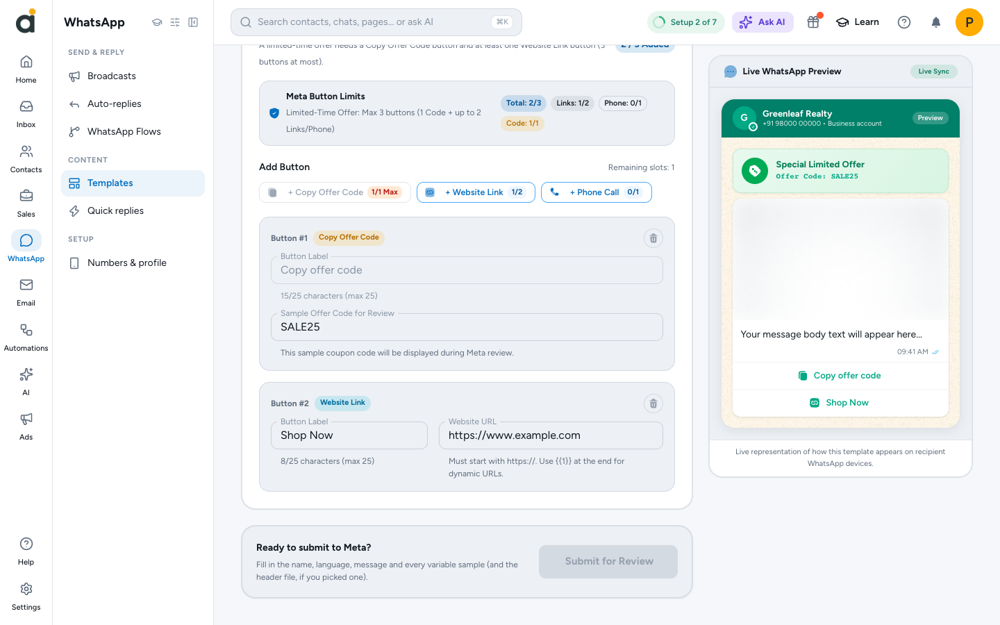

A **limited-time offer** template shows an offer title, an optional **countdown** (“Offer ends in 2 days”), a **Copy Offer Code** button and a **Website Link** button. Use it for festive discounts and launch offers with a deadline.

| | |
| --- | --- |
| Category | **Marketing** only |
| Header | Text, Image or Video (one is required) |
| Offer text | Up to 16 characters, required |
| Countdown | Optional: switch on **Enable Expiration Countdown Timer** |
| Buttons | 3 at most: **Copy Offer Code** (required) + **Website Link** (required), plus one more |
| Footer | None |

**Where:** **WhatsApp → Templates → New template** → **Marketing** → click the **Limited-time offer** card under **Special formats (optional)**.

## Make an offer

<Steps>
<Step title="Start a Marketing template">Click **New template**, keep **Marketing**, name it (like `diwali_lto_offer`) and pick the language.</Step>
<Step title="Switch on Limited-time offer">Click the **Limited-time offer** card. A **Copy Offer Code** and a **Website Link** button are added for you.</Step>
<Step title="Add the header">In **Header Format** pick **Image** (picked for you) or **Video** and add the file, or **Text** for a title.</Step>
<Step title="Write the message">In **Body Message**: “Hi `{{name}}`, book before Diwali and get ₹2 lakh off.” Give samples for variables.</Step>
<Step title="Type the offer title">In **Offer Text**, up to 16 characters, like “₹2 lakh off”. It shows next to the countdown.</Step>
<Step title="Countdown (optional)">Switch on **Enable Expiration Countdown Timer** to show when the offer ends. You set the end date and time when you send it.</Step>
<Step title="Fill the buttons">
  **Sample Offer Code for Review**: an example code, like `DIWALI2L` (letters and numbers only). **Website URL**: your booking page.

  
</Step>
<Step title="Submit for Review">Check the preview and click **Submit for Review**.</Step>
</Steps>

## Sending it

In a broadcast, after you pick the offer template, step 2 asks for **Offer Expiration** (**Select Expiration Time**): the date and time the offer ends. The real code people copy is filled there too. See [Create a broadcast](/help/campaign/wa/create).

## Troubleshooting

| Problem | Fix |
| --- | --- |
| Limited-time offer card is missing | Pick **Marketing**. Offers aren’t allowed in Utility |
| Can’t add more buttons | Offers allow 3 buttons in total |
| Submit stays grey | Fill Offer Text, the sample code and the Website URL |

## Related

<CardGroup cols={2}>
  <Card title="Buttons" icon="hand-pointer" href="/help/template/buttons">Copy Offer Code and Website Link.</Card>
  <Card title="Create a broadcast" icon="bullhorn" href="/help/campaign/wa/create">Set when the offer ends.</Card>
</CardGroup>
