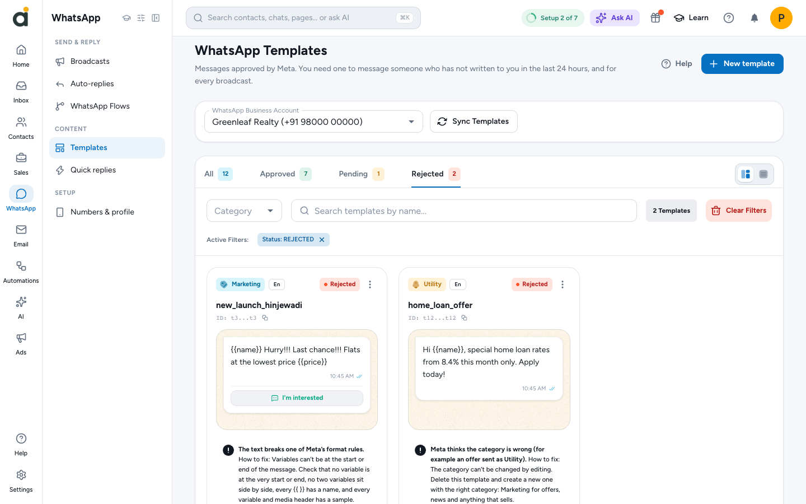
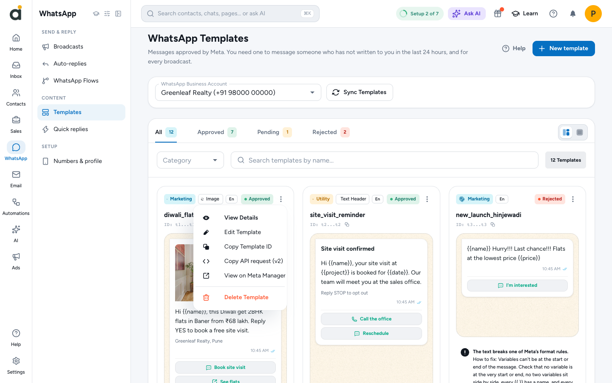
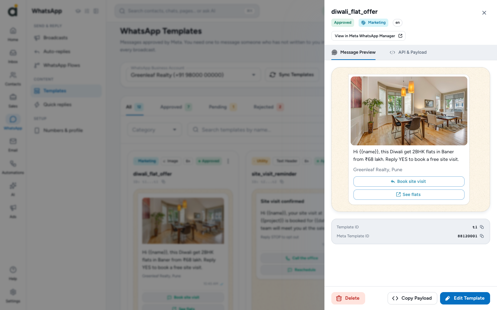
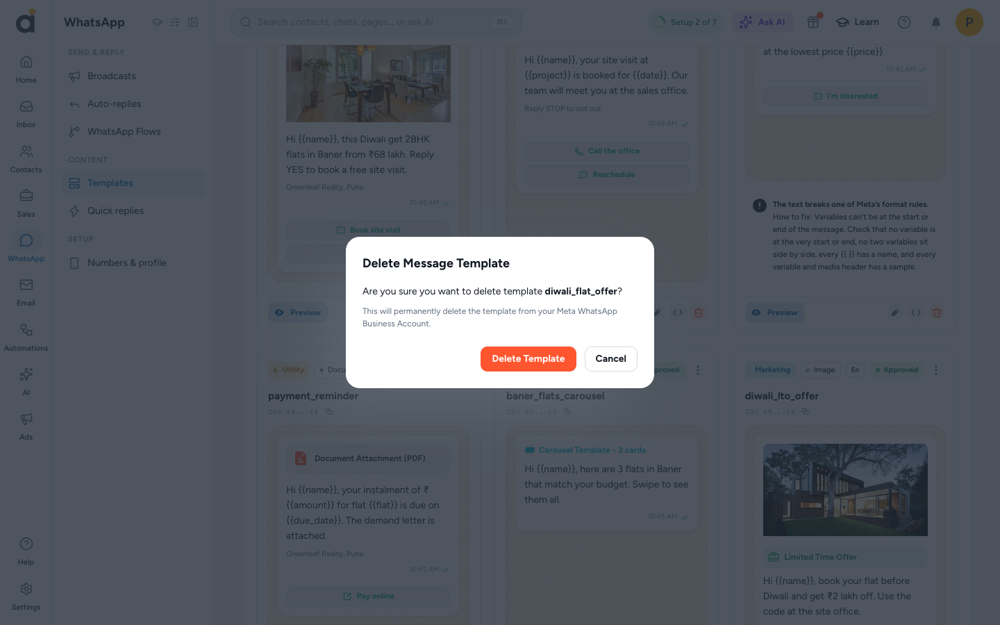

Everything you can do with templates you already have, on **WhatsApp → Templates**. [Open it →](https://app.adsera.in/dashboard/template/whatsapp/list)

## Find a template

| Control | What it does |
| --- | --- |
| **WhatsApp Business Account** | Each account has its own templates. Pick one. |
| **All / Approved / Pending / Rejected** | Show templates by status. The number is how many. |
| **Category** | Marketing, Utility or Authentication only. |
| **Search templates by name…** | Part of the name, like “diwali”. |
| **Clear Filters** | Back to everything. The **Active Filters** row shows what is on. |
| Grid / Table icons | Cards that look like the phone message, or a compact table with header type and buttons. |

## Sync with Meta

Click **Sync Templates** to bring in templates made in Meta’s WhatsApp Manager and to refresh every status. AdsEra updates statuses by itself when Meta reviews a template; use Sync when something looks out of date.

## Preview a template

Click **Preview** on a card, or **⋮ → View Details**. A panel opens with:

- the status, category and language, and **View in Meta WhatsApp Manager**;
- **Message Preview**: the template as it looks on a phone;
- **API & Payload**: what a developer sends to use this template from their own system (**Copy Payload**);
- **Template ID** and **Meta Template ID**, with copy icons;
- **Delete** and **Edit Template** at the bottom.

| Menu item | What it does |
| --- | --- |
| **View Details** | Opens the panel above. |
| **Edit Template** | Opens the editor (not while Pending). |
| **Copy Template ID** | Copies AdsEra’s ID for it (support or your developer may ask for it). |
| **Copy API request (v2)** | Copies the request a developer uses to send it. |
| **View on Meta Manager** | Opens it in Meta’s WhatsApp Manager. |
| **Delete Template** | Deletes it (see below). |

## Edit a template

1. Open **⋮ → Edit Template** (or the pencil on the card).
2. Change the header, message, footer or buttons. The **category** and **name** are locked: Meta doesn’t allow changing them.
3. Click **Submit for Review**. It goes back to Meta and shows **Pending** until Meta answers.

| Status | Can you edit? |
| --- | --- |
| Approved | Yes. Meta allows a limited number of edits (about once a day). It is reviewed again. |
| Rejected | Yes: fix it and submit again. See [Statuses and rejections](/help/template/status). |
| Paused | Yes: improve it before sending more. |
| Pending | No. Wait for Meta’s answer (usually minutes). |

## Make a copy

There is no copy button yet. Click **New template**, then copy the text from **View Details** into the new one. Use a new name.

## Delete a template

Click the red bin on the card (or **⋮ → Delete Template**) and confirm with **Delete Template**.

- It is deleted from AdsEra **and from Meta**, for good.
- Broadcasts, auto-replies and workflows that use it stop working: change them first.
- Meta doesn’t let you use the same name again for about a month. Pick a new name for a replacement.

## Related

<CardGroup cols={2}>
  <Card title="Statuses and rejections" icon="circle-check" href="/help/template/status">What each status means.</Card>
  <Card title="Create a template" icon="pen" href="/help/template/create">Make a new one.</Card>
</CardGroup>
