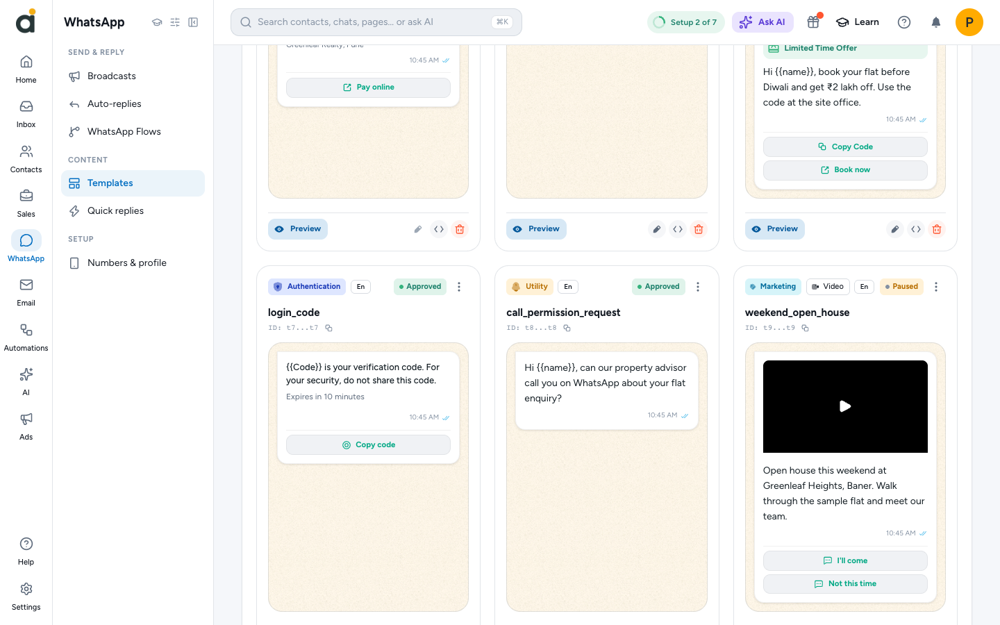
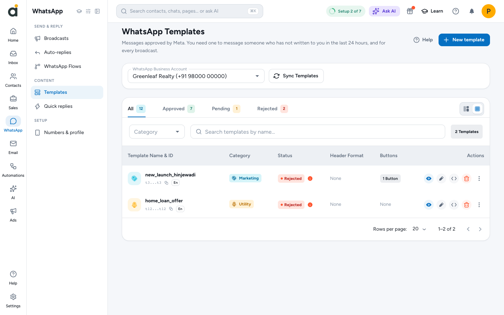
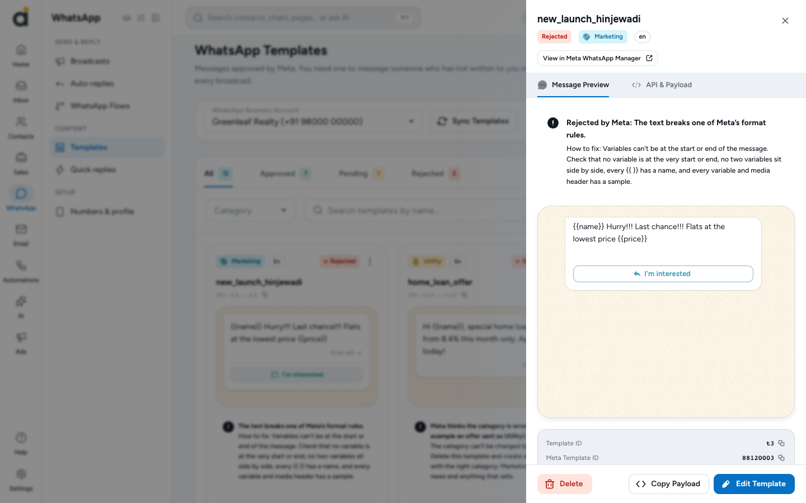
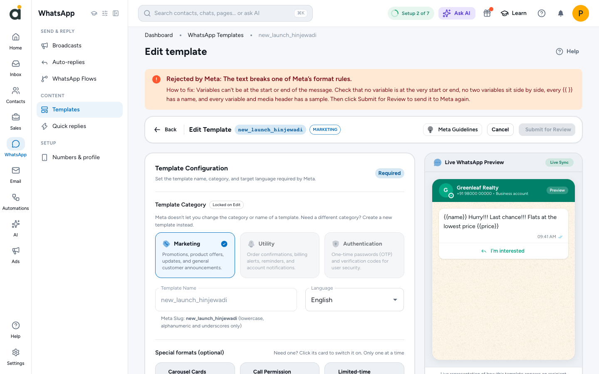

Every template shows a status chip on its card. This page explains each one and what to do.

## Statuses

| Status | What it means | What to do |
| --- | --- | --- |
| **Pending** | Meta is checking it. Usually minutes, at most 24 hours. | Wait. You can’t edit it meanwhile. Click **Sync Templates** to check. |
| **Approved** | Ready to send in broadcasts, chats, auto-replies and workflows. | Send it. |
| **Rejected** | Meta said no. The card shows why and how to fix it. | Edit and submit again (see below). |
| **Paused** | Many people blocked or reported it recently, so Meta paused it for a few hours. | Don’t resend it as is. Improve the message and send to people who expect it. It starts again on its own. |
| **Disabled** | Meta switched it off after it was paused again and again. | Make a new template with better wording. |

Meta may also show **In appeal**, **Flagged** or **Limit exceeded** for a short time. Click **Sync Templates** to get the latest.

In **Table View**, the info icon next to a rejected status shows the same reason and fix.

## Why was my template rejected?

The rejected card shows a red box: the reason in plain words, Meta’s own advice when it sent some, and how to fix it. The same box shows at the top of the editor when you edit it.

| Reason shown | What Meta means | How to fix |
| --- | --- | --- |
| The text breaks one of Meta’s format rules | A variable at the start or end, two variables side by side, an empty `{{}}`, a missing sample, or a media header without a sample | Put words before and after each variable, fill every sample, add the header file. |
| Meta thinks the category is wrong | An offer sent as Utility, for example | The category can’t be edited. Delete it and make a new **Marketing** template. |
| The category doesn’t match what the message says | Same as above | Same as above. |
| It reads like an offer, which this category doesn’t allow | Sales words in a Utility template | Remove the offer, or make it Marketing. |
| Meta found words that go against its rules | Threats, adult content, misleading claims | Rewrite it plainly and follow WhatsApp’s business policy. |
| Meta thinks the message could mislead people | Looks like a scam: “you won”, link shorteners, no business name | Use your real name and website, no shortened links. |
| Meta didn’t say exactly why | No reason sent | Make the text clearer and more specific, check samples, submit again. |

## Fix a rejected template

<Steps>
<Step title="Open the Rejected tab">
  On **Templates**, click **Rejected**.
</Step>
<Step title="Read the reason">
  The red box on the card says what to change.
</Step>
<Step title="Edit it">
  Click **⋮ → Edit Template**. The reason shows at the top of the editor.

  
</Step>
<Step title="Change and resubmit">
  Fix the text, fill every sample, and click **Submit for Review**.
</Step>
</Steps>

<Tip>Wrong category? You can’t change it by editing. Delete the template and create a new one with the right category and a new name.</Tip>

## Tips that get templates approved

- Say who you are: “Greenleaf Realty here…”.
- Keep Utility messages about something the person asked for. No offers.
- Give realistic samples: “Ravi”, not “test”.
- Don’t write in ALL CAPS or use many “!!!”.
- Use your own website, not shortened links.

## Related

<CardGroup cols={2}>
  <Card title="Find, edit and delete" icon="list-check" href="/help/template/manage">Edit and resubmit.</Card>
  <Card title="Rules, limits and costs" icon="scale-balanced" href="/help/template/rules-and-limits">Every Meta limit.</Card>
</CardGroup>
