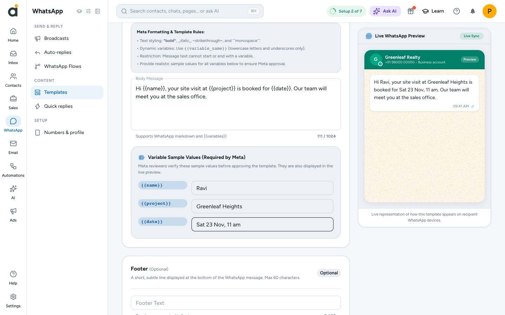
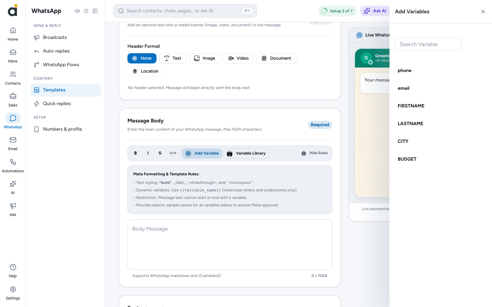

A **variable** is a part of a template that changes for each person, like their name, an amount or a date. You write it as a name inside double curly brackets: `{{name}}`, `{{amount}}`, `{{due_date}}`.

Example of a **Utility** payment reminder:

> Hi `{{name}}`, your instalment of ₹`{{amount}}` for flat `{{flat}}` is due on `{{due_date}}`.

Ravi gets “Hi Ravi, your instalment of ₹2,50,000 for flat B-704 is due on 5 Dec.”

**Where:** in the template editor (**WhatsApp → Templates → New template**), in **Message Body**, and in a **Text** header.

## Add a variable

<Steps>
<Step title="Put the cursor where it goes">
  Click in **Body Message** where the changing part should be.
</Step>
<Step title="Click Add Variable">
  AdsEra inserts `{{variable_1}}` and selects it. Type its real name straight away, like `name` or `amount`: small letters, numbers and `_` only.
</Step>
<Step title="Or pick a contact field">
  Click **Variable Library** to insert one of your contact fields (phone, email, and your own fields like CITY). Search with **Search Variable**.

  
</Step>
<Step title="Give each variable a sample">
  Under **Variable Sample Values (Required by Meta)** one row appears per variable. Type a realistic example: Ravi, 2,50,000, B-704, 5 Dec. Meta reads the samples to approve the template; customers never see them.
</Step>
</Steps>

You can also type `{{` and a name yourself. A text header can have one variable, with its own sample under **Header Variable Samples (Required by Meta)**.

## How variables get filled when you send

| Where you send it | How each variable is filled |
| --- | --- |
| **Broadcast** | In step 2, for each variable pick a **Contact field** (like FIRSTNAME) or type **Same text for everyone**. Each person gets their own value. See [Create a broadcast](/help/campaign/wa/create). |
| **Chat** (inbox) | When you pick the template in a chat, AdsEra asks you to fill each one. |
| **Workflows, Addy, API** | They fill the values from the contact or your data. |

## Meta’s rules for variables

| Rule | Bad | Good |
| --- | --- | --- |
| Not at the very start or end | `{{name}}`, your visit is booked | Hi `{{name}}`, your visit is booked. |
| Not two side by side | `{{date}}` `{{time}}` | on `{{date}}` at `{{time}}` |
| Enough words around them | Hi `{{a}}` `{{b}}` `{{c}}` | Short sentences with a few words per variable |
| Every `{{ }}` has a name | `{{}}` | `{{name}}` |
| Every variable has a sample | (empty) | Ravi |
| Names: small letters, numbers, `_` | `{{First Name}}` | `{{first_name}}` |

<Note>Website link buttons use their own variable, `{{1}}`, at the end of the URL, like `https://greenleaf.example/flat/{{1}}`. See [Buttons](/help/template/buttons).</Note>

<Note>Older templates made in Meta may use numbered variables like `{{1}}` and `{{2}}`. They work the same way. Ask AI (the button on the card) can explain them or make a copy with names.</Note>

## FAQs

<AccordionGroup>
<Accordion title="What if a contact has no value for the field?">
  In a broadcast, pick **Same text for everyone** for a safe default, like “there” in “Hi there”, or make sure the field is filled for everyone you send to.
</Accordion>
<Accordion title="Can I add a variable to the footer?">
  No. Variables work in the message and in a text header.
</Accordion>
</AccordionGroup>

## Related

<CardGroup cols={2}>
  <Card title="Create a template" icon="pen" href="/help/template/create">The whole editor.</Card>
  <Card title="Create a broadcast" icon="bullhorn" href="/help/campaign/wa/create">Fill variables from contact fields.</Card>
</CardGroup>
