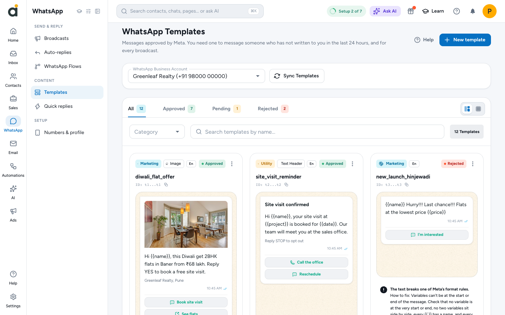
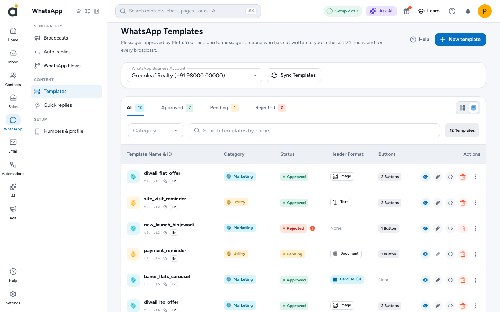
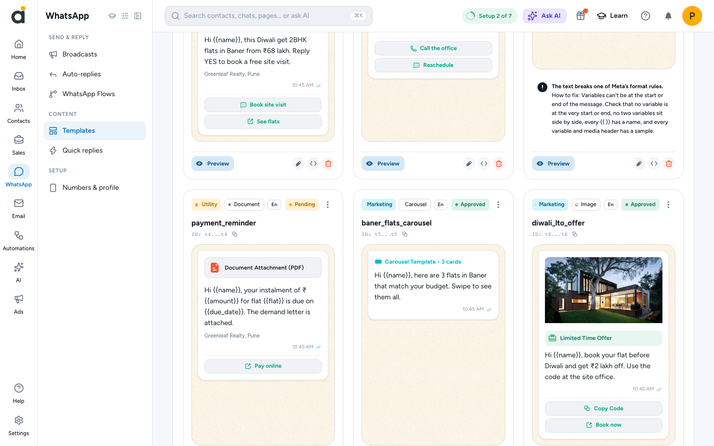
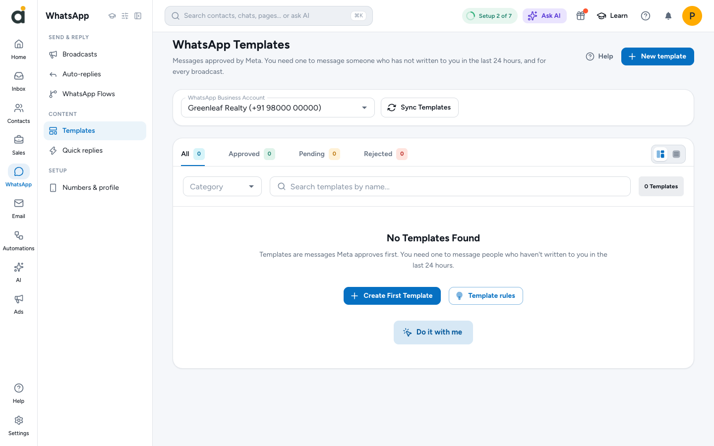
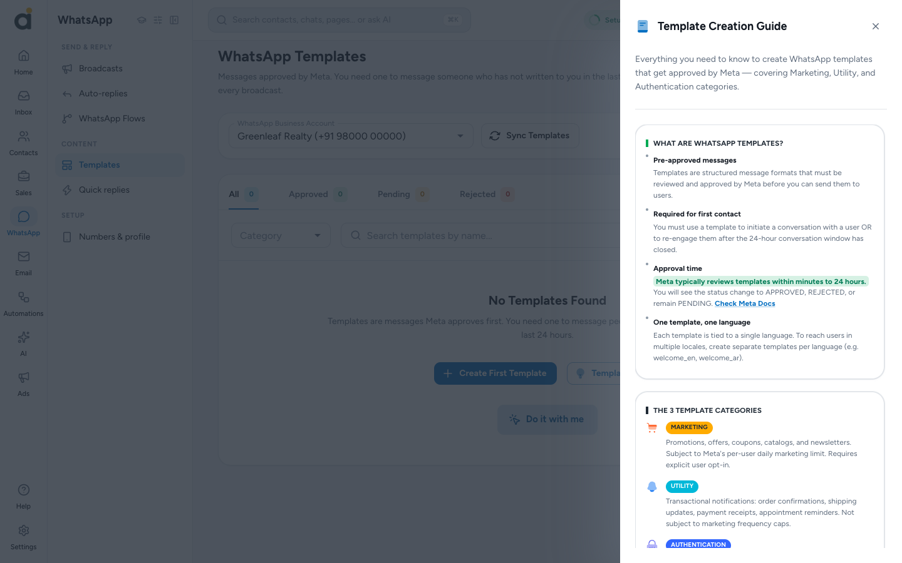

A **template** is a WhatsApp message that Meta approves before you send it. You need one whenever you message someone first:

- to message a person who hasn’t written to you in the last **24 hours**, and
- for every **broadcast**.

Inside 24 hours of a customer’s last message you can reply with anything (text, photos, quick replies). After that, only an approved template can go out. Meta does this to stop spam.

**Where:** **WhatsApp → Templates** (side menu, under **Content**). [Open it →](https://app.adsera.in/dashboard/template/whatsapp/list)

## The 3 categories

Every template has one category. Meta checks it, charges by it, and it **can’t be changed later**.

| Category | Use it for | Examples | Not allowed |
| --- | --- | --- | --- |
| **Marketing** | Anything that sells or promotes | Diwali offer, new project launch, festive greeting, “we miss you” | — |
| **Utility** | Updates about something the person already asked for or bought | Site visit confirmed, payment reminder, order shipped, class rescheduled | Offers, discounts, sales words |
| **Authentication** | One-time login codes sent by your website or app | “123456 is your verification code” | Any other text |

<Warning>Picking Utility for a promotional message is the most common reason for rejection. When in doubt, choose **Marketing**.</Warning>

## Template types AdsEra can make

| Type | What it looks like | Category | Guide |
| --- | --- | --- | --- |
| **Standard** | Optional header (text, image, video, document or location), the message, an optional footer and up to 10 buttons | Marketing, Utility | [Create a template](/help/template/create) |
| **Carousel** | A short message, then 2–10 cards people swipe, each with a photo or video, text and buttons | Marketing | [Carousel](/help/template/carousel) |
| **Limited-time offer** | An offer title, a countdown to when it ends, a copy-code button and a link | Marketing | [Limited-time offer](/help/template/limited-time-offer) |
| **Call permission** | Asks if you may call them on WhatsApp; they tap Allow | Marketing, Utility | [Call permission](/help/template/call-permission) |
| **Authentication (login code)** | Meta’s fixed code text with a **Copy code**, **One-tap** or **Zero-tap** button | Authentication | [Login codes](/help/template/authentication) |

Buttons you can add: **Quick Reply**, **Website Link**, **Phone Call**, **Copy Offer Code**, **WhatsApp Flow**, **Voice Call** and **Pay Now**. See [Buttons](/help/template/buttons).

<Note>AdsEra doesn’t make catalog or product templates. To show products in a chat, use a [quick reply with a product list or Pay Now](/help/snippet/interactive).</Note>

## The Templates page

| Part | What it does |
| --- | --- |
| **New template** | Opens the template editor for the account picked below. |
| **WhatsApp Business Account** | Each account has its own templates. Pick the one to see. |
| **Sync Templates** | Brings in templates made in Meta’s WhatsApp Manager and the latest statuses. |
| **All / Approved / Pending / Rejected** tabs | Show templates by status; the number is how many. |
| **Category** | Show only Marketing, Utility or Authentication. |
| **Search templates by name…** | Find a template by part of its name. |
| **Clear Filters** | Shows everything again. |
| Grid / Table icons | Cards that look like the phone message, or a compact table. |

Each card shows the category, header type, language and status, the message itself, and buttons to **Preview**, edit, copy the developer request, and delete. Its **⋮** menu has **View Details**, **Edit Template**, **Copy Template ID**, **Copy API request (v2)**, **View on Meta Manager** and **Delete Template**. See [Find, edit and delete](/help/template/manage).

No templates yet? The page says so and offers **Create First Template** and **Template rules** (a summary of Meta’s rules).

## Statuses at a glance

| Status | Meaning |
| --- | --- |
| **Approved** | Ready to send. |
| **Pending** | Meta is checking it: usually minutes, up to 24 hours. It can’t be edited meanwhile. |
| **Rejected** | Meta said no. The card says why and how to fix it. |
| **Paused** | Meta paused it because people blocked or reported it. |
| **Disabled** | Meta switched it off after repeated pauses. |

Full details, reasons and fixes: [Statuses and rejections](/help/template/status).

## Next

<CardGroup cols={2}>
  <Card title="Create a template" icon="pen" href="/help/template/create">Header, message, footer and buttons, step by step.</Card>
  <Card title="Variables and samples" icon="brackets-curly" href="/help/template/variables">{"{{name}}"}, {"{{amount}}"} and how they get filled.</Card>
  <Card title="Statuses and rejections" icon="circle-check" href="/help/template/status">Why Meta said no, and how to fix it.</Card>
  <Card title="Rules, limits and costs" icon="scale-balanced" href="/help/template/rules-and-limits">Every limit in one place.</Card>
</CardGroup>
